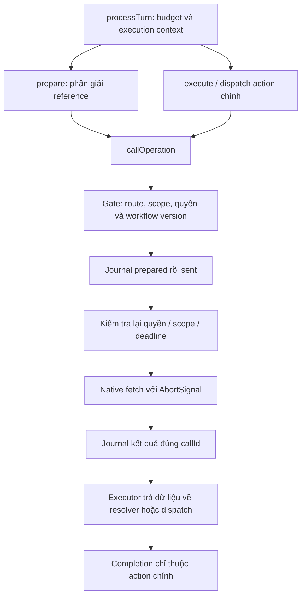

# P6 — Cổng gọi đọc, deadline và cancellation

Ngày bàn giao: **21/11/2026**. Đã hoàn tất **phần P6 được giao trong đợt này**, sau flag cục bộ. Chưa bật production, chưa triển khai V2 hoặc action ghi; P5 live vẫn chưa có ngân sách.

## 1. Phạm vi và hai quyết định đã chốt

Người dùng chọn:

1. **Giữ cách tính hiện tại; gate mới vẫn ghi đủ call.** `ExecutionBudget` vẫn tính action chính, cap24 reads,24 plans,3 writes; không cộng lookup/reference/verification vào cap và không đổi no-progress.
2. **Làm cổng gọi, deadline/cancel và hồi quy trước; chưa V2/ghi.** Gate nghiệp vụ chỉ bao phủ đường direct của `product.list` và `inventory.product.detail`, theo slice đã kiểm kê. Job giữ đường business-call legacy; không thay intake/queue/worker sang V2.

Đây là điều chỉnh rõ ràng so với đề xuất tính mọi leaf vào budget ở T0.1-A Mục5.3/6.1 và CG15/16. **Đếm đầy đủ trong journal không có nghĩa đã chuyển accounting.** Không coi toàn bộ T0.1-B, T0.5 cho mọi tính năng, hoặc toàn bộ P6 dài hạn đã nghiệm thu.

## 2. Luồng sau thay đổi

- [service.ts](../server/assistant/service.ts) giữ orchestration, pending, confirmation, budget và completion. Context server lấy từ request đã xác thực, conversation/request ID và workflow vừa nạp; model/client không gửi được context hoặc deadline mới qua `TurnInput`.
- [executor.ts](../server/assistant/executor.ts) đưa native fetch chung qua [business-call-gate.ts](../server/assistant/business-call-gate.ts). Helper lookup vẫn sử dụng cùng boundary, kể cả fallback và execute recheck.
- Gate kiểm tra owner và actual operation theo quyền của từng operation; kiểm tra workflow enabled/version của owner, user/company/branch, đúng origin nội bộ/path/method, company query duy nhất và không follow redirect. API nghiệp vụ vẫn kiểm quyền và company ownership của chính nó.
- `businessCallJournal` là sidecar riêng trong turn: `version:1`, `accounting:legacy_primary`, call ID/parent ID nếu có, step ID, owner/actual action, phase/purpose, workflow version, input fingerprint và trạng thái/thời gian. Không ghi raw payload, tên/mã sản phẩm hoặc credential vào sidecar; không đưa sidecar vào reply/model.
- Parent ID chỉ có khi invocation thực sự lồng nhau; các lần lookup tuần tự dùng step ID để liên hệ. Fallback vẫn thuộc purpose reference/verification theo phase, chưa có reason tag riêng; không tự đoán một cây call hoặc reason không tồn tại.
- Prepared/sent là các mốc durable intent. `sent` được lưu **trước** gọi transport và có thể bị chặn bởi kiểm tra cuối; nó không chứng minh API đã nhận request. Observer P3/transport trace là số fetch thực được gọi.
- Lưu journal thất bại hoặc update không match đúng turn thì dừng, không gửi leaf tiếp theo. Chưa áp dụng fail-open. Reference thành công không ghi đè primary completion hoặc trạng thái step nghiệp vụ.
- HTTP rejection, server/transport error, cancellation và timeout có trạng thái riêng. HTTP200 trả JSON hỏng/thiếu cấu trúc dữ liệu không thành danh sách rỗng thành công. Danh sách hợp lệ có `items:[]` vẫn thành công.

## 3. Deadline và cancellation

[execution-control.ts](../server/assistant/execution-control.ts) dùng context riêng theo turn và AbortController. Trong phạm vi context đã bật:

| Ranh giới | Giới hạn |
|---|---|
| Lượt direct / background | Deadline budget hiện hữu90 giây /8 phút; không reset khi sang bước/discovery/retry |
| Một business GET qua gate | Tối đa45 giây, luôn bị giới hạn bởi deadline còn lại của turn |
| Native provider attempt | Mặc định40 giây; discovery20 giây; interpretation80 giây, đều bị chặn bởi deadline chung |
| Toàn discovery / interpretation |25 /90 giây, bao gồm các lần thử và backoff trong scope đó |
| Cancellation callback | Kiểm tra trước call và polling250ms khi đang chờ; lỗi kiểm tra thì dừng có kiểm soát |

Provider [OpenRouter dùng chung](../server/service/openrouter.service.ts) truyền signal xuống native fetch và đọc response body trong scope timeout. Deadline/hủy được chốt trong turn, abort cả scope lồng nhau và chặn retry/discovery fallback tiếp theo. Retry còn hợp lệ vẫn dùng cùng GPT-6 Luna; không thêm model/provider fallback hoặc lượt gọi để đánh giá.

Đường `/turns` direct nối response close chưa hoàn tất với cancellation signal. Response đã hoàn tất không kích hoạt hủy; listener/timer được dọn sau thành công/lỗi. Khi client đã ngắt kết nối, router không cố gửi JSON vào response đó. Job intake không gắn vào signal của kết nối đã trả; provider trong execution context có thể dùng callback hủy background đã tồn tại, business-call journal background vẫn legacy.

**Giới hạn:** đây là deadline tại các ranh giới request đang kiểm soát. Chưa có hủy Mongo query, CPU task, media SDK hoặc các timeout cục bộ khác của QA/Studio. Polling và revalidation có thể phát sinh thêm DB/Redis access; chưa có đo live. Abort native fetch cũng không chứng minh nhà cung cấp đã dừng tính phí. Chưa tuyên bố SLA toàn hệ thống.

## 4. Số đo trước/sau bằng lớp B

Cohort giống P3: **19 kịch bản nhân tạo,31 turn mỗi tổ hợp**, có cả turn0 GET; observer bật để đối chiếu transport. `C` là prototype exact verification P2, được bật/tắt riêng với gate P6.

| C | Gate | Physical GET | Charged reads | Journal call | p50 /p95 /max GET mỗi turn |
|---|---|---:|---:|---:|---|
| Tắt | Tắt |116 |23 |0 |3 /5 /27 |
| Tắt | Bật |116 |23 |116 |3 /5 /27 |
| Bật | Tắt |95 |24 |0 |3 /5 /18 |
| Bật | Bật |95 |24 |95 |3 /5 /18 |

Gate bật/tắt giữ API sequence, target, reply, budget và no-progress trong ma trận hồi quy, trừ ca đã hủy trước prepare: gate cố ý chặn sớm reference GET. Ma trận có144 cặp gate off/on; test riêng kiểm tra khác biệt cancellation có chủ đích.

- Detail duy nhất: C tắt **3 GET/1 charged**, C bật **2/1**, không đổi khi bật gate.
- Chuỗi9 detail: **27/9** hoặc **18/9**, đúng thứ tự và target. Cổng mới không chặn chuỗi27 GET bằng cap24 vì cap vẫn tính primary.
- C tắt: journal có23 primary,71 reference,22 verification. C bật:24 primary,71 reference,0 verification. F101 hoàn tất khi C bật giải thích charged23→24; không phải thay đổi accounting do gate.
- Histogram vẫn như P3: C tắt `0:2;1:2;2:2;3:16;4:5;5:3;27:1`; C bật `0:2;1:3;2:7;3:15;5:3;18:1`. Quantile dùng nearest-rank.

## 5. Chi phí journal và revalidation đã quan sát

| C | Gate | Tạo turn | Update turn | Trong đó ghi sidecar | Đọc sidecar | Ghi session | Gọi currentWorkflow mock |
|---|---|---:|---:|---:|---:|---:|---:|
| Tắt | Tắt |31 |107 |0 |0 |102 |70 |
| Tắt | Bật |31 |455 |348 |29 |102 |302 |
| Bật | Tắt |31 |110 |0 |0 |102 |70 |
| Bật | Bật |31 |395 |285 |29 |102 |260 |

Gate thêm **3 update sidecar mỗi leaf**: prepared, sent, terminal; thêm một lần đọc sidecar mỗi turn có call. Khóa/session, turn create và các update nghiệp vụ cũ giữ nguyên trong so cặp. Hai child chạy song song được cấp ID riêng, chỉ load journal một lần và serialize snapshot writes để không mất entry.

Mỗi leaf còn thêm hai lần gọi `currentWorkflow` để kiểm tra trước chuẩn bị và ngay trước gửi. Trong code thật, hàm này đi qua `listWorkflows`, ACL/module access và persistence/cache; bảng trên chỉ đếm **function call mock**, không phải số DB/Redis operations thật. Mongo/network latency, kích thước document tăng dần và chi phí polling chưa đo. Các timing trong JSON chỉ là một lượt chạy fixture, có JIT/cache noise, không dùng để kết luận gate nhanh/chậm hoặc đủ điều kiện production.

**Điểm cần đánh giá trước rollout:** chi phí journal và revalidation tăng rõ. Đợt này giữ fail-closed theo thiết kế, không tự bỏ mốc journal, cache quyền thiếu revalidation, tăng cap hoặc đổi fail-open để giảm chi phí.

## 6. Kiểm thử và bằng chứng

| Bộ kiểm tra | Kết quả |
|---|---:|
| P6 mới: ma trận gate/C/observer, fault injection, deadline/cancel |**359/359 pass** |
| Hồi quy budget, API rejection, presentation, result/projection, completion báo giá |69/69 pass |
| P3 lớp B gốc |161/161 pass |
| LLM migration/interpreter/provider và các consumer liên quan |84/84 pass |
| P5 dry-run Luna offline |52/52 pass |
| `npm run typecheck` |Pass |

Tổng725 test instances; nhiều hàng là cùng fixture dưới các flag khác nhau, không phải723 ca nghiệp vụ độc lập. Test không phải accuracy model hoặc nghiệm thu toàn bộ corpus48 ca.

Đã kiểm: journal lỗi trước send và sau response, update mất match, turn journal mất/không đúng version; URL/method/company/redirect sai; scope/quyền/workflow đổi; timeout/hủy trước và giữa call; request/body đang chờ; discovery fallback/retry/backoff sau hủy; HTTP404/422/500, JSON lỗi và danh sách thật sự rỗng; concurrent children, isolation giữa execution contexts, replay và pending/flag-off. Interrupted turn chưa có result vẫn processing/uncertain theo recovery window cũ, không đọc trạng thái sent để tự chạy lại.

Fixture scripted interpretation; auth, workflow, Mongo, rewrite và business HTTP là mock. Safety setup chặn fetch chưa mock, socket/HTTP/TLS/UDP và Mongoose ngoài mock, kiểm tra cả lỗi bị runtime catch. Có safety probes cố ý chạm guard để xác nhận chặn trước I/O. **Không inference, network, API nghiệp vụ, Redis hoặc DB thật; không phát sinh tiền model.** Không sửa UI nên không có kiểm tra giao diện hoặc build frontend trong phạm vi này.

Artifacts:

- [Kết quả P6 chính thức](../server/assistant/testing/p6-call-gate/vitest-results.json), [hồi quy chung](../server/assistant/testing/p6-call-gate/regression-results.json).
- [Trace P6](../server/assistant/testing/p6-call-gate/p6-observations.json), [so144 cặp gate](../server/assistant/testing/p6-call-gate/p6-gate-comparison.json), [so C](../server/assistant/testing/p6-call-gate/p6-exact-comparison.json).
- [Tổng hợp, histogram và source hashes](../server/assistant/testing/p6-call-gate/p6-summary.json). Hash `execution-budget.ts` giữ `440627bceee07157191f6c93d12adb846b96434398d6b59c3e0ea28edf06ecd7`.
- [Hướng dẫn tái chạy](../server/assistant/testing/p6-call-gate/README.md).

## 7. Flag, rollback và điểm dừng

`ASSISTANT_SAFE_EXECUTION` mặc định **false** trong `.env.example`; chỉ có hiệu lực khi `NODE_ENV=test` hoặc `development`. Production, staging hoặc môi trường không khai báo bị vô hiệu hóa dù đặt true. `.env` thật và cấu hình deploy không được chỉnh. Flag P2/P3 độc lập; test bật riêng, không tự bật cùng gate.

Tắt flag cho lượt mới quay về business transport/accounting hiện hành, không xóa pending, turn, proof hoặc sidecar cũ. Turn đã khởi tạo context giữ context đến khi xong; không ngắt giữa chừng bằng cách đổi env. Completed replay trả cached result và không đọc version sidecar để cấp quyền dispatch mới. Pending tiếp tục bằng revalidation legacy khi flag tắt.

**Dừng sau bàn giao phần P6 này.** Chưa V2, action ghi, retrieval mới, thay quote/NFC, tăng cap24, journal fail-open hoặc live shadow/canary/deploy. Chưa mở P5 live. Các bước mở rộng/rollout cần yêu cầu và điều kiện riêng theo kế hoạch.
