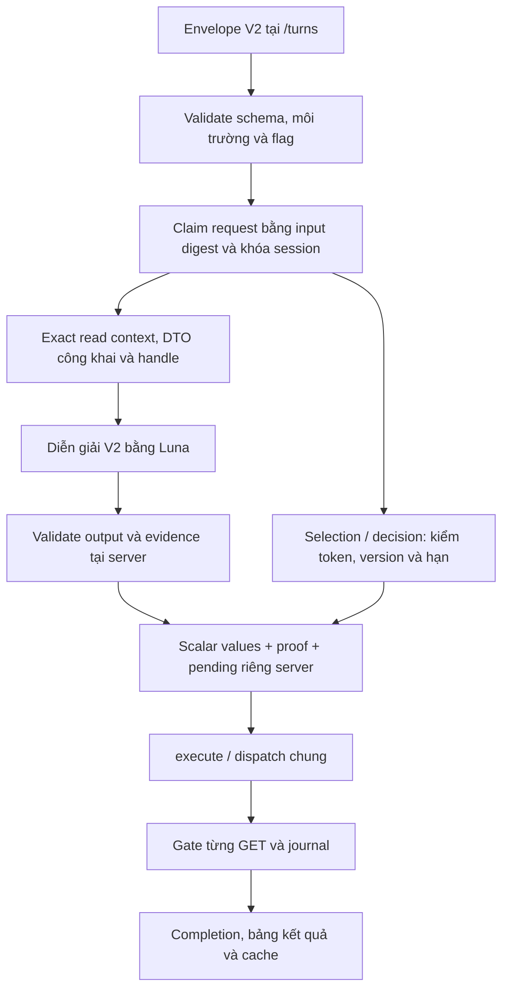

# Bàn giao V2 cho hai action đọc

Ngày: **21/11/2026**. Đã triển khai **API/contract V2 và kiểm thử fixture cục bộ, sau flag** cho `product.list` và `inventory.product.detail`. Widget/UI hiện vẫn gửi legacy; chưa có frontend tự thu context hoặc đổi nút chọn/xác nhận sang envelope V2. Chưa bật production, chưa gọi model/API/DB thật, chưa triển khai thao tác ghi, job V2 hoặc plan DAG. Budget vẫn tính primary, cap24 giữ nguyên.

## 1. Kết quả chính

- V2 có envelope/schema riêng, model output có evidence, context/handle đã xác thực, pending/version và option token. Không đưa object AI mới thẳng vào `collectValues`.
- Context từ trang chỉ là hint. Server đọc exact Product bằng quyền hiện hành trước khi tạo DTO công khai cho model. ID thật chỉ ở vùng server; SKU ID không trở thành Product target.
- Quote được tìm literal sau NFC; server tự tính offset. Quote không khớp, trùng nhiều vị trí, raw đổi hoa/thường hoặc nguồn không đúng thì hỏi lại, không chạy query từ giá trị chưa có căn cứ.
- Chọn token/confirm không gọi model để chọn lại. Target đã pin đi qua `execute → dispatch → gate → completeAssistantOperation` và bảng chung. Reference/context reads không đổi completion chính hoặc cộng vào budget24 hiện tại.
- Có replay input digest ổn định, snapshot hash riêng, mã hóa token cần trả khi replay, restore/flag-off và expiry. Thiếu proof hoặc version không hỗ trợ không được fallback sang resolver legacy.
- **122 test V2 +725 test hồi quy/offline pass; typecheck pass.** Đây là test instances với nhiều tổ hợp/case lỗi, không phải accuracy model hoặc847 ca nghiệp vụ độc lập.

## 2. Luồng code đang chạy

| Thành phần | Nhiệm vụ |
|---|---|
| [read-v2-contract.ts](../server/assistant/read-v2-contract.ts) | Joi strict schema cho client/model, các type V2, TTL, digest, nhận diện dữ liệu không được gửi model |
| [read-v2-service.ts](../server/assistant/read-v2-service.ts) | Boundary V2 → lõi hiện có; chặn môi trường không hỗ trợ; giữ replay khi đóng intake; không lưu token/identifier bị từ chối thành lịch sử thô |
| [semantic-read-v2.ts](../server/assistant/semantic-read-v2.ts) | DTO riêng chỉ có câu hiện tại, input/context reference, public entity/handle và pending action/kind; JSON output cap2048, Luna, timeout/cancel chung |
| [read-v2-runtime.ts](../server/assistant/read-v2-runtime.ts) | Exact context, kiểm evidence, phân giải tên/mã, lựa chọn, pending/confirmation và tạo proof cho lõi |
| [read-v2-cache.ts](../server/assistant/read-v2-cache.ts) | Token lookup chỉ lưu hash; vector token cho replay mã hóa AES-256-GCM, HKDF tách domain, AAD gắn actor/scope/conversation/request/digest |
| [read-v2-retention.ts](../server/assistant/read-v2-retention.ts) | Lazy sweep pin V2 hết retention; giữ turn identity/result/steps, không xóa cuộc trò chuyện hoặc tạo lại target |
| [service.ts](../server/assistant/service.ts) | Claim/lock, persist pin trước primary, execute/dispatch/budget/completion/presentation chung; chặn pending V2 bị tiếp tục bằng legacy input |
| [router.ts](../server/assistant/router.ts) | Nhận V2 trước nhánh auto-queue legacy; kiểm job đang hoạt động; `/jobs` từ chối V2; legacy routing giữ nguyên |

`PendingAction` được **export/reuse từ lõi**, không sao chép type rút gọn. Shape persistence dùng core pending hiện có cộng sidecar `readV2.schemaVersion=2`; session có `readV2Context`, turn có private pin `readV2`. Đây là adapter compatibility, thay vì bọc và sao chép toàn bộ pending trong một object `corePending` thứ hai.

Proof thực thi tái sử dụng `ProductReadProofV1` đã kiểm thử ở P2, do adapter server cấp từ context/reference đã kiểm chứng; V2 không phụ thuộc flag P2. Sidecar V2 giữ scope/context/version/provenance; proof lõi giữ target, pending ID, scope và workflow digest. ID không nằm trong public model values hoặc được client gửi như một lệnh đã xác thực.

## 3. Context, evidence và lựa chọn

Context chỉ nhận `/kho-san-pham`, list/detail, entity hoặc selection tối đa10 Product IDs không trùng, filter `search` nếu có. Unknown field/scope/route/form/file/mode khác bị từ chối. Internal ObjectId được chuẩn hóa casing ở server; name/code evidence không được đổi hoa/thường để ép khớp.

Mỗi client entity hoặc entity phiên còn hiệu lực được exact-read lại trước khi gửi model. DTO chỉ chiếu name/productCode/status, opaque handle, origin và context reference. Không gửi raw record, user/company/branch ID, legacy pending/resolved, lịch sử/summary/memory hoặc token chọn vào model. V2 cũng **không dùng legacy background session summarizer, memory extraction hoặc response rewriting**; bảng và câu hỏi do server giữ qua presentation chung.

Handle được cấp lại theo context mới, không resolve toàn session chỉ bằng tên handle. Với nhiều selection và đại từ thiếu đích, server không chọn dòng đầu; chỉ cho đích có public mention duy nhất. Nguồn và field của `context_field` phải trùng dữ liệu server đã đọc. Filter search trên trang không bị âm thầm bỏ hoặc thay bằng từ khóa khác.

Tên/mã được xác thực bằng quote rồi tra list theo search. Server kiểm raw Product items và metadata total. Nếu chỉ có một trang nhưng total lớn hơn items, **không kết luận unique**: yêu cầu mã cụ thể hơn. Một exact name/code duy nhất có thể tạo proof; fuzzy/keyword/SKU hit cần chọn Product công khai, kể cả chỉ một hit. Hai hàng cùng nhãn/cùng mã không được biến thành lựa chọn theo vị trí hoặc lộ ID để phân biệt.

Khi chọn một option, server tra hash trong đúng pending/version/scope/expiry; token không chứa payload hoặc record ID. Chọn xong làm cũ options/preview trước. Option còn hạn nhưng context đã hết5 phút được exact-revalidate rồi cấp context/proof mới cho **cùng target**, không gọi AI hoặc tra nhãn để retarget. Workflow thay version/digest thì dựng preview mới; quyết định cũ không được chạy. Record bị xóa/sai company/variant parent sai thì dừng.

Default do `collectValues` áp dụng được gắn provenance `server_default` tại server, không tin model tự gắn nhãn. Default vẫn chạy nhưng không liệt kê trong preview; giá trị người dùng nêu vẫn hiển thị dù trùng default. Trường required thiếu được hỏi bằng clarification `fill_fields`.

## 4. Số call thực tế bằng fixture

Các số dưới đây là **GET nghiệp vụ mock**, không gồm provider mock, quyền/workflow/cache/Mongo metadata. Mỗi hành động hoàn tất đi qua primary dispatch một lần. Chi tiết: [JSON tổng hợp](../server/assistant/testing/read-v2/v2-summary.json).

| Kịch bản | Lượt người dùng | Model diễn giải mock | GET thực gọi | Charged reads |
|---|---:|---:|---:|---:|
| List theo quote |1 |1 |1 |1 |
| Detail theo mã, phiên chưa có context |1 |1 |2: list + detail |1 |
| Trùng tên → chọn mã P2 hoặc P3 trong hạn context |2 |1 |2: list + detail |1 |
| “Cái này” từ context một Product |1 |1 |2: context exact + primary exact |1 |
| Detail bật custom confirmation, xác nhận trong hạn |2 |1 |2: list + primary exact |1 |
| Option được chọn sau6 phút |2 |1 |3: list + refresh exact + primary exact |1 |
| Option được chọn sau16 phút |2 |1 |1: list ban đầu, sau đó từ chối |0 |
| F101 theo mã hoặc theo screen context |1 |1 |2, đúng Product P1 |1 |
| Completed replay, kể cả flag V2 tắt/DB đã đổi | Thêm1 retry | Thêm0 | Thêm0 | Thêm0 |

Không đặt cứng mọi detail đều2 GET. Session context còn hiệu lực được revalidate trước model; nếu người dùng chuyển sang một tên/mã khác, việc kiểm lại context cũ có thể thêm một GET. Context/handle hết hạn hoặc workflow thay đổi cũng có thể cần đọc lại trước preview. Tách các lần này khỏi primary execution và khỏi charged budget.

Gate P6 vẫn thêm3 journal update mỗi leaf. V2 còn thêm pin turn/session trước primary, encrypted replay cache khi có options và lazy retention sweep; ví dụ list đơn1 turn có8 update turn mock và4 session writes mock. Đây **không phải tổng DB/Redis I/O**: ACL/workflow/sweep có công việc khác. Chưa đo latency/scan cost Mongo hoặc overhead thật; chưa có cơ sở bật production hay đổi cap/fail-open.

## 5. Replay, TTL và rollback

Input digest canonical lấy từ immutable envelope đã validate, gồm loại input/context hint/selection/filter. Hash không chứa snapshot DB đọc lại, handle mới hoặc thời gian server mới. Claim và session lock có trước context reads. Cùng requestId/nội dung replay cached result; đổi nội dung cùng requestId bị409. Snapshot hash được pin riêng. Interrupted request chưa có result giữ processing/uncertain theo cửa sổ cũ, không tự chạy lại từ journal `sent`.

| Dữ liệu | TTL prototype | Hành vi |
|---|---|---|
| Context/handle |5 phút | Không dùng làm context mới sau hết hạn; không gán handle cũ cho Product mới |
| Option |15 phút, không quá pending | Sau hết hạn không chọn lại bằng token/nhãn |
| Pending |30 phút tuyệt đối, không trượt theo retry | Cũ hết hạn không xác nhận; text mới có thể chuẩn bị lại |
| Private pin |24 giờ sau expiry | Lazy sweep khi có V2 request mới trong scope; không phải lịch xóa tự động đúng giờ |

Các TTL này dùng cho **prototype cục bộ**, theo đề xuất T0.8; chưa phê duyệt rollout. Freshness dùng giờ server; clock client không gia hạn. Sweep không xóa turn/result/completed journal hoặc đổi retention legacy. Cửa sổ không hoạt động có thể giữ pin quá mốc sweep; cần maintenance/retention/index policy trước rollout, không tuyên bố đã có wall-clock deletion.

Raw option token không lưu trong pending, session lastReply hoặc cached result công khai. Phần cần replay được mã hóa trong private pin; key rotation/cipher lỗi/unknown version thì dừng, không suy target từ label. Text dán token/ID/credential bị chặn trước model và không ghi nguyên văn vào lịch sử V2.

`ASSISTANT_PRODUCT_READ_V2=false` và `ASSISTANT_SAFE_EXECUTION=false` là mặc định trong `.env.example`. V2 cần cả hai flag và `NODE_ENV=test/development`; production/staging/unset bị từ chối. `.env` thật, deployment và UI chưa chỉnh.

Tắt **flag V2** đóng text intake mới. Cached replay và selection/decision đang chờ còn hợp lệ tiếp tục bằng compatibility path khi P6 safe execution còn bật. Tắt cả P6 hoặc chạy binary không hiểu version thì dừng và giữ draft, không strip context để chạy legacy. Pending legacy ngoài slice giữ nguyên; không chuyển job/goal nhiều bước sang V2.

## 6. Kiểm thử và phần chưa đo

| Bộ kiểm tra | Pass |
|---|---:|
| V2:107 test hội thoại/contract/privacy +8 router +7 native provider mock |122 |
| P6 gate/deadline/cancel |359 |
| P3/lớp B gốc |161 |
| LLM/interpreter/provider consumers |84 |
| Budget/completion/presentation/result/projection chung |69 |
| P5 Luna dry-run offline |52 |
| `npm run typecheck` |Pass |

Nguồn pass/fail: [report V2](../server/assistant/testing/read-v2/vitest-results.json) và các `*-regression-results.json` trong [thư mục kiểm thử](../server/assistant/testing/read-v2/README.md). Tổng847 test instances; [summary](../server/assistant/testing/read-v2/v2-summary.json) kiểm không có vi phạm guard, không business non-GET và không raw IDs/token trong model DTO/reply, kèm source hashes. Hash `execution-budget.ts` giữ nguyên.

Đã kiểm strict request/model schema, quote NFC/NFD và offset server, nguồn giả, handle/context stale, multi-selection, trùng tên, option/version/scope, false default provenance, required fields, custom confirmation, đổi target/workflow, mất quyền/record/company, Product/SKU, F101/incomplete page, crypto replay/AAD, flag-off, interruption, persistence fail, cancellation, privacy của lịch sử dài và routing direct/jobs.

Provider/auth/workflow/persistence/business HTTP được mock; wire test dùng OpenRouter wrapper thật nhưng fetch giả. Router chạy bằng request/response trong bộ nhớ, không mở port. Safety setup chặn fetch chưa mock, socket/HTTP/TLS/UDP và Mongoose ngoài mock, thay Redis startup. **0 inference thật,0 API nghiệp vụ thật,0 DB thật; không có tiền model.** Không sửa UI nên chưa có kiểm tra giao diện hoặc build frontend trong đợt này.

Chưa đo accuracy/action selection/evidence false-positive của Luna, token/cost/latency, dữ liệu hay lưu lượng thật. Quote/handle hợp lệ không chứng minh model hiểu đúng ý nghĩa; nhận diện identifier còn bảo thủ. Không dùng fixture để nới chính sách, nghiệm thu48 nhãn hoặc thay baseline live. Việc V2 không đưa raw history/memory vào prompt cũng có thể làm một số câu cần hỏi lại; chưa đo chất lượng bằng model thật.

**Điểm dừng:** phần V2 direct/read sau flag đã bàn giao. Chưa production, P5 live, thao tác ghi, retrieval mới, background V2 hoặc plan DAG.
