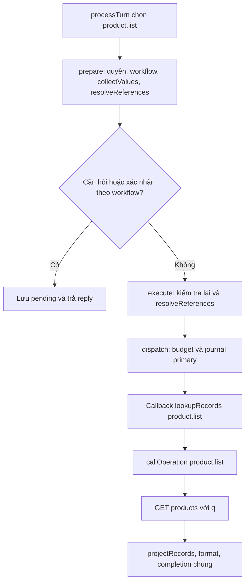
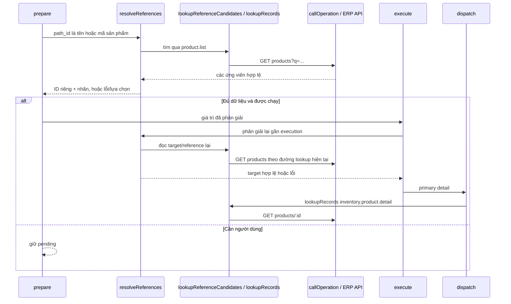

# T0.1-A — Kiểm kê và thiết kế cổng gọi Trợ lý ERP

Ngày đối chiếu: 21/11/2026. Trạng thái: **bản thiết kế chờ người dùng rà, chưa duyệt và chưa triển khai T0.1-B**.

**Cập nhật P6 ngày21/11/2026:** theo lệnh riêng và câu trả lời của người dùng, đã có [gate đọc/deadline/cancel cục bộ](ket-qua-p6-cong-goi-deadline-cancel.md). Người dùng chốt **journal đủ call nhưng giữ accounting primary/cap24; chưa V2/ghi**. Vì vậy đề xuất tính mọi leaf ở Mục5.3/6.1/CG15–16 phía dưới không được áp dụng trong đợt này. Gate direct hai action, flag mặc định tắt, fail-closed;359 test P6 và hồi quy liên quan pass. Phần dưới giữ làm thiết kế tham chiếu và lịch sử, không có nghĩa đã triển khai toàn bộ T0.1-B hoặc được bật production.

## 1. Phạm vi và cách đọc

Theo [phiếu quyết định và giới hạn đọc](../ke-hoach-nang-cap-tro-ly-erp.md), chỉ khảo sát slice `/kho-san-pham`, mode `work`, hai action `product.list` và `inventory.product.detail`. Ngân sách model/API thật là 0; bản này được soạn bằng đọc mã, không gọi API/DB/model, không chạy test hoặc harness và không sửa source.

**Cập nhật sau lệnh lớp B:** đã có [báo cáo 14 test mới](ket-qua-lop-b-tro-ly-erp.md), độc lập với task kiểm kê ban đầu. Runtime và trần24 chưa đổi; kết quả mock không biến thiết kế gate thành code đã triển khai. Các nhận định pagination dưới đây đã hiệu chỉnh theo trace limit100.

Các type, API nội bộ và trạng thái bổ sung bên dưới là **đề xuất thiết kế**, không phải khai báo hiện đã có. Quan sát hiện trạng có dẫn nguồn riêng. Ví dụ dùng record nhân tạo, không chứa dữ liệu doanh nghiệp thật.

Đọc cùng [baseline/protocol](baseline-do-luong.md) và [thiết kế contract T0.8](thiet-ke-hop-dong-tro-ly-erp-v2.md). Baseline live chưa đo; bản kiểm kê này không chứng minh chất lượng model hoặc độ phủ mọi phân hệ.

Đồng bộ với T0.8 bản 0.2: **V2 slice đầu chỉ direct**, job legacy giữ nguyên. Phần queue/DAG là thiết kế dự trữ cho một slice sau, không phải yêu cầu triển khai cùng cổng gọi của hai GET. Bản vẽ spike tích hợp target proof phải được rà trước khi thay resolver. Kiểm kê ban đầu chỉ đọc mã; bằng chứng test mới về sau được dẫn riêng trong báo cáo lớp B, không phải test gate V2.

## 2. Hai action thật trong slice

| Action | API chính | Đầu vào trong catalog cuối | Phạm vi bản ghi |
|---|---|---|---|
| `product.list` | `GET /inventory/catalog/products` | `search`, text, mapping `query.q`, không required | Catalog sản phẩm theo công ty |
| `inventory.product.detail` | `GET /inventory/catalog/products/:id` | `path_id`, required, mapping `path.id`, reference `product.list` | Sản phẩm theo `_id + companyCode`, trả cả variants |

Catalog gốc tạo `product.list`, sau đó đặt lại field tìm kiếm tại [catalog.ts](../server/assistant/catalog.ts):270–272. Metadata action detail và reference được ghép tại các đoạn 606, 756, 850. Không lấy field `query_q` của JSON sinh tự động làm chuẩn nếu action cuối đã giữ khai báo thủ công.

Router API yêu cầu `inventory:read` cho cả hai endpoint tại [router.ts](../server/modules/inventory/product-catalog/router.ts). Service list lọc `companyCode` và phân trang mặc định 20, tối đa 100; get lọc `_id + companyCode` tại [product-catalog.service.ts](../server/modules/inventory/product-catalog/product-catalog.service.ts):533–570.

**Phân biệt hai loại scope:** assistant session/request/handle vẫn phải pin user, company, branch và conversation. Nhưng sản phẩm trong slice này không phải record có quyền sở hữu riêng theo branch. Controller list chỉ bổ sung branch summaries nếu có query branchId; get dùng company từ tài khoản. Không tạo kỳ vọng “sản phẩm cùng công ty nhưng khác chi nhánh phải bị từ chối” khi API không có hợp đồng đó. Giá/tồn kho/stock summary ngoài phạm vi thiết kế này. Xem [controller](../server/modules/inventory/product-catalog/product-catalog.controller.ts):105–123 và [executor](../server/assistant/executor.ts):224–228.

## 3. Call graph hiện tại

### 3.1. `product.list` — đọc chính



Ở nhánh GET chung, service gọi `dispatch(checked.values, callback)`; callback dùng `lookupRecords(req, op.id, String(values.search || ""), values)`. Điều đáng lưu ý là journal/budget/completion đang dựa vào `checked.values` nhưng callback lấy `values` đóng trong `execute`. Cần giữ hoặc làm rõ sự tương đương cho slice; không cho cổng mới ghi một payload nhưng gửi payload khác. Nguồn: [service.ts](../server/assistant/service.ts):1916–1939, 1963–1971, 2130–2133, 2551.

`lookupRecords` kiểm tra operation, dựng input, gọi `callOperation`, sau đó project kết quả. `callOperation` dựng request nội bộ và thực hiện fetch. Đường `product.list` cơ bản có một lần HTTP chính nếu không có fallback. Nguồn: [executor.ts](../server/assistant/executor.ts):4110–4132, 589–634, 1136–1143.

### 3.2. `inventory.product.detail` — phân giải target trước khi đọc chính



Các lần đọc reference nằm trong `prepare` và `execute`, **trước callback dispatch primary**:

1. `prepare` gọi `resolveReferences` tại [service.ts](../server/assistant/service.ts):2335.
2. Resolver dùng `lookupReferenceCandidates` tại [executor.ts](../server/assistant/executor.ts):4672, gọi `lookupRecords` tại 4426; lookup gọi `callOperation` tại 4131.
3. Nếu tìm có từ khóa nhưng không có ứng viên khớp, fallback sản phẩm đọc lại danh sách không từ khóa tại 4440–4442. Đây là lần API bổ sung, không phải phép lọc thuần bộ nhớ.
4. Resolver yêu cầu một bản ghi khớp duy nhất, giữ ID và nhãn tại 4729–4769. Nhiều đích hoặc không khớp tạo lỗi/selection theo nhánh chuẩn bị; không gọi detail tùy ý với dòng đầu tiên.
5. `execute` kiểm tra workflow/quyền rồi gọi `resolveReferences` lại tại [service.ts](../server/assistant/service.ts):1942–1971. Với action đã cần confirmation, nhánh decision dùng pending đã pin rồi vào `execute` tại 2617–2646. GET không mặc nhiên cần confirmation, nhưng workflow có thể yêu cầu tại 2540.
6. API detail chính đi qua dispatch như GET chung tại 2130–2133.

Một đường thành công đơn giản có thể đọc list ở prepare, list ở execute rồi detail; không cam kết cố định ba call. Thiếu target, fallback, lựa chọn/resume, context và lỗi có thể làm số call khác. Không có đo live trong task này.

### 3.3. Hai giới hạn trong đường reference cần đưa vào case

- `lookupRecords` nhận ID nội bộ của operation `.list` sẽ đổi tìm kiếm thành chuỗi rỗng tại [executor.ts](../server/assistant/executor.ts):4117–4118. Catalog chỉ có search, nhưng `callOperation`644–646 thêm `limit=100&page=1` cho GET không contract như product.list. **Bản đọc ban đầu bỏ sót bước này:** F25 completed, F101 mới tái hiện false-negative trong lớp B. Vẫn không có căn cứ coi trang100 là đầy đủ; chưa sửa resolver ở đây.
- Detail trả product kèm variants nhưng `rawRecords` tại [executor.ts](../server/assistant/executor.ts):3968–3977 biến response có `variants` thành các dòng SKU, thêm `productId` và `productName`. `row.id` có thể là ID SKU. Output contract phải phân biệt Product/SKU; không dùng ID dòng đầu như target sản phẩm. Mảng variants rỗng cũng cần case riêng để không suy ra “sản phẩm không tồn tại” chỉ từ bảng rỗng.

## 4. Kiểm kê cổng gọi và những đường chưa được hạch toán chung

| Đường hiện có | Vai trò | Budget/journal qua closure dispatch hiện tại | Completion |
|---|---|---|---|
| GET chính trong slice → dispatch → lookupRecords → callOperation | `primary` | Có một lần ở wrapper dispatch, cho operation chính | Gán `completion` operation chính |
| resolveReferences trong prepare/execute → lookupRecords → callOperation | `reference`/tái kiểm tra reference | Không qua closure dispatch | Không nên thay completion chính |
| Fallback product.list trong lookupReferenceCandidates | `reference` với lý do fallback | Không được tính riêng bởi closure dispatch | Không nên tạo completion nghiệp vụ mới |
| Lookup fallback bỏ phần hậu tố nhãn tại executor:4152–4157 | `reference` hoặc call con primary tùy caller | Không có một entry riêng theo HTTP con | Giữ cùng mục tiêu logic |

Các helper trực tiếp trong [service.ts](../server/assistant/service.ts) tại 136, 665, 747 và 769 cũng gọi `callOperation()` ngoài closure dispatch. Chỉ ghi nhận call site và mục đích đọc/preview từ đoạn gọi; không audit nghiệp vụ miền của các helper trong task này. Bản này không tuyên bố đã kiểm kê toàn bộ API lồng trong mọi adapter.

Hiện `dispatch` đóng trên `op/workflow` và không nhận operation riêng cho từng call. Nó gán completion rồi đánh dấu entry cuối `steps[steps.length - 1]` hoàn tất. Vì vậy, đưa lookup con vào chính closure mà không đổi hợp đồng có thể:

- Ghi action/values của parent thay cho action thật đang gọi.
- Tính read/write không đúng hoặc tính hai lần wrapper và HTTP con.
- Thay completion của parent bằng kết quả reference.
- Làm trạng thái “entry cuối” mơ hồ khi thêm call con hoặc concurrency.

`hasDispatched` trong service hiện được đặt ở trước nhánh API chính theo method/module/readOnly tại 2020–2021; không phải một chỉ báo riêng cho từng HTTP call đã đi ra ngoài. Thiết kế mới cần phân biệt chuẩn bị, journal đã ghi và network đã bắt đầu.

## 5. Thiết kế đề xuất: logical step và physical call tách nhau

### 5.1. Ngữ cảnh server-only cho từng lần gọi

Type dưới đây là bản nháp để đồng bộ T0.8, chưa được thêm vào source:

```ts
type CallPurpose = 'primary' | 'reference' | 'preflight' | 'verification';
type ExecutionClass = 'pure_read' | 'mutation' | 'effectful_read' | 'unreviewed';
type BusinessCallContext = {
  turnRequestId: string;
  stepRequestId: string;
  callId: string;
  parentCallId?: string;
  ownerActionId: string;
  actionId: string;
  purpose: CallPurpose;
  executionClass: ExecutionClass;
  scope: {
    userId: string;
    companyCode: string;
    branchId: string;
    conversationId: string;
  };
};
```

- `ownerActionId` là mục tiêu logic, ví dụ `inventory.product.detail`; `actionId` là API operation thực tế, ví dụ `product.list` khi phân giải.
- `callId` cấp cho mỗi lần I/O; `parentCallId` nối cây call. Hai lần đọc cùng API có thể khác callId nhưng cùng fingerprint để budget/no-progress xét theo chính sách.
- Scope lấy từ request đã xác thực, không lấy từ model/client. Context này không chứa token/password; transport sử dụng credential riêng trong bộ nhớ server. Target IDs và private snapshots không đưa vào model hoặc telemetry công khai.
- `primary`, `reference`, `preflight`, `verification` là mục đích, **không cấp quyền và không quyết định read/write**. Cần phân loại tác động theo contract đã rà. Với slice hai endpoint hiện là pure read; không suy rộng mọi GET là pure read hoặc mọi POST là ghi.
- Operation chưa được rà tác động (`unreviewed`) không được tự hạ về pure read để bỏ xác nhận. Rollout chỉ bao phủ những operation/call path đã được kiểm kê và kiểm thử.

### 5.2. Hai ranh giới hàm dự kiến

| Ranh giới | Trách nhiệm |
|---|---|
| Logical step orchestration | Chọn operation đã được cho phép, prepare/pending/confirmation/revalidation, gom kết quả có kiểu và completion chính |
| Common business-call gate | Xác thực ngữ cảnh/action/scope, cancellation/deadline, reservation budget, journal từng call, gọi transport đã allowlist, phân loại kết quả/lỗi và kết thúc đúng callId |

Thiết kế có thể dùng tên `invokeOperation(context, input)` và transport chung dưới executor; tên chưa phải quyết định implementation. Quan trọng là mọi leaf HTTP của slice phải qua gate. Không cho helper truyền callback tùy ý gọi fetch ngoài gate; nếu giữ callback trong bước chuyển tiếp thì phải truyền call-context con và theo dõi đúng operation thực tế.

### 5.3. Trình tự một physical call

1. Nhận context từ orchestration/resolver đã được server tạo; kiểm tra scope/action hiện hành. Không cho context mới đổi target preview đã pin.
2. Kiểm tra cancellation, deadline và classification. Những call `effectful_read`/mutation giữ chính sách confirmation/permission hiện hữu.
3. Reserve budget một lần cho lần I/O sắp gửi; ghi journal với callId ở trạng thái đã chuẩn bị. Nếu ghi journal thất bại, không gửi request.
4. Đánh dấu network bắt đầu gửi; gọi transport nội bộ/adapter đã cho phép, truyền deadline/cancellation phù hợp.
5. Ghi `succeeded`, `rejected`, `failed`, `uncertain` hoặc `cancelled` đúng entry callId. Giữ API rejection khác với lỗi network không xác minh được tác động.
6. Mọi leaf read đều tính vào hạn mức đọc. No-progress xét ở ranh giới tiến triển của logical step/lookup loop có chủ đích; một lần `verification` bắt buộc trả cùng dữ liệu không tự làm cả plan thành không tiến triển. Không đưa mọi child read vào `afterRead` cũ một cách máy móc. Dữ liệu so sánh bỏ metadata request/time; hard cap vẫn chặn vòng lookup dù chưa có primary result.
7. Trả kết quả riêng phía server cho resolver/step; không tự thay `PrimaryCompletion` từ một call con.

Pure read timeout không tự thành công, không coi là dữ liệu rỗng. Call ghi/có tác động đã gửi nhưng chưa xác minh thì `uncertain`, không replay tự động. Đây là thiết kế cho contract chung; task này chỉ triển khai tài liệu, không mở rộng slice sang mutation.

**Quy tắc reread có mục đích:** orchestration có thể đánh dấu một lần kiểm tra reference lúc execute là `verification` của kết quả đã resolve ở prepare, pin theo step, target, field, workflow/context version và phase. Một kết quả y hệt trong lần kiểm tra bắt buộc này không tự đánh dấu plan là no-progress. Ngoại lệ chỉ áp dụng số lần đã được thiết kế cho phase/version đó, không do AI gửi flag và không tự gia hạn khi sinh callId mới. Cùng planner state lặp lại mà không thay dữ liệu/selection/version, hoặc lookup loop lặp ngoài reread dự kiến, vẫn phải dừng. Tất cả các lượt reread vẫn chiếm read budget; exception không cho vượt deadline/hard cap.

## 6. Budget, journal và completion

### 6.1. Tính budget một lần ở ranh giới I/O

Budget hiện có tại [execution-budget.ts](../server/assistant/execution-budget.ts): 90 giây trực tiếp, 8 phút nền, tối đa 24 lượt lập bước, 24 lần đọc và 3 lần ghi; chặn ghi lặp và đọc không tiến triển. Giữ các ngưỡng này trong thiết kế ban đầu, chưa đề xuất tăng để bù số call trước đây chưa tính.

**Cổng trước B2:** phải rà phân bố reads của kịch bản hiện hữu và các cohort mới trước khi đổi accounting. Lớp B đã có witness9 chi tiết →27 leaf reads/9 charged; đây là stress fixture, không là thống kê production. Cần mở rộng cohort đại diện các chuỗi đang dùng, đánh giá giảm call bằng spike và đưa quyết định giữ/đổi cap cho chủ dự án. Không âm thầm tính đủ rồi để chuỗi cũ fail hoặc tăng cap để che ảnh hưởng; xem [census](kiem-ke-kich-ban-doc-phu-hien-co.md) và [kết quả](ket-qua-lop-b-tro-ly-erp.md).

| Tình huống | Cách tính đề xuất |
|---|---|
| Wrapper lookup gọi một API | Một lượt đọc cho leaf, wrapper không tính thêm |
| Primary detail gồm hai reference reads và một detail GET | Ba lượt đọc nếu đúng ba leaf đã gửi; journal từng leaf, một logical step |
| Lookup fallback gọi API lần nữa | Thêm một read và callId, kèm fallback reason |
| Duyệt nhiều trang | Mỗi trang một read; báo complete/incomplete rõ, không suy kết luận từ trang đầu |
| Auth/cancellation/deadline chặn trước reserve/send | Ghi blocked/cancelled decision, không coi là call API thành công |
| Network lỗi sau reserve | Attempt vẫn được tính, trạng thái phản ánh lỗi; không refund để tạo retry vô hạn |
| Một call tạo kết quả rồi projection/format thuần code | Không thêm read, không thêm write |
| Mutation bị retry | Chỉ theo idempotency/recovery đã chứng minh; không coi fingerprint trong một turn là bảo vệ toàn hệ thống |

Nếu thêm transport retry, từng attempt phải có entry/attempt ID và chiếm budget theo chính sách đã chốt. Model-call budget là lớp đo khác, không trộn với số API nghiệp vụ; đợt hiện tại không gọi model/API thật.

### 6.2. Journal có cây call thay vì chỉ “entry cuối”

Logical step lưu trạng thái nghiệp vụ; mỗi call có ID, parent, actual action, purpose, execution class, fingerprint phù hợp, mốc thời gian và outcome. Cập nhật theo ID/version, không dựa vào vị trí cuối mảng khi có children.

Turn/session requestId và digest giữ cơ chế chống trùng hiện có. Step requestId con và idempotency key API phải ổn định cho **cùng thao tác hiệu lực**; callId attempt không thay thế idempotency key. Khi khởi động lại không chạy lại mutation chỉ vì journal có entry chưa kết thúc.

Journal riêng không lưu credentials/raw API object. Thông tin target để phục hồi giữ ở vùng server-only có scope/retention; telemetry dùng redaction hoặc fingerprint, không vô tình serialize ID ra phản hồi/model. Hợp đồng chi tiết nằm ở T0.8.

### 6.3. Completion của logical step

`PrimaryCompletion` là ngữ cảnh của action nghiệp vụ đã thực hiện, pin theo step/action/workflow/input/output. Reference/preflight/verification thành công không tự thành một action nghiệp vụ mới và không ghi đè primary completion.

Với slice read, hook [completion.ts](../server/assistant/completion.ts):56–64 vẫn được gọi theo đường service chung nhưng không hỏi optional create vì không phải POST tạo mới. Không thêm câu hỏi optional vào adapter hoặc lookup.

Thiết kế cho module ghi về sau phải giữ đầy đủ câu hỏi tùy chọn, quyền update, cùng record/branch và bảng chung; không dùng việc refactor call gate để bỏ hợp đồng đó.

### 6.4. Journal lỗi: phương án pure-read cần quyết định, chưa áp dụng

Quy tắc fail-closed ở Mục 5.3 là baseline thiết kế ban đầu. Có thể đánh giá fail-open **chỉ cho bản ghi per-call quan sát** của pure_read đã được rà, khi scope/quyền, request identity, session lock/pin và budget trong bộ nhớ vẫn hợp lệ. Phải ghi trạng thái degraded ra kênh độc lập phù hợp, không nói journal đã lưu; kiểm tra retry/resume vì không có trace durable. Không fail-open việc claim request, khóa session, lưu target/pending hoặc quyết định quyền.

Mutation, effectful_read và unreviewed giữ fail-closed. Không thay policy này trong lệnh test/spike hiện tại. Cần so sánh availability với audit/recovery và đo số writes/latency ở B5 trước chọn phương án. Lớp B chỉ đếm lời gọi persistence mock; không có latency Mongo thật để kết luận.

## 7. Quyền, revalidation và dữ liệu đầy đủ

- `assertOperation` kiểm tra role, permission group và module hiện hành tại [workflows.ts](../server/assistant/workflows.ts):12–24; workflow enabled/version kiểm tra ở service. API nghiệp vụ còn kiểm tra `inventory:read` và company scope. Gate mới không thay thế kiểm tra ở API.
- Mọi reference action phải được quyền theo chính danh tính của nó, không mượn quyền owner action. Target đã chọn vẫn kiểm tra scope/record tồn tại khi resume/execution.
- Đối với sản phẩm, revalidation phải theo company ownership thực; branch vẫn pin session/handle nhưng không tự biến thành bộ lọc quyền sở hữu sản phẩm.
- Selected ID ngoài trang đầu không được diễn giải là “không tồn tại” chỉ vì lookup chưa đọc đủ; phương án detail-by-ID đáng tin hoặc pagination cần được thiết kế trong T0.8 và thực hiện ở T0.1-B/T1 đúng phạm vi đã duyệt. Không nới quyền lookup hoặc bỏ revalidation để né lỗi.
- Khi API trả lỗi, không đổi nó thành “không có kết quả” mà mất reason code. Các helper hiện có catch/return empty tại một số đường cần được phân biệt trong triển khai để policy biết no-match và technical failure.

## 8. Kế hoạch chuyển đổi cho T0.1-B về sau

| Đợt | Phạm vi và điều kiện |
|---|---|
| A — thiết kế hiện tại | Bản này, baseline protocol, T0.8; chờ người dùng rà, không sửa runtime |
| B1 — chuẩn bị bookkeeping | Version cho journal/call context, phương án legacy reader, test fixture; không double-execute và không tự bật flag |
| B2 — primary hai action | Đưa các leaf primary qua gate, bỏ tính budget trùng ở wrapper sau khi có kiểm tra đối chiếu |
| B3 — reference/fallback hai action | Truyền context con qua resolver/lookup; ghi và tính mọi leaf, giữ target/labels và completion chính |
| B4 — restore và lỗi | Kiểm tra direct pending/confirmation tùy workflow, replay, cancellation/deadline, stale quyền/record và persistence interruption; giữ job legacy, chưa đổi intake/worker sang V2 |
| B5 — đánh giá | Chạy lại case, baseline trước/sau, rà số call hữu ích và giới hạn 24 reads; rollout theo kế hoạch một slice |

Không chạy “gate cũ” và “gate mới” song song bằng cách gửi hai HTTP request. Shadow chỉ so sánh quyết định/metadata hoặc fixture đã được phép; live shadow chưa được phép trong đợt này. Legacy session/journal cần adapter hoặc dừng có hướng dẫn theo version, không tự xóa draft/chạy lại.

Các helper ngoài slice chỉ được đưa vào backlog call map, không nhân tiện refactor domain adapter hoặc mutation.

### 8.1. Bugfix hiện hữu độc lập với V2 — cần kiểm chứng trước

| Mục cần kiểm chứng | Đã biết từ đọc code | Chưa chứng minh / bước tiếp |
|---|---|---|
| Product ID so với variant row ID | Projection có thể trải detail thành dòng SKU; ID dòng và product ID có ngữ nghĩa khác | Chưa xác định một call site cụ thể đã dùng nhầm ID. Ca O02/CG06 cần trace target và output consumer trước khi kết luận lỗi thật |
| Reference ngoài trang đầu | Catalog thiếu pagination nhưng executor thêm limit100; tái phân giải có đường list trang đầu | Lớp B: F25 completed; F101 false-negative. Có thể giao bugfix resolver riêng với regression ngoài100, không đợi V2 hoặc tự mở ở đợt này |
| API call phụ so với journal/budget | Các reference/fallback call site đi ngoài closure dispatch chính | O15/CG02/CG03 cần đo leaf calls thực trong mock so bookkeeping; không gán số call giả hoặc suy rộng mọi adapter |

Các ca deterministic được đề xuất để lấy bằng chứng không cần model thật, nhưng chưa có lệnh tạo/chạy harness trong đợt tài liệu này. Chỉ khi được giao mới chạy bằng fixture cô lập, fail nếu network/provider/DB thật bị gọi, và báo kết quả bất kể có xác nhận giả thuyết hay không. Không tự sửa source ở task kiểm kê.

## 9. Ma trận nghiệm thu dự kiến, chưa chạy

| ID | Fixture/tình huống | Kết quả cần kiểm chứng ở implementation |
|---|---|---|
| CG01 | `product.list`, search có kết quả | Một primary leaf, một read, đúng q và company, primary completion đúng action |
| CG02 | Detail theo mã công khai duy nhất | Mọi reference + detail leaf có callId/actual action; không ghi completion `product.list` thay cho detail |
| CG03 | Product fallback cần lần list không q | Leaf thứ hai có reason và budget riêng; wrapper không tăng read thêm lần nữa |
| CG04 | Hai sản phẩm trùng tên | Collecting/selection, không detail vào dòng đầu và không tạo primary thành công giả |
| CG05 | F25 đối chứng target ngoài100 records | F25 không lỗi vì limit100; F101 false-negative đã tái hiện. Không đổi expected hoặc dùng trang20 giả để khẳng định bug |
| CG06 | Detail trả nhiều SKU hoặc variants rỗng | Product target giữ đúng productId, SKU row không đổi thành product handle; không suy record mất chỉ từ table rỗng |
| CG07 | Cùng company, đổi session branch | Handle/option sai scope bị chặn; không đặt quyền sở hữu sản phẩm theo branch khi API không quy định |
| CG08 | ID thuộc company khác hoặc mất inventory:read | Không lộ record/ID; quyền con và API checks giữ nguyên; không dispatch ngoài scope |
| CG09 | Workflow GET yêu cầu confirmation | Lưu pending, decision đúng version mới chạy; xác nhận cũ/hết hạn không gọi API |
| CG10 | Deadline/cancel trước call và giữa các call | Chặn leaf tiếp theo; giữ kết quả đã có; journal không báo tất cả hoàn tất |
| CG11 | API read timeout/4xx/5xx | Rejected/failed/timeout phân biệt no-match; không dữ liệu rỗng giả và không retry vô hạn |
| CG12 | Cùng requestId/digest replay | Trả kết quả đã lưu, không tạo call nghiệp vụ mới |
| CG13 | Journal fail trước send | Không gửi API; báo lỗi có kiểm soát |
| CG14 | Persist fail sau API | Không báo đã lưu journal thành công giả; khôi phục theo turn/step, không blind replay |
| CG15 | 24 reads đã dùng và lookup muốn call tiếp | Gate chặn leaf tiếp; mỗi child chỉ chiếm budget một lần |
| CG16 | Prepare lookup rồi execute verification trả cùng dữ liệu | Đúng phase/version cho phép recheck có giới hạn, không dừng nhầm plan; tất cả vẫn tính read. Lặp tiếp cùng planner state ngoài reread dự kiến phải dừng; không dùng callId/timestamp ngẫu nhiên né no-progress |
| CG17 | Synthetic mutation compatibility, ngoài rollout | Không ghi thật; unit fixture tương lai kiểm completion/no replay/uncertain, không mở rộng slice |

CG17 là ràng buộc tương thích cho thiết kế chung; không cấp quyền thao tác ghi. Các case phải được người dùng rà cùng bộ baseline trước khi coi là chuẩn.

## 10. Bằng chứng đã đọc và phần chưa có

| Nguồn | Giá trị tham khảo và giới hạn |
|---|---|
| [execution-budget.test.ts](../server/assistant/execution-budget.test.ts) | Có case chặn writes, fingerprint ổn định, no-progress, thời gian direct/background; không chứng minh child API đã đi qua gate |
| [reference-projection.test.ts](../server/assistant/reference-projection.test.ts) | Có kiểm tra projection/ẩn dữ liệu riêng cho các loại record khác; chỉ đọc hợp đồng projection, không audit nghiệp vụ các miền đó |
| [retail-inventory-business-database.test.ts](../server/assistant/retail-inventory-business-database.test.ts) | Mock model/interpreter và workflow, có fixture backend; không chứng minh model thật chọn action đúng hoặc slice gate đã phủ hết |
| [function-conversation-matrix.test.ts](../server/assistant/function-conversation-matrix.test.ts) | Kiểm thử tổng quát có mock; cần case chuyên hai action và trace actual leaf khi triển khai |
| [models.ts](../server/assistant/models.ts) | Session có branch scope; turn có digest/status và mixed steps. Mixed schema không tự bảo đảm call-context/version invariants |

Task kiểm kê ban đầu không đo call count. Lệnh lớp B về sau đã có số call mock trong [báo cáo](ket-qua-lop-b-tro-ly-erp.md); latency Mongo/model, production accuracy và chi phí thật vẫn chưa đo. Không đánh dấu T0.1-B hoặc baseline live đã đạt; dừng trước implementation gate, rollout và phê duyệt.
