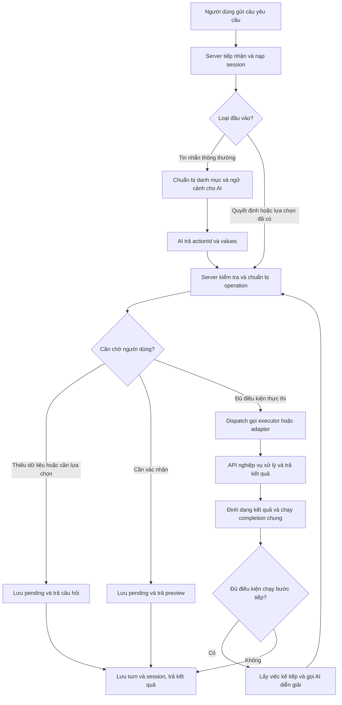

# Phân tích luồng xử lý của Trợ lý ERP

Ngày đối chiếu mã nguồn: 20/11/2026.

Tài liệu này giải thích cách một câu tiếng Việt được chuyển thành thao tác trong ERP: AI nhận gì, trả gì, server hiểu kết quả đó như thế nào và dựa vào đâu để thực hiện. Nội dung bám theo mã nguồn hiện tại, tập trung vào chế độ **Thao tác — `work`**.

Đây là mô tả kiến trúc và luồng xử lý qua việc đọc mã. Các hội thoại ví dụ dùng để giải thích cơ chế, không phải kết quả chạy thử với mô hình và dữ liệu thật. Tài liệu [OPERATION_FLOW.md](D:/cty/erp/Igen-ERP/OPERATION_FLOW.md) cung cấp thêm bản đồ kỹ thuật tổng thể.

## 1. Ý chính cần nắm trước

Hệ thống hiện nối ngôn ngữ tự nhiên với các thao tác được khai báo sẵn:

**Câu người dùng → AI chọn thao tác và lấy dữ liệu → server tra khai báo → kiểm tra và chuẩn bị → gọi API → dựng kết quả.**

Ví dụ, từ câu “Tìm sản phẩm iPhone”, AI đề xuất mã thao tác `product.list` và từ khóa `search = iPhone`. Server tra mã `product.list` trong danh mục, biết API cần gọi và biết từ khóa đó phải được đưa vào tham số nào.

Có hai nhóm quyết định xuyên suốt luồng:

| AI quyết định hoặc đề xuất | Code server quyết định |
|---|---|
| Câu nói đang yêu cầu việc gì | Thao tác có tồn tại và được phép sử dụng không |
| Chọn mã thao tác phù hợp | Thao tác đó gọi API hoặc adapter nào |
| Trích xuất giá trị từ câu nói | Giá trị có đúng trường, kiểu và điều kiện không |
| Đây là việc mới hay đang bổ sung việc cũ | Cách giữ, thay thế hoặc tiếp tục trạng thái đang chờ |
| Đề xuất câu hỏi làm rõ ý định | Trường bắt buộc nào còn thiếu và có phải chọn hồ sơ không |
| Đề xuất các việc tiếp theo | Có chạy tiếp, yêu cầu xác nhận hay dừng không |

## 2. Các khái niệm dùng trong luồng

### 2.1. Operation: một thao tác được hệ thống hỗ trợ

Operation là một khai báo trong code mô tả một hành động mà trợ lý được phép đề xuất và thực hiện.

Một operation thường có các phần sau:

| Thành phần | Tác dụng |
|---|---|
| `id` | Mã duy nhất để tìm operation trong catalog |
| `title`, `description` | Giúp AI và người dùng hiểu thao tác dùng để làm gì |
| `module` | Xác định phân hệ |
| `permissions`, `roles` | Điều kiện quyền sử dụng |
| `fields` | Danh sách đầu vào được chấp nhận |
| `method`, `path` | Phương thức và đường dẫn API nghiệp vụ |
| `confirmation`, `readOnly` | Thông tin phục vụ chính sách thực thi |
| `adapter` | Nhánh xử lý riêng nếu operation cần adapter |
| `resultFields` | Danh sách trường kết quả được khai báo để trình bày/phân giải |

Catalog được ghép từ các khai báo trong `catalog.ts`, catalog sinh tự động và catalog chuyên biệt như Y tế, Báo giá. Có những bước hiệu chỉnh khi ghép; muốn biết operation thực tế phải xem danh mục cuối cùng được xuất ra, không chỉ đọc riêng file JSON sinh tự động.

### 2.2. `actionId`: AI chọn operation nào

Trong catalog, mã được đặt ở thuộc tính `id`. Trong kết quả AI, mã được trả ở thuộc tính `actionId`.

Hai thuộc tính này nối với nhau: **server lấy `actionId` do AI trả về để tìm operation có `id` tương ứng.**

Danh sách mã action, API và field đầu vào được xuất trong [Tham chiếu action Trợ lý ERP](D:/cty/erp/Igen-ERP/docs/tham-chieu-action-tro-ly-erp.md). Schema đầy đủ của từng operation nằm trong [bản JSON](D:/cty/erp/Igen-ERP/docs/tham-chieu-action-tro-ly-erp.json).

`actionId` là khóa tra cứu trong ứng dụng. Nó không phải tên hàm mà mô hình được tự do thực thi. Server chỉ chấp nhận các mã có trong danh mục hợp lệ.

### 2.3. `values`: dữ liệu đưa vào operation

`values` là tập các cặp tên trường và giá trị mà AI trích xuất từ câu nói/ngữ cảnh.

Với câu “Tìm sản phẩm iPhone”:

| Thành phần | Nội dung |
|---|---|
| `actionId` | `product.list` |
| Trường trong `values` | `search` |
| Giá trị trường | `iPhone` |

Tên trường do schema của operation quy định. AI phải điền đúng các trường được công bố. Server kiểm tra lại và có xử lý một số tên tương đương không mơ hồ; dữ liệu không phù hợp có thể khiến hệ thống hỏi làm rõ hoặc báo lỗi.

### 2.4. Field mapping: dữ liệu được đặt vào API ở đâu

Khai báo field có thể chứa:

| Thuộc tính | Ý nghĩa |
|---|---|
| `key` | Tên trường dùng trong workflow và `values` |
| `apiKey` | Tên trường phía API |
| `source` | Trường đi vào URL path, query hay request body |
| `type`, `required`, điều kiện khác | Quy tắc kiểm tra dữ liệu |
| `reference` | Thao tác được dùng để tìm bản ghi liên quan |

Một mapping có thật trong catalog là: operation `product.list` có field `search`, gửi qua query với tên API là `q`.

Do đó, AI trả `search = iPhone`, còn executor dựng request tìm kiếm với query `q=iPhone`. Server biết cách chuyển đổi nhờ khai báo field.

### 2.5. Workflow: cấu hình sử dụng operation

Workflow bổ sung cấu hình theo tài khoản/công ty, như bật/tắt thao tác, hướng dẫn, trường bắt buộc, mặc định và yêu cầu xác nhận trong giới hạn cho phép.

Metadata về API, quyền và ràng buộc bắt buộc từ code vẫn được giữ. Khi gửi cho AI, server dùng các workflow khả dụng làm danh mục lựa chọn.

### 2.6. Turn, session và pending

| Khái niệm | Vai trò |
|---|---|
| Turn | Một lượt gửi yêu cầu và kết quả xử lý; có `requestId` để chống chạy trùng |
| Session | Trạng thái của cuộc trò chuyện: lịch sử, việc đang chờ, các bước còn lại và khóa xử lý |
| Pending | Operation đang thu thập thông tin, chờ chọn hồ sơ hoặc chờ xác nhận |
| Completion | Ngữ cảnh kết quả operation vừa thực thi thành công, dùng cho xử lý hoàn tất chung |
| `remainingRequests` | Danh sách mô tả các việc còn lại để vòng điều phối xử lý tiếp |

## 3. Toàn bộ luồng từ câu hỏi đến kết quả

### Bước 1. Frontend gửi yêu cầu

Giao diện gửi một lượt tới `/api/v1/chatbot/assistant/turns`, kèm mã cuộc trò chuyện, mã request, chế độ và nội dung tương ứng.

Đầu vào có thể là câu nói, quyết định xác nhận, lựa chọn hồ sơ hoặc biểu mẫu được hỗ trợ. Vì vậy, không phải mọi lượt gửi đều cần gọi AI để hiểu lại một câu mới.

### Bước 2. Server kiểm tra request và nạp trạng thái

Router xác thực và kiểm tra schema. `processTurn()` xác định phạm vi tài khoản/công ty/chi nhánh, kiểm tra request trùng và lấy khóa cuộc trò chuyện.

Server nạp lịch sử, pending và các việc còn lại. Nếu cùng request đã có kết quả, hệ thống có thể trả lại kết quả đã lưu thay vì chạy thao tác lần nữa.

### Bước 3. Server chuẩn bị đầu vào cho AI

Với nhánh diễn giải thông thường, đầu vào AI gồm:

- Câu người dùng vừa gửi.
- Danh mục thao tác khả dụng, gồm mã, mô tả, fields và hướng dẫn.
- Pending hiện tại, nếu có.
- Tối đa 12 tin nhắn gần nhất ở bước interpreter.
- Tóm tắt phiên và ghi nhớ được bật.
- Hướng dẫn cá nhân/dự án và ngữ cảnh các việc chưa hoàn tất.

Session giữ tối đa 40 message gần nhất, nhưng phần prompt diễn giải dùng một cửa sổ lịch sử ngắn hơn. Đây là hai mức lưu và sử dụng ngữ cảnh khác nhau.

Nếu có hơn 120 workflow, hệ thống có thể gọi AI trước để chọn các phân hệ liên quan. Sau đó mới diễn giải với danh mục đã thu hẹp, đồng thời giữ operation đang pending. Có đường quay lại danh mục đầy đủ nếu việc thu hẹp không giúp chọn được thao tác.

### Bước 4. AI trả kết quả diễn giải

AI được yêu cầu trả dữ liệu JSON. Các thông tin điều khiển chính là:

| Thuộc tính | Câu hỏi mà thuộc tính trả lời |
|---|---|
| `intentType` | Đây là thao tác, hỏi đáp, ý định mơ hồ hay yêu cầu chưa hỗ trợ? |
| `actionId` | Operation nào cần được chuẩn bị ở bước hiện tại? |
| `values` | Đã lấy được những dữ liệu đầu vào nào? |
| `newRequest` | Có chuyển sang một mục tiêu độc lập mới không? |
| `cancel` | Có yêu cầu hủy không? |
| `clarification` | Cần hỏi gì để hiểu rõ ý định? |
| `remainingRequests` | Sau bước hiện tại còn những việc nào? |

Interpreter parse và kiểm tra đầu ra này. Nếu AI trả một mã ngoài danh mục, JSON không hợp lệ hoặc trường không phù hợp, kết quả không được coi là lệnh thực thi hợp lệ.

### Bước 5. Server dùng `actionId` để tìm phần xử lý

Server tra operation tương ứng trong catalog và kiểm tra quyền/workflow hiện tại.

Từ operation này, server biết bộ field, cách phân giải liên kết, API/adapter, chính sách xác nhận và những trường kết quả có thể sử dụng. Đây là thời điểm một đề xuất của AI được nối với phần xử lý đã lập trình trong ERP.

### Bước 6. Server chuẩn bị dữ liệu

`prepare()` thực hiện phần thu thập và chuẩn bị:

- Kết hợp dữ liệu với pending nếu đang tiếp tục cùng yêu cầu.
- Chuẩn hóa dữ liệu và xử lý tệp nếu operation hỗ trợ.
- Tìm hồ sơ thật cho các trường reference.
- Áp dụng mặc định theo quy tắc thực thi và ghi nhận trường nào được tự điền.
- Kiểm tra trường còn thiếu, kiểu dữ liệu và các điều kiện.
- Chuẩn bị thông tin hiển thị và bản xem trước.

Ví dụ, AI trả tên một sản phẩm trong field reference. Server phải tìm bản ghi tương ứng để có ID dùng trong API. Nếu cần phân biệt nhiều kết quả hoặc field yêu cầu lựa chọn tường minh, hệ thống chuyển sang chờ người dùng chọn.

### Bước 7. Dừng chờ hoặc thực thi

| Kết quả chuẩn bị | Server làm gì tiếp |
|---|---|
| Thiếu dữ liệu hoặc chưa chọn được hồ sơ | Lưu pending và trả `collecting` |
| Đủ dữ liệu nhưng cần xác nhận | Lưu payload/preview và trả `confirmation` |
| Đủ điều kiện để chạy | Chuyển sang execution |

Khi người dùng bấm xác nhận, server tìm đúng pending bằng mã preview, kiểm tra lại quyền, workflow và dữ liệu, rồi dùng payload đã lưu để thực thi. Nhánh này không cần gọi AI để chọn lại operation.

Nếu người dùng gửi thêm thông tin bằng câu chữ, AI có thể được gọi lại cùng ngữ cảnh pending để trích xuất phần bổ sung.

### Bước 8. Executor dựng và gọi request nghiệp vụ

Đường thực thi chính qua `dispatch()`, ghi nhận step đang chạy, kiểm tra giới hạn và gọi `callOperation()` hoặc callback đọc được truyền vào.

Executor lấy method/path từ operation và map các giá trị vào URL path, query hoặc body. Nó giữ thông tin xác thực/phạm vi để gọi API ERP hiện có, hoặc chuyển sang adapter chuyên biệt.

Phần controller/service của API nghiệp vụ tiếp tục kiểm tra và xử lý theo logic backend đã có. Kết quả trả về là cơ sở để trợ lý thông báo thành công hay lỗi.

### Bước 9. Xử lý kết quả và hoàn tất

Server chuẩn hóa kết quả, chọn trường công khai và định dạng câu trả lời/bảng. Hook completion chung xem xét các xử lý sau thành công, trong đó có hỏi thông tin tùy chọn còn thiếu sau khi tạo, nếu tìm được operation cập nhật phù hợp và tài khoản có quyền.

AI có thể được gọi thêm để biên tập lời trả lời theo cài đặt. Trong code hiện tại, kết quả `completed` đã được parser nhận diện là bảng được giữ nguyên ở bước rewrite. Lần gọi biên tập này chỉ phục vụ cách diễn đạt, không phải một lần chọn thao tác tiếp theo.

### Bước 10. Chạy bước tiếp hoặc kết thúc lượt

Nếu còn việc và thỏa điều kiện của vòng tự chạy, server tiếp tục bước sau. Nếu không, nó lưu kết quả turn, lịch sử và session rồi nhả khóa.

`completed` ở đây là trạng thái của lượt xử lý. Với API trả trạng thái xếp hàng, nội dung kết quả vẫn phải phản ánh rằng tác vụ phía sau chưa hoàn tất.

## 4. Operation có tương ứng từng API không?

**Phần lớn operation được khai báo gắn với một method và một đường dẫn API. Tuy nhiên, số operation không đồng nghĩa số lần gọi API.**

| Trường hợp | Quan hệ thực tế |
|---|---|
| Operation thông thường | Một operation gọi API chính đã khai báo |
| Operation cần reference | Có thể gọi thêm API để tìm hồ sơ trước khi gọi API chính |
| Operation có adapter | Adapter có xử lý chuẩn hóa/kiểm tra hoặc chuỗi gọi riêng |
| Nhiều thao tác dùng cùng endpoint | Có thể khác mục đích, field hoặc giá trị cố định được khai báo |
| Yêu cầu nhiều bước | Được chia thành nhiều operation theo thứ tự |

Ví dụ API tạo và API cập nhật thường là hai operation khác nhau, dù cùng xử lý một loại dữ liệu. Một số thao tác báo cáo cũng có logic đọc, lọc hoặc tổng hợp riêng.

Khả năng thao tác của trợ lý phụ thuộc vào danh mục đã được nối. Việc backend có API chưa tự động làm cho AI sử dụng được API đó. Cần có khai báo, mapping, quyền và phần xử lý tương ứng.

## 5. Ví dụ 1: từ một câu tìm kiếm đến API

Người dùng gửi: **“Tìm sản phẩm iPhone.”**

Ví dụ này dùng mã và mapping có thật trong catalog.

| Chặng | Dữ liệu hoặc hành động |
|---|---|
| Câu đầu vào | Tìm sản phẩm iPhone |
| AI chọn operation | `actionId = product.list` |
| AI trích xuất | Trong `values`, `search = iPhone` |
| Server tra catalog | Operation tìm sản phẩm bằng `GET /inventory/catalog/products` |
| Server đọc field mapping | `search` đi vào query, tên API là `q` |
| Executor gọi API | `GET /api/v1/inventory/catalog/products?q=iPhone`, kèm thông tin phạm vi/xác thực theo xử lý executor |
| API trả kết quả | Các sản phẩm phù hợp trong phạm vi truy cập |
| Server trình bày | Bảng kết quả với các trường công khai được cho phép |

Điểm cần phân tích ở ví dụ này là mapping: người dùng nói “iPhone”, AI điền `search`, còn server biết phải chuyển nó sang query `q` nhờ catalog.

## 6. Ví dụ 2: cập nhật một hồ sơ qua nhiều lượt

Người dùng gửi: **“Đổi mô tả sản phẩm iPhone thành Hàng mới nguyên hộp.”**

Các tên field dưới đây mô tả ý nghĩa; schema thực tế được lấy theo operation cập nhật trong catalog.

### Lượt đầu

1. AI chọn operation cập nhật sản phẩm.
2. AI lấy tên sản phẩm cần sửa và nội dung mô tả mới.
3. Server tìm bản ghi sản phẩm từ tên.
4. Nếu cần người dùng chọn đúng sản phẩm, server lưu dữ liệu đã có vào pending và trả lựa chọn.

### Lượt chọn sản phẩm

1. Frontend gửi lựa chọn gắn với trạng thái đang chờ.
2. Server kiểm tra lựa chọn có hợp lệ với pending không.
3. Server hoàn thiện payload với ID sản phẩm thật.
4. Server tạo preview và yêu cầu xác nhận nếu chính sách yêu cầu.

### Lượt xác nhận

1. Frontend gửi mã preview và quyết định xác nhận.
2. Server kiểm tra lại pending, quyền, version và điều kiện thực thi.
3. Executor đưa ID vào phần `:id` của API cập nhật, đưa mô tả vào body.
4. API cập nhật và trả kết quả; server trình bày kết quả và kết thúc.

Pending nối các lượt này thành cùng một thao tác. Người dùng không cần gửi lại toàn bộ dữ liệu ở mỗi lần chọn/xác nhận.

## 7. Ví dụ 3: thiếu dữ liệu và chuyển yêu cầu

Người dùng gửi một yêu cầu tạo mới nhưng chưa cung cấp đủ thông tin.

1. AI vẫn có thể chọn operation tạo phù hợp và chỉ trả những giá trị đã hiểu được.
2. Server dùng schema để xác định trường còn thiếu.
3. Server lưu pending và hỏi thêm.
4. Người dùng trả lời ngắn; AI được cung cấp pending để hiểu các giá trị đó thuộc việc đang làm.
5. Server merge phần bổ sung, kiểm tra lại và tiếp tục chuẩn bị.

Nếu người dùng chuyển sang mục tiêu độc lập, AI có thể trả `newRequest = true`. Server dùng tín hiệu này cùng logic xử lý hiện có để thay thế pending và phần việc cũ.

Đây là một quyết định ngữ nghĩa đáng chú ý: nếu AI phân biệt sai giữa “bổ sung việc cũ” và “bắt đầu việc mới”, luồng có thể đi sai dù dữ liệu vẫn hợp lệ về kiểu.

## 8. Vòng tự thao tác nhiều bước đang chạy thế nào?

### 8.1. AI đề xuất bước hiện tại và danh sách việc còn lại

Ví dụ minh họa: **“Tìm sản phẩm iPhone, cập nhật mô tả rồi kiểm tra lại.”**

Một cách phân rã mà AI có thể trả là:

| Vị trí | Nội dung |
|---|---|
| Bước hiện tại | Operation tìm sản phẩm |
| Việc còn lại thứ nhất | Cập nhật mô tả sản phẩm vừa xác định |
| Việc còn lại thứ hai | Kiểm tra lại thông tin sản phẩm |

`remainingRequests` chứa các mô tả công việc dạng chuỗi. Các phần việc sau chưa phải một danh sách đầy đủ các request API đã được phân giải sẵn.

### 8.2. Server lấy từng việc để gọi AI diễn giải tiếp

Sau bước thành công, server:

1. Thêm phản hồi đã định dạng của bước trước vào ngữ cảnh vòng lặp.
2. Lấy việc đầu tiên trong `remainingRequests`.
3. Gọi AI để chọn `actionId` và trích xuất `values` cho việc đó.
4. Kiểm tra và đưa qua `prepare()` như một bước bình thường.
5. Nếu bước đã hoàn tất hoặc đã chuyển thành pending, bỏ việc đó khỏi hàng đợi.
6. Lưu trạng thái trước khi xét chạy tiếp.

Khi cần chờ người dùng, việc hiện tại đã chuyển sang pending; hàng đợi giữ phần việc phía sau. Sau khi pending được xử lý thành công ở lượt tiếp theo, vòng tự chạy có thể tiếp tục.

### 8.3. Kết quả bước trước được chuyển cho AI thế nào?

Trong vòng này, server đưa **reply đã định dạng** vào lịch sử bước. Nó không truyền nguyên raw API response như một tool-result có cấu trúc đầy đủ.

Một số ngữ cảnh định danh được server giữ và chuyển riêng, ví dụ follow-up của bản ghi vừa tạo. Không có cơ chế tổng quát trong vòng lặp để mọi đầu ra của bước trước tự động trở thành tham số đã định kiểu cho bước sau.

### 8.4. Mức độ điều chỉnh kế hoạch hiện tại

Ở mỗi vòng, code sử dụng `actionId` và `values` AI trả cho việc kế tiếp. Nó không dùng `next.remainingRequests` để thay thế toàn bộ hàng đợi.

Vì vậy, cần đánh giá kiến trúc hiện tại như một cơ chế **thực thi danh sách việc, có AI diễn giải từng bước và dùng kết quả trước làm ngữ cảnh**. Việc lên kế hoạch lại toàn bộ khi kết quả khác dự kiến chưa phải một cơ chế tổng quát trong vòng này.

### 8.5. Khi nào vòng tự chạy dừng?

Vòng tiếp tục khi đang ở `work`, có completion, reply là `completed`, không có pending, còn việc, còn budget, không có file trả về và không có câu hỏi bổ sung tùy chọn.

Vòng có thể dừng do:

- Cần thêm dữ liệu, lựa chọn hoặc xác nhận.
- AI chưa chọn được bước tiếp theo.
- Lỗi, yêu cầu hủy hoặc kết quả chưa xác định.
- Hết thời gian hoặc số bước/lần gọi được phép.
- Kết quả có file hoặc câu hỏi bổ sung cần trả cho người dùng.

Giới hạn hiện khai báo trong `ExecutionBudget`:

| Giới hạn | Giá trị |
|---|---|
| Thời gian lượt trực tiếp | 90 giây |
| Thời gian lượt nền | 8 phút |
| Lượt lập bước được budget tính | Tối đa 24 |
| Lần đọc qua dispatch | Tối đa 24 |
| Lần ghi qua dispatch | Tối đa 3 |

Ngoài giới hạn số lượng, budget chặn cùng một thao tác ghi có cùng dữ liệu lặp lại trong lượt, và dừng tiếp tục khi các lần đọc trùng không tạo thêm tiến triển.

## 9. Một câu người dùng có thể dẫn tới bao nhiêu lần gọi AI?

Không có số lần cố định cho mọi yêu cầu.

| Điểm có thể gọi AI | Mục đích |
|---|---|
| Chọn phân hệ khi danh mục lớn | Thu hẹp danh mục thao tác |
| Diễn giải chính | Chọn operation và trích xuất dữ liệu |
| Diễn giải lại/chuyên biệt | Một số nhánh cần xử lý thêm hoặc quay về danh mục đầy đủ |
| Các bước còn lại | Diễn giải từng việc trong vòng tự chạy |
| Viết lại phản hồi | Điều chỉnh cách diễn đạt theo cài đặt |
| Operation dùng AI riêng | Phụ thuộc chức năng nghiệp vụ mà operation thực hiện |

Ngược lại, lượt bấm xác nhận hoặc gửi lựa chọn reference có thể đi thẳng vào phần xử lý pending mà không cần AI chọn lại operation.

Luồng gọi interpreter hiện sử dụng dịch vụ `openrouterChat()`. Model lấy theo cấu hình môi trường, có giá trị fallback trong code; tên hiển thị ở giao diện không đủ để xác định model thật đang dùng.

## 10. Trạng thái, lỗi và cách tiếp tục

| Trạng thái | Ý nghĩa đối với luồng |
|---|---|
| `collecting` | Cần thông tin/lựa chọn hoặc làm rõ; chưa hoàn tất bước hiện tại |
| `confirmation` | Đã có preview và đang chờ quyết định |
| `completed` | Lượt xử lý trả kết quả hoàn tất theo phản hồi nghiệp vụ |
| `processing` | Request hoặc job còn đang xử lý |
| `cancelled` | Phần đang chờ/chạy đã được dừng theo luồng hủy |
| `unsupported` | Không có thao tác phù hợp/khả dụng trong nhánh xử lý tương ứng |
| `failed` | Lỗi đã xác định trong xử lý; có thể gồm lỗi quyền tại thời điểm thực thi |
| `uncertain` | Không xác minh được tác động thực tế; không tự chạy lại thao tác đó |

Cần phân biệt ba việc:

1. **Giữ bản nháp:** lỗi trước dispatch có thể giữ pending để tiếp tục sửa.
2. **Chống gửi trùng:** requestId và digest giúp trả lại kết quả đã có thay vì gọi API lại.
3. **Không biết API đã ghi hay chưa:** timeout/mất kết nối khi ghi có thể dẫn tới `uncertain`; gửi lại mù quáng có thể tạo tác động trùng.

Với chuỗi nhiều bước, các bước đã hoàn tất được giữ; hệ thống không tự rollback toàn bộ mục tiêu khi bước sau dừng hoặc lỗi.

## 11. Chạy nền có thay đổi cơ chế AI không?

Khi cấu hình nền được bật, request văn bản phù hợp có thể được đưa vào queue. Worker nhận job, xác thực lại và gọi chính `processTurn()` với chế độ background và callback kiểm tra hủy.

Queue/worker thay đổi nơi và thời gian chạy, đồng thời cung cấp trạng thái để frontend kiểm tra. Cơ chế diễn giải operation và vòng tự thao tác vẫn là luồng chung đã mô tả.

Chế độ Hỏi đáp `qa` có nhánh xử lý riêng cho hội thoại/tài liệu. Các mô tả về vòng thực thi operation nhiều bước trong tài liệu này chủ yếu áp dụng cho `work`; có một số nhánh chuyên biệt được xét riêng trong service.

## 12. Những điểm nên tập trung khi phân tích trợ lý

### 12.1. Chất lượng chọn thao tác

Kiểm tra AI có chọn đúng `actionId` giữa các operation gần nghĩa không. Server có thể phát hiện mã ngoài danh mục hoặc dữ liệu sai schema, nhưng một mã hợp lệ vẫn có thể không đúng ý người dùng.

Ví dụ cần phân biệt tìm danh sách với xem chi tiết, tạo mới với cập nhật, hoặc cùng một từ nhưng thuộc các phân hệ khác nhau.

### 12.2. Chất lượng trích xuất dữ liệu

Kiểm tra `values` có giữ tên, mã, số liệu, khoảng ngày và điều kiện người dùng đã nêu không. Cần xét trường hợp AI chọn operation không thể biểu diễn đủ điều kiện của câu hỏi.

### 12.3. Chất lượng nối các lượt

Kiểm tra AI có hiểu câu trả lời ngắn là bổ sung pending không, có đổi nhầm mục tiêu không và preview cũ có bị vô hiệu hóa đúng lúc không.

### 12.4. Chất lượng nối các bước tự chạy

Kiểm tra phản hồi bước trước có đủ thông tin cho bước sau không. Cần đặc biệt chú ý trường hợp nhiều bản ghi trùng tên, bước sau phụ thuộc ID, hoặc kết quả thực tế khác giả định của kế hoạch ban đầu.

### 12.5. Mức độ hỗ trợ thực tế của từng operation

Một operation có trong catalog mới chứng minh rằng hệ thống có khai báo để AI lựa chọn. Muốn đánh giá đầy đủ còn phải xét phân giải đầu vào, API thực thi, kết quả hiển thị, completion và tiếp tục hội thoại.

Các điểm đã thấy khi đối chiếu mã hiện tại:

- Tạo sản phẩm qua `/inventory/catalog/products/with-price` và `/inventory/catalog/products/bulk-create-with-variants` chưa được ghép với operation cập nhật qua cơ chế hiện có của completion. Chúng không có `completionUpdateId`, không có cặp theo quy tắc tên và đường dẫn. Điều này có thể làm thiếu bước hỏi bổ sung dù tạo thành công.
- Một số helper trong `service.ts` vẫn gọi `callOperation()` trực tiếp, ví dụ preview xóa học viên và đọc thông tin hồ sơ còn thiếu. Những lần gọi đó không được tính/ghi bằng callback dispatch chung. Đây là ngoại lệ cần tính đến khi đọc mô tả journal và budget.
- Một số nhánh định dạng kết quả vẫn dùng formatter ngày riêng. Cần phân biệt quy tắc trình bày được yêu cầu với mức áp dụng thực tế ở từng nhánh.

Những điểm này là quan sát qua mã nguồn; chưa thay thế kiểm thử hội thoại hoặc tích hợp thật.

## 13. Bản đồ file để đọc tiếp

| Muốn hiểu phần nào | File nên đọc |
|---|---|
| Bản mô tả tổng thể sẵn có | [OPERATION_FLOW.md](D:/cty/erp/Igen-ERP/OPERATION_FLOW.md) |
| Frontend gửi turn | [assistantService.ts](D:/cty/erp/Igen-ERP/src/services/assistantService.ts) |
| Endpoint, schema, routing nền | [router.ts](D:/cty/erp/Igen-ERP/server/assistant/router.ts) |
| Điều phối chính, pending, prepare, execute, dispatch và vòng nhiều bước | [service.ts](D:/cty/erp/Igen-ERP/server/assistant/service.ts) |
| Prompt diễn giải và kiểm tra JSON từ AI | [semantic-interpreter.ts](D:/cty/erp/Igen-ERP/server/assistant/semantic-interpreter.ts) |
| Các luật/hàm diễn giải nghiệp vụ bổ trợ | [interpreter.ts](D:/cty/erp/Igen-ERP/server/assistant/interpreter.ts) |
| Operation, field mapping và danh mục cuối cùng | [catalog.ts](D:/cty/erp/Igen-ERP/server/assistant/catalog.ts) |
| Khai báo API sinh tự động | [expanded-catalog.generated.json](D:/cty/erp/Igen-ERP/server/assistant/expanded-catalog.generated.json) |
| Nguồn hợp đồng của nhiều operation sinh tự động | [reviewed-contracts.mjs](D:/cty/erp/Igen-ERP/server/assistant/scripts/reviewed-contracts.mjs) |
| Quyền và cấu hình workflow | [workflows.ts](D:/cty/erp/Igen-ERP/server/assistant/workflows.ts) |
| Kiểm tra dữ liệu/required | [policy.ts](D:/cty/erp/Igen-ERP/server/assistant/policy.ts) |
| Phân giải references, dựng request và gọi API/adapter | [executor.ts](D:/cty/erp/Igen-ERP/server/assistant/executor.ts) |
| Giới hạn của vòng tự chạy | [execution-budget.ts](D:/cty/erp/Igen-ERP/server/assistant/execution-budget.ts) |
| Hỏi bổ sung sau tạo và context cập nhật | [completion.ts](D:/cty/erp/Igen-ERP/server/assistant/completion.ts) |
| Lưu session, turn, workflow và các model liên quan | [models.ts](D:/cty/erp/Igen-ERP/server/assistant/models.ts) |
| Queue/worker | [jobs.ts](D:/cty/erp/Igen-ERP/server/assistant/jobs.ts), [assistant.worker.ts](D:/cty/erp/Igen-ERP/server/workers/assistant.worker.ts) |
| Định dạng và viết lại kết quả | [result-format.ts](D:/cty/erp/Igen-ERP/server/assistant/result-format.ts), [reply-presentation.ts](D:/cty/erp/Igen-ERP/server/assistant/reply-presentation.ts), [reply-rules.ts](D:/cty/erp/Igen-ERP/server/assistant/reply-rules.ts) |
| Hợp đồng dữ liệu trao đổi và trình bày | [assistant-workflow.ts](D:/cty/erp/Igen-ERP/src/shared/assistant-workflow.ts), [assistant-result-table.ts](D:/cty/erp/Igen-ERP/src/shared/assistant-result-table.ts), [assistant-date.ts](D:/cty/erp/Igen-ERP/src/shared/assistant-date.ts) |

Khi lần theo code, nên bắt đầu ở `processTurn()`, xem lời gọi `interpretRequest()`, theo dữ liệu vào `prepare()`, rồi tới `execute()` và `dispatch()`. Sau đó đọc vòng `remainingRequests` để thấy cơ chế tự chạy dùng lại các bước đó như thế nào.
