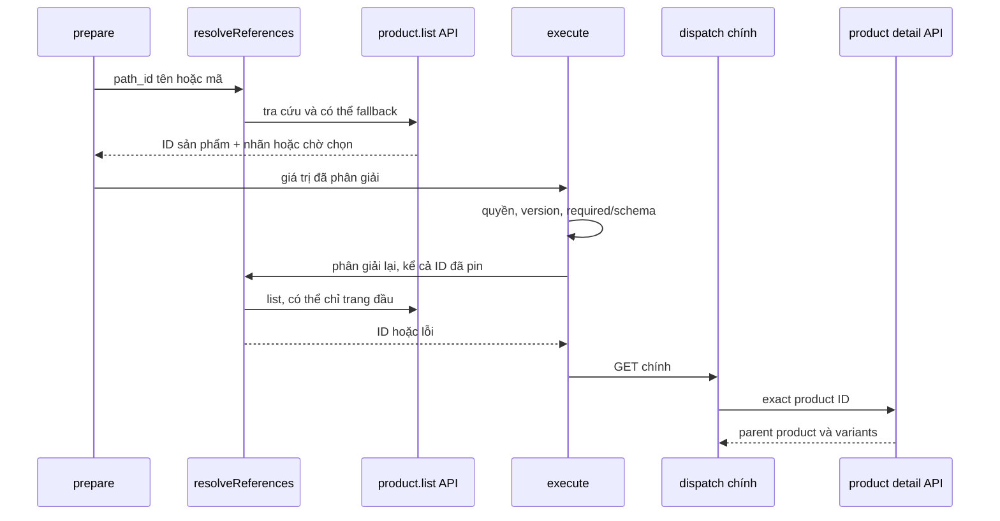
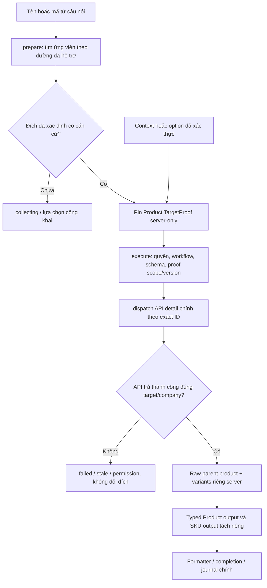

# Spike đọc mã — trusted references và exact getter cho slice sản phẩm

Ngày đối chiếu: 21/11/2026. **Trạng thái: bản vẽ để rà, chưa duyệt implementation.**

Đây là spike đọc mã theo T0.8 Mục 4.1, chỉ xét `/kho-san-pham`, `product.list` và `inventory.product.detail`, đường direct. Không tạo prototype, không sửa runtime, không chạy test/model/provider/API/DB. Các kết quả lớp B do nhiệm vụ riêng bàn giao tại [kết quả lớp B](ket-qua-lop-b-tro-ly-erp.md); không lấy giả thuyết trong spike làm số đo.

Đọc cùng [baseline](baseline-do-luong.md), [kiểm kê cổng gọi T0.1-A](kiem-ke-thiet-ke-cong-goi-tro-ly-erp.md), [hợp đồng V2 bản 0.2](thiet-ke-hop-dong-tro-ly-erp-v2.md) và [kế hoạch](../ke-hoach-nang-cap-tro-ly-erp.md).

## 1. Kết luận thiết kế để xem xét

Với **đúng hai action đọc đã chọn**, có cơ sở để đánh giá phương án: sau khi server đã pin một Product target có căn cứ, dùng **API detail chính đọc theo exact ID** để kiểm tra record còn tồn tại/đúng company và trả kết quả. Không nhất thiết phải gọi list thêm ở `execute`, rồi gọi lại cùng API detail lần nữa như một bước riêng.

Đây là phương án cần kiểm chứng và duyệt, không phải kết luận đã có hook an toàn hoặc đã sửa lỗi. Nó chỉ giảm bước đọc dư nếu giữ được toàn bộ kiểm tra quyền, workflow, target pin, lựa chọn tường minh và bộ lọc của mục tiêu. Không áp dụng quy tắc này cho thao tác ghi hoặc GET có tác động phụ.

`trustedReferences` trong tài liệu V2 **chưa tồn tại** ở chữ ký `prepare()`/`resolveReferences()`. Gói scalar/ID mới không được đưa vào lõi rồi coi là trusted chỉ vì đến từ một adapter. Cần một boundary server-only kiểm chứng proof và có quy tắc vô hiệu hóa rõ.

## 2. Bằng chứng hiện trạng

| Đoạn nguồn đã đối chiếu | Hành vi trong slice |
|---|---|
| [catalog.ts](../server/assistant/catalog.ts), 270–272 và 850 | List công bố `search → query.q`; detail có một field required `path_id`, reference `product.list`, mapping `path.id` |
| [service.ts](../server/assistant/service.ts), `prepare` 2335 | Gọi resolver với các giá trị đã thu thập trước khi tạo trạng thái chờ/bản xem trước |
| [service.ts](../server/assistant/service.ts), `execute` 1942–1971 | Kiểm tra quyền, workflow version, required/schema, rồi phân giải reference lại; áp dụng cả cho GET |
| [executor.ts](../server/assistant/executor.ts), 4110–4132 | `lookupRecords` kiểm operation, dựng input, gọi API và project kết quả; đường list nhận internal ID có thể đổi từ khóa thành rỗng |
| [executor.ts](../server/assistant/executor.ts), 4426 và 4440–4442 | Reference có thể đọc list theo từ khóa rồi đọc lại list không từ khóa khi không có exact match |
| [executor.ts](../server/assistant/executor.ts), 4729–4769 | Resolver chọn duy nhất một exact candidate, lưu ID và nhãn; không có đủ đích thì tạo lỗi/lựa chọn |
| [service.ts](../server/assistant/service.ts), 2130–2133 | GET chính đi qua `dispatch(checked.values, callback lookupRecords)`; callback hiện dùng object `values` của execute |
| [router.ts](../server/modules/inventory/product-catalog/router.ts), endpoint `/products/:id` | API detail yêu cầu `inventory:read` |
| [product-catalog.controller.ts](../server/modules/inventory/product-catalog/product-catalog.controller.ts), 118–120 | Detail gọi `get` với company của request đã xác thực |
| [product-catalog.service.ts](../server/modules/inventory/product-catalog/product-catalog.service.ts), 564–570 | Exact `findOne` theo `_id + companyCode`, 404 nếu mất record, rồi lấy variants theo company và product ID |
| [executor.ts](../server/assistant/executor.ts), `rawRecords` 3968–3977 | Response detail có variants bị trải thành dòng SKU; ID dòng variant không phải product ID |

**Hiệu chỉnh sau lớp B:** API service mặc định limit 20 và sort theo name, nhưng đó không phải kích thước trang hiệu lực của request trợ lý này. `product.list` là GET không dùng adapter contract; [executor.ts](../server/assistant/executor.ts) 644–646 tự đặt `limit=100`, `page=1` khi chưa có query tương ứng, dù catalog không công bố page/limit. Vì vậy fixture 25 sản phẩm nằm trong trang hiệu lực đầu và không chứng minh lỗi “record thứ 25 không thấy”. Root đã xác nhận ca F-25 thành công bằng test mới cô lập; trace và trạng thái từng ca nằm trong [báo cáo lớp B](ket-qua-lop-b-tro-ly-erp.md).

Đường reference vẫn có thể bị giới hạn bởi **trang hiệu lực 100**, không phải 20. Tái tìm ID bằng list chỉ là một trang, không phải exact existence check cho mọi record. Ca vượt 100 item cần kết quả riêng; không suy từ F-25 rằng mọi record được tìm đủ hoặc khẳng định ca thứ 101 đã lỗi khi chưa đọc báo cáo test.

Một quan sát khác từ lớp B do root thực hiện: nhãn lựa chọn cho P2/P3 cùng tên có thể bị gộp thành một chuỗi “Tai nghe Sóng [trùng tên, cần thêm thông tin]”, vì bộ differentiator hiện không đưa productCode vào nhãn; `suggestReferenceOptions()` khử trùng lặp theo chuỗi nhãn ở executor 4608. Đây là vấn đề lựa chọn công khai cần trace riêng, khác với giả thuyết dùng nhầm SKU ID làm product ID. Không coi bước free-text mã để phục hồi là bằng chứng picker đã phân biệt hai bản ghi đúng.

Đặc biệt, `callOperation()` không tự thay thế full permission check: nó bắt đầu bằng kiểm unavailableReason tại executor 285–286. `lookupRecords()` gọi `assertOperation`, còn API route kiểm permission riêng. Phương án exact getter phải giữ cả kiểm tra assistant và API; không chuyển thẳng sang gọi service DB rồi bỏ middleware.

## 3. Luồng hiện tại và chỗ tích hợp có thể đặt

Không giả định cố định ba HTTP call: thiếu target, lựa chọn/resume hoặc fallback có thể làm số lần đọc khác. Đường có reread theo ID ngoài trang đầu có thể dừng trước detail chính; phải lấy trace lớp B để xác nhận ca cụ thể.

### 3.1. Chức năng revalidation hiện cần giữ

| Kiểm tra | Giữ khi thay list reread bằng exact detail? |
|---|---|
| `assertOperation`/module/permission hiện hành | Giữ trước dispatch; API cũng kiểm lại theo credential hiện tại |
| Workflow enabled/version | Giữ; proof không cấp quyền vượt phiên bản workflow |
| Required/type/schema và mục tiêu đã thu thập | Giữ; không cho proof hợp thức hóa field ngoài schema |
| Đối tượng chọn từ danh sách/option | Giữ pin; không tự đổi sang record cùng tên khi record cũ mất |
| Preview/confirmation nếu workflow GET bật riêng | Giữ; ID/version preview cũ không chạy khi target đổi |
| Record còn tồn tại và thuộc company | Exact API detail có thể cung cấp bằng chứng tại thời điểm đọc |
| Quyền sở hữu theo branch | Không tự thêm cho product; branch vẫn ràng buộc session/handle/option |
| Ràng buộc trạng thái/requiredWhen theo miền | Hai action hiện không có logic trạng thái đặc biệt như các action ghi; phải rà lại khi catalog đổi |

Các điều kiện partialUpdate, snapshot tác động xóa, pinned version tuyển dụng/lương hoặc confirmationDetails của module khác không là lý do tự động buộc product GET phải reread list. Nhưng chúng là lý do **không** xóa bước revalidation toàn cục hoặc áp tối ưu này cho mọi action.

## 4. So sánh phương án

| Phương án | Ưu điểm | Hạn chế/điều kiện |
|---|---|---|
| A — giữ resolver hiện tại | Thay đổi thấp nhất; giữ đường cũ để đối chiếu | Có thể đọc list lặp, giới hạn trang đầu; chưa giải quyết proof context |
| B — proof + exact preflight riêng, sau đó detail chính | Dễ tách bằng chứng proof với output chính | Có thể gọi cùng detail hai lần; không nên coi đây là đích tối ưu mặc định |
| C — proof + detail chính là exact verification và output | Một lần API có thể vừa kiểm tồn tại/company/quyền vừa lấy dữ liệu; bỏ list reread của target đã pin | Cần boundary typed, raw parent response, bookkeeping đúng và không bỏ revalidation khác |

**Đề xuất ưu tiên đánh giá C cho slice đọc direct**, giữ A làm đường đối chiếu/khôi phục có khai báo. Không tự chọn C làm quyết định implementation. B có thể phục vụ giai đoạn thử nghiệm nếu có lý do, nhưng phải đo chi phí đọc tăng thêm và không gửi hai request chỉ để “shadow”.

### 4.1. Bản vẽ tích hợp phương án C

Đây là bản vẽ logic, chưa là patch cho service/executor. Các điểm cắm cần thiết kế trước prototype:

1. **Nhận proof ở boundary riêng:** gọi chỉ từ orchestration đã xác thực; proof chứa field, Product entity key, ID private, context/version và public label. Không nhận proof trong `values` từ model/client.
2. **Giữ name/code flow:** nếu chỉ có tên/mã chưa phân giải thì resolver vẫn có trách nhiệm hỏi/cho chọn. Một exact row trên trang bị cắt chưa chứng minh tên duy nhất trên toàn phạm vi. Exact getter chỉ giải quyết target ID đã có căn cứ; nó không tự giải quyết ambiguity tên.
3. **Chuyển về scalar có kiểm soát:** sau validation, ID product có thể đưa vào path input cho execution. Không đánh dấu `selectedReferenceKeys` từ một ID tự khai để bỏ qua resolver. Không đặt các cờ private từ output LLM.
4. **Exact verification dùng cùng primary call:** chỉ xét khi operation là detail read thuộc allowlist tối ưu, target đã pin và không có kiểm tra domain khác cần dữ liệu trước dispatch. Nếu response lỗi/404 thì không đổi sang tên gần giống hoặc option khác.
5. **Giữ raw parent trước projection:** lấy `_id/id` của product parent đã exact-fetch; kiểm nó trùng target proof, giữ variants riêng. Không lấy `row.id` sau `rawRecords()` làm product ID. Response có variants rỗng vẫn có thể là product hợp lệ.
6. **Tái dùng kết quả trong cùng logical step:** formatter/projection dùng response vừa lấy, không gọi detail lại chỉ để lấy bảng. Nếu projection hiện tại không biểu diễn được parent, adapter output cần loại Product/SKU rõ; mọi thay đổi output phải giữ public allowlist/parser/bảng chung.
7. **Một input chuẩn hóa:** dữ liệu budget/journal và input transport phải là cùng command đã kiểm tra. Tránh wrapper ghi `checked.values` trong khi callback tiếp tục dùng object cũ đóng trên `values`.
8. **Proof không sống vĩnh viễn:** option/pending còn hợp lệ vẫn cần kiểm quyền/record hiện hành; handle/context hết hạn không được gán lại target. Quy tắc TTL trong T0.8 0.2 là đề xuất cần chốt, không là trạng thái runtime đã có.

### 4.2. Walkthrough bắt buộc trong spike/prototype về sau

| Ca | Phương án C cần thể hiện |
|---|---|
| Tên/mã P1 duy nhất trong dữ liệu đã đọc đủ | Prepare pin P1; exact detail xác thực P1 và trả cùng dữ liệu dùng trình bày |
| Tên P2/P3 trùng | Chờ chọn; chưa có quyền lấy dòng đầu. Option đã chọn P3 pin ID product P3 |
| Target vượt trang hiệu lực đầu (>100) | Với ID đã được chọn/context xác thực, exact getter không đi qua list để tìm lại ID. Nếu chưa có ID có căn cứ thì vẫn xử lý ambiguity/recall của bước tìm kiếm riêng. P25 không phải ca ngoài trang trong đường trợ lý hiện tại |
| Product P3 có nhiều variant ID | Target vẫn P3; SKU rows chỉ là con, không tạo product handle từ variant ID |
| Product bị xóa sau prepare | GET exact 404, không đọc record cùng tên của company khác hoặc thay target |
| Mất permission/module/workflow đổi | Dừng theo kiểm tra hiện hành, không dùng proof cũ để vượt |
| Cùng company, session đổi branch | Handle/option sai session scope không dùng được; không giả định record product thuộc branch cũ |
| GET được workflow yêu cầu confirmation | Preview/decision pin cùng target; exact GET xảy ra sau xác nhận hợp lệ |

Không có số call tiết kiệm đã đo trong spike. Lớp B chạy code hiện tại chỉ tạo baseline để so; phương án C cần task prototype/implementation riêng mới đo được before/after. Mốc pagination phải lấy từ request thực tế (`limit=100`), không chỉ từ default của API service; phương án C vẫn có giá trị để đánh giá exact revalidation cho ID vượt trang và giảm reread, nhưng F-25 không chứng minh false-negative.

## 5. Read budget: điều kiện trước B2

Tính đủ reference/fallback có thể làm cùng một yêu cầu từ ít primary reads thành nhiều leaf reads. Giữ trần 24 hiện tại trong code; **không tự tăng trần** để tránh test fail hoặc để các chuỗi mới qua được.

Trước B2 cần phân bố theo kịch bản, với từng scenario ghi:

- Primary reads, reference ở prepare, reference ở execute, fallback, retry và các trang đọc thêm.
- Số đọc wrapper/budget hiện tính so với leaf API thật; số call dự kiến nếu tất cả được hạch toán.
- Status hiện tại, vị trí dừng nếu áp read cap cho leaf, lượng headroom tới 24, và kịch bản đang thành công có nguy cơ hồi quy.
- Phân biệt phân bố từ test/harness đã chạy với thống kê chỉ đọc mã test. Không gọi một phép đếm tĩnh là phân bố runtime.

Các scenario nên gồm list đơn, detail theo mã, tên trùng/chọn, target ngoài trang đầu, fallback, confirmation riêng và chuỗi nhiều bước đã có fixture liên quan. Không cần chạy toàn bộ test cũ khi lệnh hiện tại chỉ cho chạy test mới; có thể tái hiện có dẫn nguồn trong bộ mới hoặc ghi rõ thiếu độ phủ. Không suy từ vài case hai GET thành toàn bộ ERP.

Quyết định giữ/tối ưu/đổi trần phải dựa trên số đo và được chủ dự án chốt. Ưu tiên loại reread không cần thiết được chứng minh trước khi bàn tăng cap. Reread bắt buộc vẫn tính budget; no-progress cần phân biệt phase/version có mục đích với loop lặp vô ích, không dựa vào callId mới để né giới hạn.

## 6. Journal lỗi: lựa chọn cần duyệt, không tự đổi mặc định

Hiện dispatch ghi `steps` trước khi lookup/API chạy ở service 1924–1926. Nếu ghi đó throw, callback primary không được gọi. Điều này không có nghĩa mọi reference trước dispatch đều đã được journal đầy đủ; đó là khoảng thiếu bookkeeping riêng.

| Phương án | Điều kiện | Tác động cần đo/rà |
|---|---|---|
| Giữ fail-closed hiện tại | Mọi call cần journal bắt buộc đều phải ghi được trước gửi | Đơn giản hơn nhưng giảm availability khi Mongo lỗi; chưa biết tần suất/latency thật |
| Fail-open có giới hạn cho pure_read | Chỉ action/call đã rà thuần đọc; quyền/scope/target/budget/session ownership vẫn xác định; lỗi chỉ ở bản ghi observability có thể suy giảm | Có thể trả kết quả đọc nhưng trace thiếu; cần degraded marker, cảnh báo server, policy retry/replay và đo failure mode |
| Fail-closed bắt buộc | Mutation, effectful_read, unreviewed; hoặc lỗi ở dữ liệu pin, pending/lock, auth/quyền, budget/identity cần cho tính đúng | Không dùng nhãn pure_read để bỏ state quyết định đúng target hoặc chống ghi trùng |

Đề xuất fail-open là **một phương án để duyệt**, chưa thay quy tắc trong T0.1-A hoặc code. Không coi tất cả Mongo write là telemetry tùy chọn. Nếu không lưu được pin/option/pending dùng để tiếp tục, không tạo token có thể dùng lại hoặc giả vờ request đã được lưu hoàn chỉnh. Scope/permission failure không được hạ thành journal availability warning.

Nếu muốn thử fail-open, thiết kế phải chốt trường hợp nào degraded, có được trả completed không, replay sau lỗi persistence xử lý ra sao và theo dõi thiếu audit bằng cơ chế độc lập nào. Kết quả đã gửi API rồi không được chuyển thành “chưa gửi” để retry bừa.

**Chi phí Mongo chưa đo:** B5 cần số lần journal writes/updates trên logical step và physical call, elapsed time p50/p95, payload size và lỗi trước/sau send. Lớp B mock có thể đếm operation/update nhưng không đo được latency Mongo production. Không đặt SLA hoặc kết luận tăng latency bao nhiêu từ mock.

## 7. Evidence quote và hỏi thừa

Bản 0.2 dùng quote literal được server tìm sau NFC; đây là lựa chọn thiết kế để giảm lỗi model đếm offset. Nó vẫn có thể từ chối giá trị có căn cứ khi model đổi hoa/thường, thêm/bớt dấu câu, quote quá ngắn xuất hiện nhiều lần hoặc trích rộng hơn giá trị field.

Không nới thành fuzzy matching trong spike này. Khi lớp A được cấp phép, đo riêng:

| Chỉ số | Cách gán nhãn |
|---|---|
| Evidence acceptance | Số claim qua kiểm chứng / tổng claim theo loại field/source |
| False `UNSOURCED_VALUE` | Claim thật sự có căn cứ theo người rà nhưng bị verifier từ chối / tổng claim có căn cứ |
| Extra clarification do evidence | Số lượt hỏi thêm chỉ do verifier từ chối / số case đủ thông tin đã duyệt |
| Loại nguyên nhân | NFC/NFD, case, dấu câu/space, quote lặp, quote rộng, model đổi tên/mã, evidence sai thật |
| Rủi ro nếu nới | Số claim sai target/value được chấp nhận thêm khi thử rule mới trên cùng holdout |

Phân biệt `raw` chuẩn hóa hợp lệ bằng rule server với model tự sửa tên/mã. Có thể so sánh rule về quote và value trong một experiment sau; không coi literal match là chứng minh đúng ngữ nghĩa, và không dùng kết quả lớp B mock interpreter để công bố verifier đã ít hỏi thừa trên model thật.

Ngân sách lớp A đợt hiện tại vẫn 0; spike không chạy model, không tra giá provider hoặc tự cấp budget.

## 8. Cổng quyết định và sản phẩm bàn giao

| Quyết định | Bằng chứng trước khi chốt |
|---|---|
| Dùng primary exact getter thay list revalidation cho hai GET | Trace lớp B hiện tại, bản vẽ proof/scope/output và prototype riêng nếu được giao; chứng minh không bỏ quyền/workflow/preview pin |
| Điều chỉnh read cap 24 | Phân bố leaf reads theo scenario, hồi quy và phương án giảm call; không tăng ngầm |
| Pure-read journal fail-open | Failure policy cụ thể, state nào bắt buộc lưu, degraded reporting và phép đo B5; writes/effectful vẫn fail-closed |
| Nới rule quote | Số liệu live lớp A trên tập đã duyệt và đối chiếu false-reject/false-accept; không chỉ dựa vào ví dụ đẹp |

Bàn giao spike hiện gồm call graph, phương án A/B/C, boundary integration và các walkthrough ở trên. Chưa có prototype, chưa có implementation, chưa có test runtime do spike thực hiện. Kết quả test lớp B phải được đọc từ bản bàn giao riêng và không được gộp thành bằng chứng phương án C đã chạy.

**Dừng để người dùng/chủ dự án rà.** Không tự duyệt T0.8/T0.1-B, không sửa runtime/bugfix, không đổi cap hoặc journal policy, không mở slice ghi/job/DAG. Lớp B và spike không chứng minh chất lượng hiểu ngôn ngữ hoặc production SLA.
