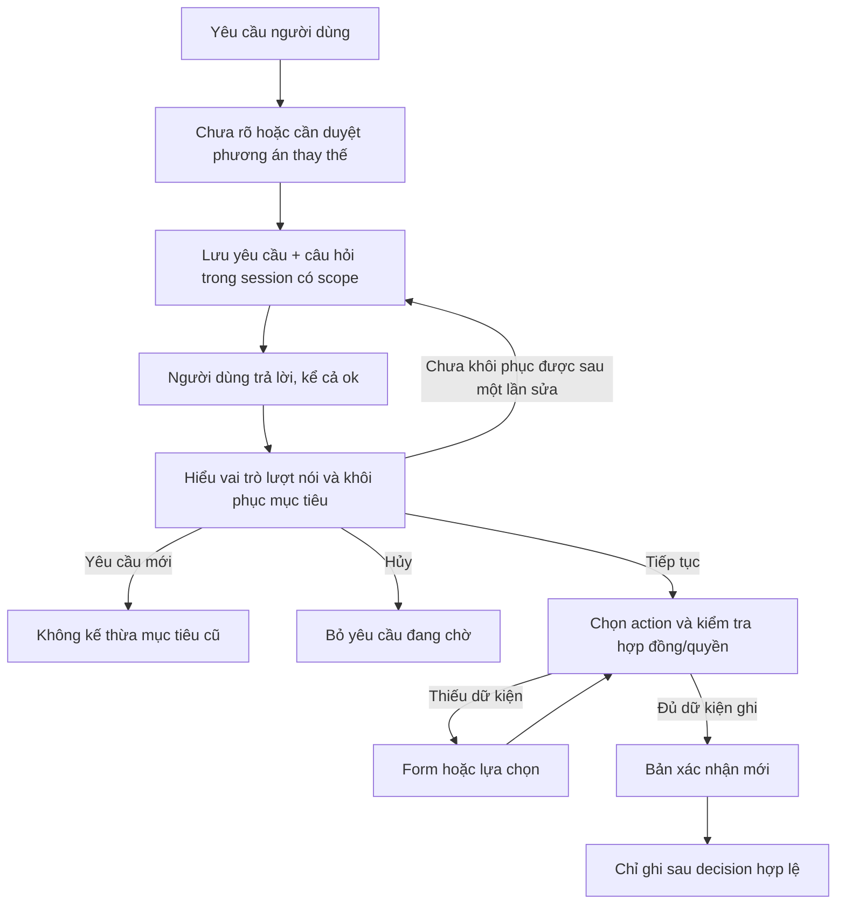

# Nối câu trả lời với yêu cầu đang hỏi lại — 27/11/2026

## Hiện tượng và bằng chứng

Ảnh staging: người dùng muốn tạo kỳ thi ngày 27/11/2026, lúc 14h, tại P102. Bot đề xuất chỉ tạo với ngày/phòng; người dùng trả lời “ok”, bot lại hỏi cần hỗ trợ gì.

Chưa có log/DB của hội thoại staging để xác định chính xác bản triển khai và response model. Không tìm thấy P102 trong Mongo local, phù hợp với xác nhận của người dùng rằng ảnh ở staging. Không khẳng định đã kiểm tra lịch sử staging hay đã sửa trực tiếp staging.

Mã repository đã có lưu session trong Mongo, API conversationState và listConversations; messages giữ tối đa 40 tin gần nhất, summary được quản lý riêng. Có lưu tin nhắn không có nghĩa bước chọn action luôn sử dụng đúng yêu cầu đang chờ.

Các điểm yếu đã tái hiện offline:

1. Khi chưa chọn được action, NLU có thể trả “ok” thành framing độc lập. Nhánh tiếp tục draft có actionId không xử lý trường hợp này, nên mục tiêu gốc có thể mất.
2. Reference có căn cứ trong yêu cầu gốc vẫn bị xóa nếu lượt “ok” không nhắc lại giá trị đó.
3. Khi sửa nguồn ngữ nghĩa thất bại, lưu “ok” thành yêu cầu mới làm mất câu hỏi cũ.
4. Cờ ASSISTANT_SEMANTIC_CONTEXT mặc định chỉ bật ở development nếu không cấu hình. Việc nối một câu hỏi đang chờ cần hoạt động cả khi cờ triển khai ngữ nghĩa tổng thể tắt. Chưa kiểm tra giá trị cờ thực tế của staging.

## Thay đổi dùng chung

- Lưu yêu cầu gốc và câu hỏi đang chờ cùng scope user/company/branch/conversation/project. Dùng lại sau khi tải session; tương thích context cũ chỉ có text bằng lastReply.
- Đưa trạng thái clarification riêng vào đầu vào hiểu ngữ nghĩa, kể cả chưa có actionId. Phản hồi tiếp tục phải khôi phục mục tiêu và các dữ kiện còn hiệu lực; yêu cầu mới độc lập không kế thừa việc cũ.
- Nếu NLU chỉ trả acknowledgement hoặc không khôi phục goal, sửa nội bộ tối đa một lần trong budget hiện có. Nếu vẫn không đủ, giữ yêu cầu/câu hỏi cũ; không chuyển sang hỏi chung người dùng muốn gì và không tạo hồ sơ.
- Khi người dùng đồng ý phương án bỏ phần chưa hỗ trợ, prompt yêu cầu chỉ bỏ phần được đề xuất, giữ các dữ kiện khác. Quote vẫn phải có trong yêu cầu gốc/lời người dùng, không lấy lời bot làm nguồn dữ kiện mới. Chất lượng hiểu đề xuất này vẫn cần kiểm chứng AI thật.
- Giữ reference có căn cứ trong toàn bộ yêu cầu đã nối, thay vì chỉ tìm trong câu hiện tại.
- Ngữ cảnh thực thi của một clarification được xác minh nhận marker server riêng, gắn action/schema/intent. Vì vậy nó tiếp tục hoạt động khi cờ semantic tổng thể tắt, kể cả qua form và reload. Không bật semantic cho toàn bộ yêu cầu mới, không bỏ kiểm tra quyền/schema.
- Thao tác ghi sau đồng ý tiếp tục vẫn bắt buộc qua chuẩn bị và xác nhận. Không coi “ok” là decision.confirmed. Giữ form và option đang có.
- Không lưu thông báo dừng kỹ thuật như một câu hỏi nghiệp vụ đang chờ đồng ý. Hủy hoặc kết thúc thì bỏ context; scope khác không dùng lại context cũ.

## Kiểm chứng

- Hồi quy offline có chặn provider/network/DB thật: **1.011 test / 51 file đạt** bằng config catalog-routing. Đây là test code và hội thoại điều khiển đầu ra model, không phải 1.011 câu AI thật.
- Sau bổ sung kiểm tra API tải lịch sử: **144 test / 2 file đạt**. npm run typecheck và git diff --check đạt.
- Chuỗi kỳ thi: yêu cầu → câu hỏi phương án thay thế → JSON round trip session và conversationState → “ok” → form trạng thái/lớp → lựa chọn do server phát hành → xác nhận. Kiểm tra giữ tên/ngày/P102 và không có HTTP ghi. Chạy cả semantic true/false.
- Kiểm tra bounded repair khi AI chỉ trả acknowledgement, giữ nguyên câu hỏi sau repair thất bại, hủy yêu cầu, yêu cầu độc lập mới, scope khác, không lấy quote bịa từ câu bot, không coi lỗi thời gian xử lý là câu hỏi nghiệp vụ.
- Không thay giao diện; không có kiểm chứng trình duyệt/staging cho bản sửa này.
- Không gọi AI thật sau sửa: sổ đợt 32 câu đã COST_RESERVE_LIMIT. Giữ nguyên chi phí 0,23931413 USD + giữ chỗ chưa rõ 0,001387375 USD, không mở lại sổ. Kết quả 32 câu trước sửa nằm riêng tại ket-qua-32-cau-tu-nhien-tro-ly-erp-2026-11-27.md.

## Khi kiểm chứng staging sau triển khai

Dùng dữ liệu giả, cùng tài khoản/chi nhánh/cuộc trò chuyện. Ghi conversationId/requestId trong log nội bộ; kiểm tra session.messages, clarificationContext, lastReply và dialogue.act. Nhắn yêu cầu kỳ thi tương tự, đợi câu hỏi, tải lại trang rồi “ok”. Phải tiếp tục form hoặc preview; dừng ở xác nhận, không bấm tạo. Không kết luận staging đã hết lỗi từ các test local ở trên.
