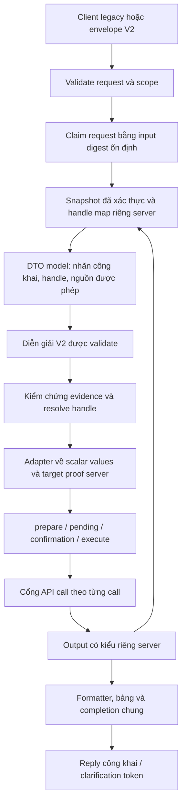

# T0.8 — Thiết kế hợp đồng Trợ lý ERP V2

Ngày lập và cập nhật: 21/11/2026. Phiên bản tài liệu: **0.2 — chờ người dùng rà, chưa duyệt**.

**Cập nhật implementation theo lệnh riêng:** đã có [API V2 direct/read sau flag](ket-qua-v2-hai-action-doc-tro-ly-erp.md),122 test V2 và725 hồi quy/offline pass. Bản triển khai reuse `PendingAction` và proof lõi P2, lưu sidecar có version, không sao chép core pending; token lookup chỉ hash, token replay mã hóa. TTL đề xuất dùng trong prototype; chưa approve rollout. UI/client capture, job/DAG V2 và thao tác ghi chưa triển khai. Các đoạn “chưa triển khai” phía dưới ghi lại trạng thái lúc lập thiết kế0.2, không thay thế báo cáo implementation mới.

Đây là sản phẩm thiết kế của T0.8 theo [phiếu quyết định và phạm vi đọc](../ke-hoach-nang-cap-tro-ly-erp.md). Các type, version, JSON và thuật toán dưới đây **chưa được triển khai**. Runtime/schema chưa đổi. Lệnh lớp B về sau đã thêm/chạy14 test riêng theo [báo cáo](ket-qua-lop-b-tro-ly-erp.md), không chạy test cũ/model/API/DB thật. Ngân sách live/shadow vẫn0; **baseline live chưa đo**, không mở cổng T1.

## 1. Phạm vi và nền hiện tại

Slice được chọn: `/kho-san-pham`, mode `work`, hai action thuần tra cứu:

| Action | Field hiện tại | API và mapping |
|---|---|---|
| `product.list` | `search`: text, không bắt buộc, tối đa 100 ký tự | `GET /inventory/catalog/products`, `search → query.q` |
| `inventory.product.detail` | `path_id`: text, required/systemRequired, reference `product.list` | `GET /inventory/catalog/products/:id`, `path_id → path.id`, adapter `contract` |

Hai workflow mặc định không yêu cầu xác nhận. `settings.alwaysConfirm` ở `prepare()` chỉ áp dụng write không read-only; riêng `workflow.requireConfirmation` vẫn có thể bật cho GET. Vì vậy ví dụ chi tiết mặc định thực thi sau khi phân giải; ví dụ confirmation bên dưới chỉ áp dụng khi workflow hiện hành thực sự yêu cầu.

Sản phẩm là dữ liệu theo **companyCode** trong API hiện có, không phải tài sản thuộc riêng một branch. Branch vẫn là phần scope session/handle/option: đổi branch vô hiệu token cũ, nhưng không suy ra rằng sản phẩm cùng công ty nằm ngoài quyền chỉ vì khác branch. Quyền API/module hiện hành vẫn là nguồn quyết định.

Những quan sát cần giữ khi thiết kế:

- `service.ts` gọi `semantic-interpreter.ts`; interpreter trả `actionId`, scalar/chuỗi JSON trong `values`, `intentType`, `cancel`, `newRequest` và `remainingRequests`.
- `TurnInput` chưa có context V2; router hiện XOR text/decision/reference selections/các form. Không gửi field V2 tới router hiện tại rồi coi là đã hỗ trợ.
- Pending giữ provided/resolved/preview/workflowVersion và reference selections. Session/turn Mongo và queue/envelope đã có; không tạo lại nền này.
- Default mode của `processTurn()` là `work`; digest hiện chuẩn hóa `research` theo mode. Digest hiện bỏ password khỏi decision. Job hiện có fingerprint riêng của input và envelope mã hóa.
- `prepare()` và `execute()` đều có thể phân giải reference; một số lần đọc phụ nằm ngoài dispatch. GET chính có thể đi `dispatch(callback lookupRecords)`.
- Reference hiện có thể chỉ tìm trên trang danh sách đầu; tìm lại bằng ID cũng có thể đọc danh sách không lọc. Không lấy “không thấy trên trang” làm bằng chứng toàn bộ dữ liệu không tồn tại hoặc duy nhất.
- `rawRecords()` có thể chuyển detail có `variants` thành các dòng SKU. ID dòng SKU không phải ID sản phẩm. Catalog detail còn có `productId`; trường thuộc `resultFields` không tự động an toàn để gửi model.

Phần ngoài slice chỉ giữ tương thích contract cũ. Không thêm create/update/delete, giá, tồn kho, form-only hoặc phân hệ khác vào rollout này.

### 1.1. Thu gọn phạm vi triển khai đầu tiên của V2

| Hạng mục | Phạm vi đề xuất cho slice đầu |
|---|---|
| V2 direct | Hai action đọc, context/handle, kiểm chứng quote, adapter và pending/selection/preview theo workflow thực tế |
| Background job | **Giữ legacy**; không nhận request V2, không pin-at-enqueue, không thay worker hoặc xây intake direct/job chung ở slice đầu |
| Plan DAG/output liên bước | Thiết kế trước để kiểm tra khả năng mở rộng; **chưa triển khai** trong slice đầu. Vòng `remainingRequests` legacy không bị đổi contract hoặc nghiệm thu nhờ slice này |
| Trusted reference integration | Cần spike đọc mã/bản vẽ chi tiết trước implementation; prototype/test chỉ được làm khi có lệnh riêng |
| Thao tác ghi | Ngoài slice; kết quả của hai GET không được dùng để nới ngưỡng hoặc nghiệm thu slice ghi |

Router hiện tự đưa text `work` vào job khi bật `ASSISTANT_BACKGROUND_ENABLED`. Vì vậy “direct-only” phải có boundary cụ thể: đề xuất `/turns` nhận envelope V2 bằng schema riêng, kiểm tra flag/slice rồi chọn đường direct **trước nhánh auto-queue legacy**; `/jobs` từ chối V2 trước claim/dispatch. Đầu vào legacy vẫn giữ routing cũ. Flag V2 tắt hoặc transport không phù hợp thì báo chưa hỗ trợ/đề nghị gửi lại đúng đường, không strip context hoặc đổi sang legacy một cách âm thầm. Đây là thay đổi thiết kế chưa được code hay phê duyệt.

## 2. Ranh giới dữ liệu và sơ đồ chuyển đổi



Sơ đồ trên chỉ áp dụng V2 direct. Job legacy giữ đường cũ riêng; phương án job V2 ở Mục 8.2 là thiết kế dự trữ, không nằm trên đường triển khai slice đầu.

| Lớp | Được giữ | Không được nhận/đưa tiếp |
|---|---|---|
| Client | Mã request/conversation, context hint, lựa chọn token, dữ liệu công khai | ID thật được phép gửi **vào** resolver từ trang nhưng không là quyền; không nhận handle map/resolved payload/credentials từ server |
| Model | Câu và dữ liệu tối thiểu đã allowlist, public code/name, handle, source ID mờ | Raw record IDs, scope IDs, password/token, private snapshots, SQL/API URL tùy ý |
| Server | Auth scope, IDs thật, provenance đã kiểm chứng, pin/version, payload execution | Không tin metadata tự khai của client/model; không để model tạo default/quyền/xác nhận |
| Telemetry | Metadata tối thiểu đã redaction và version | Raw request/form/context/record hoặc token dùng được để tiếp tục pending |

Các mã sản phẩm/SKU công khai như `SP-MAY-A1` và `SKU-MAY-A1-128` có thể hiển thị; không cấm chỉ vì chúng là “mã”. Ngược lại, UUID/Mongo ID không được cho model ngay cả khi xuất hiện trong field có tên công khai.

## 3. Type đề xuất: request và context

Các đoạn TypeScript là định nghĩa thiết kế để người rà đánh giá, **không phải source được tạo**. Mỗi schema khi triển khai phải reject unknown keys, giới hạn kích thước/độ dài và validate runtime; type TS không đủ để kiểm chứng request.

```ts
type SliceActionId = "product.list" | "inventory.product.detail";
type SliceField = "search" | "path_id";
type Scalar = string | number | boolean; // shape AssistantValue hiện có
type UUID = string;                     // validate UUIDv4 ở boundary
type ISOInstant = string;
type PublicProduct = {
  name: string;
  productCode?: string;
  categoryCode?: string;
  productType?: "physical" | "service" | "bundle";
  status?: string;
};

// Client gửi hint; server phải tra lại và kiểm tra scope.
type ClientScreenContextV2 = {
  version: 2;
  route: "/kho-san-pham";
  viewInstance: string;
  revision: number;
  capturedAt: ISOInstant;
  pageType: "list" | "detail";
  entity?: { type: "product"; id: string };  // ID thật chỉ client -> server
  selection?: { type: "product"; ids: string[] }; // tối đa 10, không trùng
  filters?: { search?: string };             // chỉ field slice hỗ trợ
};

type ClientTurnV2 = {
  schemaVersion: 2;
  conversationId: UUID;
  requestId: UUID;
  mode: "work";
  input:
    | { kind: "text"; text: string; screenContext?: ClientScreenContextV2 }
    | { kind: "selection"; pendingId: UUID; pendingVersion: number; optionToken: string }
    | { kind: "decision"; pendingId: UUID; pendingVersion: number; confirmed: boolean };
};

// Các type dưới đây chỉ tồn tại ở server, tuyệt đối không serialize vào prompt/reply.
type ServerScope = { userId: string; companyCode: string; branchId: string };
type VerifiedContextV2 = {
  version: 2;
  owner: ServerScope & { conversationId: UUID };
  contextId: string;
  contextVersion: number;
  inputContextHash: string;
  effectiveSnapshotHash: string;
  verifiedAt: ISOInstant;
  expiresAt: ISOInstant;
  route: "/kho-san-pham";
  entityKeys: string[];
  registry: Record<string, ServerEntityV2>;
  handleBindings: Record<string, HandleBindingV2>;
};
type ServerEntityV2 = {
  entityKey: string;
  entityType: "product";
  recordId: string;
  recordVersion?: string; // chỉ khi API có, không tự bịa revision
  companyCode: string;
  public: PublicProduct;
  origin: "screen" | "selection" | "session" | "step_output";
  readAt: ISOInstant;
};
type HandleBindingV2 = {
  handle: string;
  entityKey: string;
  contextId: string;
  contextVersion: number;
  owner: ServerScope & { conversationId: UUID };
  issuedAt: ISOInstant;
  expiresAt: ISOInstant;
};
type ModelEntityV2 = {
  handle: string; // mờ, giới hạn trong một context version
  entityType: "product";
  label: string;
  productCode?: string;
  status?: string;
  origin: ServerEntityV2["origin"];
};
```

Quy tắc schema:

1. Envelope V2 chỉ chọn một loại input. Không nhận `actionId`, method/path, company/branch scope hoặc resolved values từ client text/selection.
2. `screenContext` chỉ đi cùng text; không thêm context mới vào decision để thay target cũ. Route khác hoặc field form/filters chưa hỗ trợ bị từ chối có lý do hoặc chạy legacy **trước claim** theo policy đã chốt; không âm thầm bỏ context làm đổi ý nghĩa.
3. IDs client gửi bị kiểm tra định dạng, tồn tại, quyền và company bằng API/service được phép. Selection là gợi ý ngữ cảnh; không đồng nghĩa người dùng yêu cầu bulk.
4. `capturedAt` chỉ dùng kiểm tra freshness, không tin giờ client để xác định thời gian nghiệp vụ. TTL khởi điểm đề xuất tại Mục 8.4 cần được rà/chốt trước rollout; không coi thời gian client là quyền gia hạn.
5. Version này không nhận file, form, `qa` hoặc password. Các đầu vào legacy vẫn dùng contract legacy; không “fallback” một yêu cầu V2 cần context sang đường cũ mà mất scope/ý nghĩa.
6. Không tự suy ngày/branch cho slice. Bản ghi cùng company vẫn có thể truy cập dù branch session khác; đổi branch làm option/handle cũ không hợp lệ và cần request mới theo scope mới.

`handleBindings` lưu riêng server, tra bằng handle trong đúng context ID/version và owner; sau đó mới tra `entityKey` trong registry. Không resolve chỉ bằng chuỗi `e1` trên toàn session. Handle hết hạn/khác version không được gán lại cho entity mới; model DTO chỉ xuất các binding còn hợp lệ. Dùng UUID/token random hay alias `e1` là lựa chọn implementation nhưng luôn phải giữ tuple scope/context/version, không lấy độ khó đoán làm quyền truy cập.

Model context builder phải chiếu lại cả pending cũ, lịch sử/summary, option, memory và output theo allowlist. Không đưa thẳng `pending.provided/resolved` hoặc session đã lưu vào prompt V2 vì chúng có thể chứa ID từ lựa chọn server trước đó. Với phần không thể chuyển sang model-safe DTO mà vẫn giữ ý nghĩa, giữ ở đường legacy được khai báo hoặc dừng có hướng dẫn, không tự gửi raw để “tăng ngữ cảnh”. Đây là yêu cầu của boundary mới, chưa phải tuyên bố mọi prompt legacy hiện đã đạt I2.

## 4. Type đề xuất: model output, evidence và adapter

```ts
type EvidenceClaimV2 =
  | { kind: "text_quote"; inputRef: string; quote: string }
  | { kind: "context_field"; contextRef: string; handle: string; field: "name" | "productCode" }
  | { kind: "selected_handle"; contextRef: string; handle: string };
type ExtractedClaimV2 = {
  raw: string;
  source: "utterance" | "screen" | "session";
  evidence: EvidenceClaimV2;
};
type ReferenceClaimV2 =
  | { kind: "name_or_code"; extracted: ExtractedClaimV2 }
  | { kind: "handle"; handle: string; evidence: EvidenceClaimV2 };
type ActionProposalV2 =
  | { actionId: "product.list"; values: { search?: ExtractedClaimV2 } }
  | { actionId: "inventory.product.detail"; values: { path_id?: ReferenceClaimV2 } };
type InterpretationV2 = {
  schemaVersion: 2;
  intentType: "workflow" | "ambiguous" | "unsupported" | "general_question";
  proposal?: ActionProposalV2;
  cancel: boolean;
  newRequest: boolean;
  clarification?: string;
  remainingRequests?: string[]; // bridge cho kế hoạch legacy, tối đa 40
};

// Provenance được server tạo sau kiểm chứng; model không được trả object này.
type VerifiedTextEvidenceV2 = {
  inputRef: string;
  inputContentHash: string;
  normalization: "NFC";
  quote: string;
  canonicalStart: number; // code point do SERVER tính, không do model trả
  canonicalEnd: number;
};
type VerifiedValueV2 = {
  field: SliceField;
  normalized: Scalar;
  source: "utterance" | "screen" | "session" | "server_default" | "deterministic_transform";
  evidenceRef: string;
  transform?: { rule: string; ruleVersion: string; inputRefs: string[] };
  entityKey?: string;
};
type TargetProofV2 = {
  field: "path_id";
  entityKey: string;
  recordId: string;
  publicLabel: string;
  contextId: string;
  contextVersion: number;
  proofVersion: number;
  validatedAt: ISOInstant;
};
type CoreReadyCommandV2 = {
  actionId: SliceActionId;
  values: Partial<Record<SliceField, Scalar>>;
  trustedReferences: TargetProofV2[]; // riêng server, không đưa vào values
  provenance: VerifiedValueV2[];     // riêng server
  inputRequestDigest: string;
  effectiveSnapshotHash: string;
};
```

Runtime validator phải ràng buộc theo `intentType`: `workflow` có proposal; `ambiguous` có câu hỏi nhưng không có lệnh thực thi; `unsupported/general_question/cancel` không được kèm values để chạy. `newRequest` chỉ là đề xuất; giữ các hiệu chỉnh hiện có trong service. Không để model nêu default hoặc nhét ID thật vào `raw`, evidence, clarification hay remainingRequests.

Kiểm chứng evidence:

- `text_quote` gồm inputRef server cấp và đoạn trích nguyên văn, **không yêu cầu model đếm offset**. Server lấy đúng snapshot inputRef, chuẩn hóa cả input và quote về NFC rồi tìm tất cả vị trí khớp literal. Chỉ một vị trí khớp mới tạo `VerifiedTextEvidenceV2`; nhiều vị trí, quote rỗng hoặc không khớp → `UNSOURCED_VALUE`. Có thể hỏi lại hoặc yêu cầu quote dài hơn có ngữ cảnh, không tự chọn vị trí đầu.
- Với field chuỗi trong slice, `raw` sau NFC/trim phải khớp giá trị được trích, hoặc đi qua phép biến đổi deterministic đã định nghĩa và kiểm chứng. Quote có thật chưa chứng minh AI đã chọn đúng action/ý nghĩa; vẫn validate field, ý định và reference. Không fuzzy-match, bỏ dấu, đổi hoa/thường hoặc sửa mã để ép evidence khớp.
- Offset nếu cần cho audit do server tính trên snapshot NFC đã pin và lưu riêng cùng inputContentHash. Chuẩn hóa evidence không tự thay request digest hoặc chuỗi tên/mã nguyên gốc trong lưu trữ. Telemetry không nhận raw quote; model/client không nhận vị trí hoặc mapping riêng server.
- Context evidence chỉ trỏ handle đã xuất cho model của snapshot đó. Context field là nhãn công khai đã đọc, không tin label client gửi.
- “Cái này” không có public name vẫn có thể hợp lệ nhờ `selected_handle` và đích context duy nhất. Không có một quy tắc chung rằng mọi giá trị phải khớp nguyên văn câu mới nhất.
- Default do server cấu hình mới được gán `server_default`; không hỏi LLM suy provenance của default. Transform hợp lệ phải có inputRefs và rule/version để tái tạo.
- Slice chỉ dùng chuỗi; tương lai field date/datetime/number phải chuẩn hóa theo type, giữ cụm gốc và quy tắc được duyệt. Chỉ formatter shared chuyển giá trị ngày sang cách hiển thị; names/codes không đi qua parser ngày.

### 4.1. Mapping sang lõi và việc tích hợp cần làm về sau

| Đầu vào | Mapping đề xuất | Điều kiện |
|---|---|---|
| `product.list.values.search.raw` | `values.search` là chuỗi đã trim/validate max100 | Evidence kiểm chứng; không tự thêm status/branch filter ngoài schema |
| Detail `name_or_code` | `values.path_id` là tên/mã công khai đã kiểm chứng | Lõi tiếp tục phân giải; nhiều đích thì collecting |
| Detail `handle` | Resolve thành TargetProof riêng, ID chỉ đi payload execution server | Exact getter/permission check trước thực thi; không coi handle là quyền |
| Selection token | Server tra target, tạo TargetProof và tiếp tục đúng pending | Pending/version/scope/expiry hợp lệ; không gọi model chọn lại action |
| Legacy text/input | Dùng đường và schema legacy đã có | Không tự migrate operation ngoài slice |
| Legacy mutation pending | Giữ legacy phiên bản/lifecycle và xác nhận đang chờ | Chỉ là tương thích chung, không nằm trong rollout đọc |

`trustedReferences` là **extension được đề xuất cho boundary phân giải**, không phải argument hiện đã có trong `prepare()`/`resolveReferences()`. Cần hook server-only có type ở T1 để nhận proof, kiểm tra lại target bằng exact getter và đưa scalar/ID vào đoạn thực thi phù hợp. Không giả vờ chỉ đổi wrapper thành scalar là đủ.

**Spike trước khi cam kết tích hợp:** trước tiên chỉ đọc mã và bàn giao bản vẽ nhánh `prepare`/`resolveReferences`/`execute`, xác định chính xác chỗ nhận proof, kiểm tra quyền/record, tái kiểm tra và chuyển về scalar. Chứng minh bằng walkthrough tên/mã, handle, option đã chọn, stale record và ID ngoài trang đầu; so sánh việc tích hợp proof với việc giữ reference legacy. Chỉ khi được giao riêng mới viết prototype/test với model/API mock và network bị chặn; không refactor lõi hoặc mở rộng action trong spike. Kết quả spike phải được rà trước khi coi boundary `trustedReferences` là phương án đã chốt.

Không sử dụng `selectedReferenceKeys` để biến một ID model/client tự đưa thành reference đã được người dùng chọn. Không bỏ revalidation vì proof trước đó thành công. Nếu không thể tích hợp exact verification an toàn, giữ collecting/legacy reference flow, ghi rõ không hỗ trợ auto-context cho case đó. Không triển khai silent first-page lookup rồi tuyên bố unique.

Ngày giờ, credentials, scope, version, defaultedKeys không được nhận từ LLM trong `values`. `expectedVersion`/idempotency hệ thống vẫn do server pin như hiện tại. Contract mới không cho actor sửa những trường đó qua form/prompt.

## 5. Clarification token, pending và preview

```ts
type ClarificationV2 = {
  schemaVersion: 2;
  pendingId: UUID;
  pendingVersion: number;
  kind: "choose_entity" | "fill_fields" | "choose_action" | "confirm_assumption";
  question: string;
  understood?: string;
  options?: { optionToken: string; label: string; hint?: string }[];
  fields?: { key: SliceField; type: "text"; required: boolean; label: string }[];
  allowFreeText: boolean;
  expiresAt: ISOInstant;
};
type PrivateOptionV2 = {
  tokenHash: string;
  owner: ServerScope & { conversationId: UUID };
  pendingId: UUID;
  pendingVersion: number;
  actionId: SliceActionId;
  target: TargetProofV2;
  expiresAt: ISOInstant;
  acceptedByRequestId?: UUID; // cùng request retry idempotent
};

// Shape private hiện có (service.ts:45), mô tả đủ để rà mapping.
// Implementation phải reuse/extract type gốc, không duy trì bản copy lệch.
type CorePendingV1 = {
  id: UUID;
  actionId: string;
  provided: Record<string, unknown>; // private legacy, không chấp nhận object tùy ý từ model/client
  intent: string;
  resolved?: Record<string, Scalar>;
  selectedProductVariant?: { productId: string; variantId: string };
  explicitReferenceKeys?: string[];
  workflowVersion: number;
  preview: {
    requiresPassword?: boolean;
    id: string;
    title: string;
    values: { label: string; value: Scalar; defaulted?: boolean }[];
  };
  attachmentSummary?: { fieldKey: string; fileName: string; rowCount: number };
  confirmationDetails?: Record<string, { label: string; value: string }[]>;
  awaitingReferenceKeys?: string[];
  awaitingReferenceLabels?: Record<string, string>;
  awaitingPathReferenceKeys?: string[];
  skippedReferenceKeys?: string[];
  referenceSelections?: AssistantReferenceSelection[]; // reuse shared type hiện có
  defaultedKeys?: string[];
};
type PendingEnvelopeV2 = {
  schemaVersion: 2;
  pendingVersion: number;
  corePending: CorePendingV1;
  owner: ServerScope & { conversationId: UUID };
  contextId: string;
  contextVersion: number;
  targetProofs: TargetProofV2[];
  provenance: VerifiedValueV2[];
  inputRequestDigest: string;
  effectiveSnapshotHash: string;
  createdAt: ISOInstant;
  expiresAt: ISOInstant;
};
```

`corePending` liên kết tới kiểu `PendingAction` hiện private trong service. Shape cụ thể ở trên để rà thiết kế; `AssistantReferenceSelection` là type đang có ở shared workflow. Khi triển khai cần export/reuse type gốc hoặc adapter typed có tất cả trường hiện hữu, không duy trì hai bản định nghĩa riêng rồi lệch state. Mục 12 ghi đây là điểm thiết kế cần rà.

Mỗi token mờ, random đủ mạnh, chỉ lưu hash để tra; không mang record ID trong token cho client giải mã. Không log raw token. Một pending có thể nhiều option; chọn một option làm cũ các option/preview phụ thuộc. Retry cùng request phải lấy lại kết quả turn trước khi tiêu thụ token lần nữa. Request khác dùng token đã tiêu thụ phải kiểm tra trạng thái/version, không lặp API mù quáng.

Preview vẫn dùng public values của `AssistantReply.action`; default tự điền bị ẩn qua shared presentation. Không đưa provenance/private context vào `action.values`. GET mặc định không xuất preview chỉ để giới thiệu V2; nếu workflow bật confirmation, giữ preview ID, pending version và target pin. Thay target phải tạo preview mới; quyết định cũ không chạy được.

Tiêu đề kết quả đọc được đề xuất trong slice: lấy từ input/metadata đã xác thực, ví dụ “Sản phẩm khớp ‘Điện thoại Mây A1’”. Không phải nơi liệt kê default, không tự thêm kỳ/branch, không mở rộng sang báo cáo doanh thu.

## 6. Plan và output giữa các bước

**Thiết kế dự trữ cho slice sau, chưa triển khai trong slice đầu direct/read.** Các type này giúp rà ranh giới Product/SKU và tương thích, không bắt buộc dựng DAG store/replan engine để đưa hai action đọc vào V2. Nếu yêu cầu nhiều bước cần contract này mà slice đầu chưa hỗ trợ, trả giới hạn rõ hoặc giữ toàn bộ yêu cầu trên legacy theo policy đã chốt; không trộn một phần V2 rồi âm thầm mất ngữ cảnh.

```ts
type ProductOutputV2 = {
  kind: "products";
  entities: { handle: string; product: PublicProduct }[];
  collection: { complete: boolean; returned: number; total?: number };
};
type ProductDetailOutputV2 = {
  kind: "product_detail";
  product: { handle: string; product: PublicProduct };
  skus: { sku: string; displayName?: string; unitCode?: string; trackingMode?: string }[];
};
type StepOutputRefV2 = {
  stepId: string;
  slot: "products" | "product";
  entityHandle?: string;
  selection: "unique" | "user_selected";
};
type PlannedStepInputV2 =
  | {
      state: "unresolved";
      proposal: ActionProposalV2; // có field claim riêng từng action, ví dụ search
      targetRef?: StepOutputRefV2; // chỉ detail; chờ output bước trước
      provenanceRefs: string[];  // các nguồn đã xác thực nếu có; claim mới chưa là proof
    }
  | {
      state: "ready";
      command: CoreReadyCommandV2; // scalar normalized values + private target proofs
      provenanceRefs: string[];
    };
type PlanStepV2 = {
  stepId: string;
  actionId: SliceActionId;
  dependsOn: string[];
  input: PlannedStepInputV2;
  status: "queued" | "collecting" | "confirmation" | "executing" | "completed" | "failed" | "uncertain" | "cancelled";
  outputRef?: string; // trỏ kho output riêng server
};
type PlanEnvelopeV2 = {
  schemaVersion: 2;
  planId: string;
  planVersion: number;
  currentStepId?: string;
  steps: PlanStepV2[];
  legacyRemainingRequests?: string[];
  replanCount: number;
};
```

Output model-safe trên là DTO, không toàn bộ API result. Product handle phải lấy từ record sản phẩm/base `productId`, không từ `_id/id` của dòng variant trong projection hiện tại. SKU ID nội bộ không xuất model; public SKU code có thể xuất nếu thuộc allowlist.

Plan envelope và `PlannedStepInputV2` là **state riêng server**, không serialize trực tiếp vào prompt/client. Bước list giữ `proposal.values.search` của chính nó khi unresolved; sau kiểm chứng giữ `command.values.search` đã chuẩn hóa khi ready. Bước detail giữ claim tên/mã/handle hoặc `targetRef` có kiểu, rồi tạo target proof trong command khi dependency đủ. Không chỉ giữ actionId rồi mất tham số của bước.

Runtime validator bắt buộc `step.actionId` bằng `proposal.actionId` hoặc `command.actionId`; list không có `targetRef`, detail không được có cả đích literal và output reference mâu thuẫn. `ready` đòi hỏi required field/proof/nguồn và workflow/context version hợp lệ, không chỉ có object command. Reference provenance phải thuộc kho proof của scope/plan này. Unresolved step không dispatch; khi replan/resume, nếu pin hết hạn thì trở lại cần xác minh/collecting, không coi command cũ luôn ready. DTO đưa model chỉ gồm dữ liệu công khai cần cho bước và inputRefs mờ.

`complete` chỉ true khi biết API đã trả đủ/nhất quán trong phạm vi. Trang đầu không có tổng/đủ trang thì không suy `complete=true`. Detail target đơn cần exact verified ID hoặc lựa chọn; không dùng `$step1.items[0]`. `selection=unique` phải chứng minh trong phạm vi hợp lệ, không chỉ một row trên trang đã cắt.

Bridge legacy: giữ nguyên chuỗi `remainingRequests` tối đa 40, không tự biến tất cả thành action đã được phép. Việc chuyển thành DAG cần đối chiếu từng bước với catalog/scope, không truncate. Một current + 40 remaining có thể dài hơn khả năng chạy trong một lượt; giữ pending và ngân sách hiện có, không ép cả plan chạy. Tối đa 3 writes trong budget không phải giới hạn 3 bước tổng. Slice này không có writes.

Replan phải có version mới, giới hạn được chốt trước rollout, giữ completed steps và không replay chúng. Nếu target/tác động thay đổi, vô hiệu các preview phụ thuộc; kế hoạch chung không thay xác nhận bắt buộc. No-progress hoặc kết quả không đủ để kết luận phải dừng hỏi/thu hẹp.

## 7. Cổng API và telemetry: hợp đồng nối T0.1-A

```ts
type BusinessCallContext = {
  turnRequestId: UUID;
  stepRequestId: string;
  callId: string;
  parentCallId?: string;
  ownerActionId: string;
  actionId: string;
  purpose: "primary" | "reference" | "preflight" | "verification";
  scope: ServerScope & { conversationId: UUID };
  executionClass: "pure_read" | "mutation" | "effectful_read" | "unreviewed";
};
type InterpretationTelemetryV2 = {
  schemaVersion: 2;
  turnRef: string;
  stepRef?: string;
  path: "semantic-production" | "legacy-audit";
  catalogVersion: string;
  promptVersion: string;
  contextVersion?: number;
  candidateIds: string[];
  proposedActionId?: string;
  finalActionId?: string;
  reasonCodes: string[];
  provenanceSummary: { field: SliceField; verified: boolean; source: VerifiedValueV2["source"] }[];
  modelAttempts: { purpose: string; model: string; provider: string; elapsedMs?: number; tokensIn?: number; tokensOut?: number; cost?: number }[];
  outcome: "not_measured" | "collecting" | "confirmation" | "completed" | "failed" | "uncertain" | "cancelled" | "unsupported";
};
```

Completion của primary là object riêng theo step, không bị call đọc phụ thay thế. Một callback orchestration bao quanh low-level call đã được ghi nhận không thu thêm một đơn vị read cho cùng request API; các API thật phát sinh thêm vẫn tính riêng. Input budget/hash và input executor phải cùng giá trị chuẩn hóa của call đó, không một bên `checked.values` còn callback dùng một object cũ.

Giữ thuật ngữ `BusinessCallContext`/`PrimaryCompletion` và phân loại `pure_read | mutation | effectful_read | unreviewed` như T0.1-A. `unreviewed` không tự hạ thành thuần đọc. Reread reference lúc execute có thể là verification dự kiến của step/target/field/version/phase; kết quả y hệt trong lần kiểm tra có mục đích này không tự làm plan no-progress. Số lần recheck phải có giới hạn do server quy định; lặp planner state ngoài recheck dự kiến vẫn dừng. Mọi reread vẫn tính budget và callId/timestamp mới không được dùng để né no-progress.

Telemetry không chứa raw IDs/handle maps/evidence text/option token/password hoặc toàn bộ result. Các reference nội bộ chỉ xem trong công cụ server có quyền và retention; model không nhận event này. Trong đợt hiện tại `modelAttempts=[]`, outcome live là `not_measured`; không tạo bản ghi giả có latency/accuracy/cost bằng 0 để coi là đã đo.

## 8. Digest, replay, pin và queue

### 8.1. Hai lớp fingerprint, không trộn dữ liệu động

1. **Input request digest:** hash canonical của payload client hiệu lực sau validate/default input (`mode` thiếu ở legacy → `work`), loại input, text, context hint/selection/filter có ý nghĩa và version. Thứ tự key object chuẩn hóa; text/name giữ nguyên ngoài trim đã định nghĩa. UI phải gửi lại cùng immutable request khi retry.
2. **Effective snapshot hash:** hash của snapshot server đã xác thực/pin cho request đầu tiên. Không dùng hash này để tính lại request identity từ DB mới khi retry. Scope/user/company/branch là key định danh ngoài payload theo auth; client không tự chọn scope.
3. Đầu tiên kiểm tra/claim request theo scope+requestId+input digest. Nếu có kết quả thì replay kết quả đã sanitize; nếu đang chạy thì processing/uncertain theo lifecycle, không resolve context lại để chạy thêm API.
4. Snapshot và handle map được tạo sau claim bằng tiến trình giữ session lock, lưu pin trước khi execution. Nếu crash giữa claim và pin, recovery chỉ được hoàn thiện bước chưa dispatch theo journal; trạng thái không chứng minh an toàn phải dừng, không mặc nhiên gọi lại.
5. Timestamp cấp lại bởi server, handle random, order của handle map hoặc version DB thay đổi không làm cùng payload retry thành 409. Ngược lại thay text/target/selection/filter/context semantic version mà tái sử dụng requestId phải 409.
6. Client `capturedAt` và `viewInstance/revision` được giữ trong immutable request. Fingerprint canonical của context gồm các field được nhận có ý nghĩa; không thêm giờ mới của server khi tái tính. Nếu UI muốn snapshot mới thì tạo requestId mới. Các metadata transport vô nghĩa không được tự thay request identity.
7. Password legacy không vào digest/log/model. Giữ cách xử lý password qua vùng bảo mật hiện hữu; contract V2 slice không chứa password. Không khôi phục hoặc tự ghi lại password khi restore.

### 8.2. Queue và worker — dự trữ, không triển khai trong slice đầu

Job giữ request input bất biến, input digest, snapshot reference/hash và context policy version trong envelope mã hóa hoặc bản ghi riêng server có scope. Authorization tiếp tục dùng cơ chế mã hóa hiện có, không gửi nó vào model/reply/log hoặc ví dụ tài liệu.

Đường background của slice đầu giữ contract legacy, không nhận envelope V2/context mới. Không triển khai pin-at-enqueue hoặc intake chung chỉ để phục vụ hai GET. Các đoạn tiếp theo chỉ ghi phương án để rà khi mở một slice background riêng; chưa lựa chọn phương án thắng.

Hai lựa chọn cho giai đoạn sau là resolve/pin lúc enqueue hoặc khi worker claim từ immutable input. Cần so sánh call budget, freshness, lock/lease/recovery và độ trễ trước khi chọn. Không lấy UI hiện thời ở worker; mọi lần đọc xác thực phải được ghi journal/budget, không tạo cổng ngoài dispatch.

Để pin-at-enqueue không mâu thuẫn quy tắc claim trước resolve ở Mục 8.1, implementation cần **một intake chung** cho direct/background: validate → claim identity/digest theo scope/requestId → lấy quyền sở hữu session/chuẩn bị snapshot → journal các context reads → lưu immutable pin → lưu job envelope/tham chiếu. Unique identity dùng lại cho worker; worker nhận execution lease/ownership của chính request đã claim, không tạo requestId/turn claim mới hoặc chạy lại intake để thay snapshot. Session lock khi enqueue chỉ bảo vệ pha chuẩn bị ngắn; job active/lease và session execution lock phải phối hợp khi worker tiếp quản, không để job tự khóa chính mình.

Nếu không thể atomic cùng transaction thì thiết kế recovery idempotent cho từng pha (claimed, context_preparing, pinned, queued), ghi rõ pha nào chưa gửi API và cách phục hồi. Claim tồn tại nhưng chưa queued không tự thành một mutation được phép replay. Không chuyển quy trình này sang code trước khi rà migration/lock và nhật ký/call budget. Đây là thay đổi thiết kế intake cần duyệt; worker hiện tại đang gọi `processTurn()` theo contract cũ, chưa có intake V2 này.

Job đã bắt đầu hết lease: dùng turn result nếu đã có; nếu không xác minh execution thì uncertain và không blind retry. Read có thể có chính sách retry riêng về sau nhưng không thay semantics hiện tại trong slice đầu. Cancel không đồng nghĩa rollback; request đang gọi có thể hoàn tất, dừng trước call tiếp theo.

### 8.3. Restore và flag

Đọc version trước khi đọc payload; không có version được phân loại legacy chỉ khi khớp schema cũ, không coi mọi object thiếu version là legacy hợp lệ. Session có pending ngoài slice vẫn đi legacy. Khi flag tắt, envelope V2 đã pin được adapter compatibility đọc tiếp nếu bằng chứng/version còn hợp lệ; không tự strip context và tái diễn giải như yêu cầu mới.

Nếu binary rollback không hiểu version V2, phải tắt nhận mới, drain job/session có thể chuyển an toàn hoặc dừng các session đó với thông báo và giữ draft/completed journal. Không chuyển `executing/uncertain` thành queued. TTL/retention phải dài hơn cửa sổ resume được hỗ trợ; nếu không đủ thì trả expired, không tạo lại mapping theo label.

Trong slice đầu, chỉ có pending V2 direct cần adapter phục hồi mới; job legacy được giữ nguyên. Không áp migration job V2 chưa triển khai hoặc sửa lifetime job legacy theo các TTL đề xuất bên dưới.

### 8.4. TTL khởi điểm đề xuất để rà

| Dữ liệu V2 mới | Giá trị đề xuất | Hành vi khi hết hạn |
|---|---|---|
| Context cho lượt diễn giải mới | 5 phút tuyệt đối từ lúc server xác thực | Không dùng snapshot cũ làm ngữ cảnh mới; yêu cầu context mới khi cần |
| Model handle binding | Không vượt expiry của context, tối đa 5 phút | Không resolve handle cũ hoặc gán lại nó cho target mới |
| Option selection | 15 phút, không vượt expiry pending | Token hết hạn phải chọn lại; không decode/tra bằng nhãn để tự phục hồi |
| Pending V2 direct | 30 phút tuyệt đối từ khi tạo pending, không tự trượt theo retry | Giữ draft có thể xem lại nhưng không xác nhận/chọn bằng ID/version cũ; tạo lượt chuẩn bị mới khi người dùng muốn tiếp tục |
| Bản ghi private V2 phục vụ phục hồi/tombstone | 24 giờ sau thời điểm hết hiệu lực cuối cùng | Xóa theo policy đã chốt; không dùng retention dài để cấp lại quyền dùng token |

Đây là **đề xuất cấu hình cho bản 0.2, chưa là quyết định rollout**. TTL cấp phát từ server, không do model/client sửa. Revalidation quyền/record vẫn xảy ra ở mỗi lần dùng, không đợi TTL. Không đổi chính sách lưu turn/conversation/request replay legacy; replay completed dựa vào turn đã lưu, không yêu cầu handle map còn sống.

Context hết hạn sau 5 phút không tự hủy option còn hợp lệ: option pin target riêng ở server và yêu cầu exact revalidation/quyền khi dùng. Không tái sử dụng handle hết hạn; tạo proof/context xác thực mới cho cùng target đã pin, không đổi đối tượng và không gọi AI chọn lại. Nếu record/quyền/version đổi thì dừng hoặc dựng preview mới. Pending 30 phút không làm option 15 phút sống lại. Thời hạn retention/biện pháp xóa dữ liệu mới cần người phụ trách xác nhận trước triển khai.

## 9. JSON minh họa và mapping cũ–mới

Mọi mã, user/company và record dưới đây là **fixture nhân tạo**, không dữ liệu thật. Fixtures theo baseline: P1 `Điện thoại Mây A1` / `SP-MAY-A1`; P2/P3 cùng `Tai nghe Sóng`, code `SP-SONG-DEN` và `SP-SONG-TRANG`; P4 `Ốp Mây A1` inactive; P5 company khác cùng tên/code P1. ID sản phẩm chỉ được xuất hiện trong ví dụ **server/client→server**, không trong JSON model-safe.

### 9.1. Tìm kiếm: legacy và V2

Legacy request hiện tại:

```json
{"conversationId":"11111111-1111-4111-8111-111111111111","requestId":"22222222-2222-4222-8222-222222222222","mode":"work","text":"Tìm sản phẩm Điện thoại Mây A1"}
```

Legacy interpretation dự kiến, chưa chạy model:

```json
{"intentType":"workflow","actionId":"product.list","values":{"search":"Điện thoại Mây A1"},"cancel":false,"newRequest":false,"remainingRequests":[]}
```

Envelope V2 client đề xuất:

```json
{"schemaVersion":2,"conversationId":"11111111-1111-4111-8111-111111111111","requestId":"33333333-3333-4333-8333-333333333333","mode":"work","input":{"kind":"text","text":"Tìm sản phẩm Điện thoại Mây A1"}}
```

Model V2 dự kiến, với inputRef do server cấp; model trích nguyên văn, server tự tìm trên snapshot NFC:

```json
{"schemaVersion":2,"intentType":"workflow","proposal":{"actionId":"product.list","values":{"search":{"raw":"Điện thoại Mây A1","source":"utterance","evidence":{"kind":"text_quote","inputRef":"input-1","quote":"Điện thoại Mây A1"}}}},"cancel":false,"newRequest":false,"remainingRequests":[]}
```

Adapter tạo core values `{"search":"Điện thoại Mây A1"}`; executor map `query.q`. Evidence phải được implementation kiểm chứng lại, không lấy ví dụ này làm test đã đạt. Result title từ từ khóa thật, rows qua shared formatter/parser; `schemaVersion` không đưa vào `values`.

### 9.2. Chi tiết từ context “cái này”

Client context, ID nhân tạo chỉ gửi server:

```json
{"schemaVersion":2,"conversationId":"11111111-1111-4111-8111-111111111111","requestId":"44444444-4444-4444-8444-444444444444","mode":"work","input":{"kind":"text","text":"Xem chi tiết cái này","screenContext":{"version":2,"route":"/kho-san-pham","viewInstance":"view-product-a","revision":1,"capturedAt":"2026-11-21T09:00:00+07:00","pageType":"detail","entity":{"type":"product","id":"65aa00000000000000000001"}}}}
```

Model nhận entity rút gọn, không thấy ID trên:

```json
{"contextRef":"ctx-1-v1","entities":[{"handle":"e1","entityType":"product","label":"Điện thoại Mây A1","productCode":"SP-MAY-A1","status":"active","origin":"screen"}]}
```

Model output dự kiến:

```json
{"schemaVersion":2,"intentType":"workflow","proposal":{"actionId":"inventory.product.detail","values":{"path_id":{"kind":"handle","handle":"e1","evidence":{"kind":"selected_handle","contextRef":"ctx-1-v1","handle":"e1"}}}},"cancel":false,"newRequest":false,"remainingRequests":[]}
```

Server-only mapping: `e1 → entityKey(product,P1) → recordId 65aa00000000000000000001`. Sau exact getter và quyền, adapter pin TargetProof; ID đi URL API server. Hình dạng này chưa được prepare hiện tại nhận trực tiếp; hook T1 cần được thiết kế/kiểm thử như Mục 4.1.

Nếu API chưa công bố revision dùng được, không gán revision tự chế vào payload API. Có thể lưu hash các thuộc tính target liên quan để so sánh trước thực thi, nhưng hash không thay optimistic concurrency tại backend. Slice chỉ đọc; yêu cầu tương lai có ghi cần contract cập nhật/version riêng trước rollout.

### 9.3. Tên trùng → pending → lựa chọn

Với “Xem chi tiết Tai nghe Sóng”, legacy proposal là action detail, `values.path_id = Tai nghe Sóng`. Kết quả phân giải có P2/P3 phải collecting; chưa gọi detail primary với một dòng tự chọn.

Reply V2 công khai đề xuất:

```json
{"schemaVersion":2,"pendingId":"55555555-5555-4555-8555-555555555555","pendingVersion":1,"kind":"choose_entity","question":"Bạn muốn xem Tai nghe Sóng mã nào?","options":[{"optionToken":"opaque-option-den","label":"Tai nghe Sóng — SP-SONG-DEN"},{"optionToken":"opaque-option-trang","label":"Tai nghe Sóng — SP-SONG-TRANG"}],"allowFreeText":true,"expiresAt":"2026-11-21T02:15:00Z"}
```

Option tokens minh họa không phải token triển khai. Client chỉ gửi token:

```json
{"schemaVersion":2,"conversationId":"11111111-1111-4111-8111-111111111111","requestId":"66666666-6666-4666-8666-666666666666","mode":"work","input":{"kind":"selection","pendingId":"55555555-5555-4555-8555-555555555555","pendingVersion":1,"optionToken":"opaque-option-den"}}
```

Server xác thực option rồi đi tiếp, không cần LLM chọn lại. Mặc định GET thực thi và completed. Nếu workflow hiện tại yêu cầu confirmation, tạo preview public, pin target P2 và pendingVersion mới; decision phải đúng version mới. Shared legacy decision tương ứng là `decision.id = pending.id`, `decision.confirmed = true`; adapter V2 giữ chính sách này chứ không coi chọn option là xác nhận ghi.

### 9.4. Context hết hạn

Client retry cùng requestId/nội dung của request **đã có completed result** được replay result đã sanitize, không tính freshness lại để đổi kết quả. Request mới sử dụng context/option đã hết hạn không được resolve theo nhãn một cách tự động:

```json
{"status":"collecting","reply":"Ngữ cảnh sản phẩm đã hết hiệu lực. Bạn chọn lại sản phẩm cần xem nhé."}
```

Reason server-only: `STALE_CONTEXT`; không dùng lỗi này để tiết lộ ID hoặc sự tồn tại của record ngoài scope. Nếu chỉ thay dữ liệu DB sau snapshot, kiểm tra lại target đã pin; không tự đổi input digest rồi 409 request nguyên gốc.

### 9.5. Job V2: ví dụ dự trữ, không được nhận trong slice đầu

```json
{"schemaVersion":2,"jobInputRef":"request-4444","inputRequestDigest":"sha256:input-example","contextSnapshotRef":"ctx-1-v1","effectiveSnapshotHash":"sha256:snapshot-example","owner":{"userId":"fixture-user","companyCode":"FIX-A","branchId":"fixture-branch-a"},"state":"queued","envelope":"<ciphertext-server-only>"}
```

Đây không phải payload gửi client/model hoặc job đã được hỗ trợ. Slice đầu phải từ chối envelope này trên đường job; job legacy vẫn theo schema cũ. Nếu một giai đoạn sau triển khai job V2, phải giữ auth trong envelope mã hóa, reauth/pin/freshness và target P1 độc lập với UI chuyển sang P3. Không có token thật trong ví dụ.

### 9.6. Legacy confirmation mutating ngoài slice

Contract cũ của action ghi khác phân hệ không bị tự convert sang V2: giữ `PendingAction.resolved`, workflowVersion và `decision` ở đường legacy. Nếu khôi phục pending có `requiresPassword`, UI yêu cầu nhập lại qua vùng bảo mật; không giữ password trong log/context/model. Ví dụ này chỉ mô tả tương thích, không cấp quyền chạy write, không mở rollout action ngoài hai action đọc.

## 10. Ma trận chấp nhận và phục hồi cần kiểm thử ở implementation

Tất cả dòng dưới đây là **case dự kiến**, chưa chạy và chờ người dùng rà. Ma trận không đồng nghĩa T0.8 đã được duyệt hay T0.4 đã có baseline thật.

| ID | Điều kiện | Kỳ vọng |
|---|---|---|
| C01 | Legacy search, flag off | Giữ đường cũ, không thêm schema/field vào values |
| C02 | Legacy search, flag on | Adapter nhận legacy chính xác; không cần context |
| C03 | V2 search, flag on | Scalar search map query.q, public result |
| C04 | V2 text có field API/method lạ | Reject trước dispatch, không âm thầm bỏ nghĩa |
| C05 | V2 detail context P1 duy nhất | Exact target P1, không ID vào model |
| C06 | Detail P2/P3 trùng tên | Collecting, không lấy dòng đầu |
| C07 | Chọn token P2 đúng scope/version | Đi tiếp pending, không LLM chọn lại |
| C08 | Token của user/company khác | Reject, không tiết lộ record |
| C09 | Token branch session khác | Vô hiệu token; không kết luận sản phẩm thuộc branch cũ |
| C10 | Product khác company cùng tên/code | Không chọn P5, API scope hiện tại quyết định |
| C11 | Không inventory read/module tắt | Không chạy business API ngoài quyền |
| C12 | Raw ID nhét trong model raw/evidence | Không thành target proof, sanitize và hỏi/reject |
| C13 | Quote không khớp, rỗng hoặc xuất hiện nhiều vị trí | `UNSOURCED_VALUE`; không chọn occurrence đầu hoặc tin offset model |
| C14 | Input NFC/NFD, tiếng Việt/emoji; quote khớp duy nhất sau NFC | Server tính vị trí, hash và value từ snapshot, không yêu cầu model đếm; không bỏ dấu/đổi mã |
| C15 | Handle hết hạn/unknown context version | Collecting/error có hướng dẫn, không resolve bằng tên mù |
| C16 | Request trùng input đã completed, DB đổi | Replay result đã sanitize, không gọi API lại |
| C17 | RequestId cũ nhưng target/filter/context semantic input đổi | 409, không tái sử dụng result |
| C18 | Request retry, handle random server khác | Dùng pin cũ; handle không đổi request digest |
| C19 | Crash sau claim trước snapshot, chưa dispatch | Recovery theo journal/lock; không giả completed |
| C20 | Crash sau API, chưa persist kết quả | Giữ uncertain nếu không xác minh, không replay mù |
| C21 | Workflow default GET | Không confirmation mặc định |
| C22 | GET workflow requireConfirmation=true | Preview/decision đúng pending version, không bỏ xác nhận |
| C23 | Preview cũ rồi yêu cầu target mới | Vô hiệu preview cũ, decision cũ không chạy |
| C24 | Defaulted field/user explicit cùng default | Ẩn tự điền, giữ user explicit theo shared presentation |
| C25 | Result detail chứa SKU row.id/productId | Product handle đúng base product, nội bộ không ra model |
| C26 | Danh sách trang đầu chưa đủ | Không kết luận complete/unique toàn dữ liệu |
| C27 | Primary có reference đọc phụ | Budget/journal theo call thật, completion chính không bị ghi đè |
| C28 | Job queued, UI chuyển P1→P3 | Giữ snapshot P1, không lấy context mới |
| C29 | Job worker reauth mất quyền | Dừng, không gọi API theo token quyền cũ |
| C30 | Job lease hết khi đã bắt đầu | Result turn hoặc uncertain, không queue lại mutation |
| C31 | Legacy pending outside slice, flag on/off | Giữ legacy, không migrate mất fields |
| C32 | V2 pending, flag tắt nhưng binary còn compatibility | Resume từ pin/version hợp lệ, không strip context |
| C33 | Binary rollback không biết version V2 | Drain/dừng có draft, không reset executing/uncertain |
| C34 | `remainingRequests` legacy 40 phần việc | Không truncate; ngân sách dừng/resume đúng phần còn lại |
| C35 | Step cần unique nhưng trả 2 product | Hỏi chọn, không `$items[0]` |
| C36 | Output condition thiếu dữ liệu/DB thay đổi | Revalidate hoặc dừng; không suy từ reply |
| C37 | Câu nói rõ P2 trong lúc màn hình P1 | Chọn P2 khi duy nhất và được phép; không tự báo conflict vì khác màn hình |
| C38 | Câu “cái này” nhưng nhiều đích hợp lý | Hỏi với public options |
| C39 | Tên sản phẩm chứa chỉ thị độc hại | Xem như dữ liệu; không đổi action/quyền/xác nhận |
| C40 | TTL context mất trước job claim | Stale có hướng dẫn, không tạo lại mapping theo label |
| C41 | Selection token retry cùng request | Replay kết quả trước consume lần hai; không tạo API trùng |
| C42 | Ngân sách live/shadow 0 | Không provider/API/DB thật; không ngăn deterministic test cô lập được giao riêng. Không tính test mock thành live evaluation |

**Phân loại phạm vi:** C28–C30/C40 là dự trữ job V2; C34–C36 có phần plan/DAG dành slice sau. Chúng không bắt buộc triển khai ở slice đầu và không được gắn nhãn đã pass chỉ vì đọc thiết kế. Với slice direct cần thêm kiểm tra routing: envelope V2 không bị auto-queue dù cờ background legacy bật; `/jobs` từ chối V2; legacy job không đổi hành vi. Kiểm tra TTL theo Mục 8.4 gồm option còn hạn sau context hết hạn, pending/option hết hạn và completed replay không phụ thuộc mapping đã xóa. Các ca này chưa chạy.

## 11. Đối chiếu các bản bàn giao liên quan

Hai tài liệu cần đọc cùng bản này:

- [T0.4 — baseline/protocol/fixture](baseline-do-luong.md): các fixture P1–P5 và S01–S03 được dùng thống nhất trong JSON minh họa. Cases còn chờ người dùng rà, không lấy dự kiến làm ground truth đã duyệt.
- [T0.1-A — kiểm kê và thiết kế cổng gọi](kiem-ke-thiet-ke-cong-goi-tro-ly-erp.md): thuật ngữ BusinessCallContext/primary completion và cách tính call phụ dùng chung; còn là thiết kế, không tuyên bố mọi API đã vào dispatch.

T0.8 không tự biến trạng thái thiếu số đo live thành nghiệm thu; yêu cầu chất lượng/latency/recall chưa có dữ liệu phải tiếp tục ghi “chưa đo”. Kết quả số lượng catalog nếu có trong baseline là metadata đọc được, không phải accuracy.

## 12. Quyết định còn cần người dùng rà trước duyệt

1. Type đề xuất có đủ cụ thể cho adapter và có giữ đúng field legacy không? Cần chốt cách tái sử dụng/extract `PendingAction` hiện private; không duy trì type copy riêng hoặc rút gọn làm mất state trong implementation.
2. Rà TTL đề xuất 5 phút context/handle, 15 phút option, 30 phút pending, retention private 24 giờ sau hết hiệu lực; chốt giới hạn resume, quyền xóa và cách cấp proof mới cho option còn hạn. Chưa triển khai hoặc phê duyệt rollout các con số này.
3. Chốt fingerprint canonical input ở boundary mới và job; migration digest legacy không đổi khóa/identity của các turn đã có.
4. Rà spike đọc mã/bản vẽ tại Mục 4.1 trước tích hợp target proof; không giải quyết unique bằng trang đầu. V2 direct-only là hướng thu gọn đề xuất; queue legacy giữ nguyên. Pin/enqueue/intake chung chỉ xem xét khi giao slice background riêng.
5. Chốt quyền/allowlist context và model-safe DTO. Đặc biệt detail product/variant, public SKU code và internal productId/SKU ID phải tách đúng.
6. Rà case labels của baseline và chấp nhận tiêu đề từ phạm vi thật của hai action; chưa mở rộng sang đọc doanh thu hoặc hiển thị default/provenance.
7. Chốt runtime schema validation framework theo dự án và provider strict schema nếu có; model JSON mode hiện có không là bằng chứng strict schema.
8. Chốt ngân sách/môi trường/model/dữ liệu trước đo thật; shadow live có sample rate/budget/egress/timebox riêng. Hiện mọi giá trị này ở trạng thái không bật/0 budget.

**Điều kiện dừng:** gửi tài liệu để người dùng rà tính nhất quán. Chưa đánh dấu duyệt, không tự chuyển T1/T0.1-B, không tự thực hiện bugfix hoặc rollout. Thay đổi thiết kế sau review cần version và giải thích thay đổi; implementation là nhiệm vụ được giao riêng.

### 12.1. Thay đổi của bản 0.2 so với 0.1

- Model trả quote thay offset; server chuẩn hóa NFC, yêu cầu literal match duy nhất và tự lưu vị trí kiểm chứng.
- V2 đầu tiên chỉ direct; job nền legacy, pin-at-enqueue/intake chung và plan DAG được ghi là thiết kế dự trữ.
- Bổ sung spike tích hợp trustedReferences trước implementation và TTL khởi điểm có ranh giới resume rõ.
- Tại lần soạn bản0.2, các nhận xét Product/SKU identity, pagination và bookkeeping còn là đọc mã/case cần xác nhận. Kết quả lớp B được bổ sung ở Mục12.2; chưa có quyết định sửa runtime.

### 12.2. Bằng chứng lớp B và các điểm chưa quyết định sau đó

Lớp B mới kiểm một số đường legacy/executor thật trên fixture; **không kiểm implementation V2 hoặc chứng minh 42 case contract đã pass**. Xem [kết quả](ket-qua-lop-b-tro-ly-erp.md) và [spike chỉ đọc mã](spike-trusted-references-tro-ly-erp.md).

- Hiệu chỉnh pagination: API default20 nhưng executor đặt limit100 cho product.list. F25 completed; F101 failed khi tái phân giải ID. Không còn dùng “thứ25 sẽ không thấy” làm kết luận.
- Có chênh read budget/journal và witness27 leaf reads với9 charged. Giữ cap24; cần phân bố đại diện và quyết định trước B2, không đổi accounting/trần ngầm.
- Có lỗi nhãn lựa chọn trùng tên trong fixture; chưa xác nhận gọi nhầm product bằng variant ID trên đường đã đo.
- Spike đánh giá primary exact detail GET có thể làm verification cho proof đã pin, giữ ACL/workflow và raw parent envelope để tránh duplicate call; chưa chọn hoặc triển khai phương án này. Vấn đề unique theo tên trên tập bị cắt vẫn riêng biệt.
- Fail-open cho journal per-call pure_read là phương án cần duyệt, không áp cho quyền/claim/session/pending hoặc mutation/effectful; latency Mongo chưa đo.
- Quote literal/NFC có thể tăng false UNSOURCED/hỏi thừa. Lớp A sau này phải gán nhãn và đo tỉ lệ này theo field/biểu thức trước khi kết luận nới rule; không dùng orchestration mock để quyết định chất lượng ngôn ngữ.

## 13. Dấu vết nguồn và phạm vi đã đọc

Các đường dẫn tương đối từ `docs/`, line để định vị snapshot đọc ngày 21/11/2026; line có thể đổi sau chỉnh code.

| Nguồn | Đoạn và điều được đối chiếu |
|---|---|
| [AGENTS.md](../AGENTS.md) | Quy tắc chung cho default/date/dispatch/completion/result table và optional follow-up |
| [Kế hoạch](../ke-hoach-nang-cap-tro-ly-erp.md) | 11.1, 11.2, 13.2: quyết định slice/budget, giới hạn đọc/ghi và điểm dừng |
| [catalog.ts](../server/assistant/catalog.ts) | 270–272 product.list; 850 detail; 1960–1962 catalog cuối/default workflow |
| [shared workflow](../src/shared/assistant-workflow.ts) | AssistantValue/Field, reply/action/reference/form hiện có; 122–132 public reply |
| [service.ts](../server/assistant/service.ts) | 44–45 TurnInput/Pending; 1827–1868 default mode/digest/replay/lock; 2187 prepare; 2463 pending; 2522 resolved; 2540–2551 confirmation/execute; 2617–2658 decision/reference; 2966+ loop |
| [executor.ts](../server/assistant/executor.ts) | rawRecords3968+ variant projection; lookupRecords4110+; lookupReferenceCandidates4426+; resolveReferences4615+ |
| [router.ts](../server/assistant/router.ts) | 257 XOR request schema; turns/jobs routing |
| [workflows.ts](../server/assistant/workflows.ts) | 8–24 actorScope, allowedOperations/assertOperation; current workflow và quyền/module |
| [jobs.ts](../server/assistant/jobs.ts) | 26–39 input fingerprint/envelope; 78+ lease/claim/reauth/recovery |
| [execution-budget.ts](../server/assistant/execution-budget.ts) | Canonical call fingerprint; 90s/8min, 24 read/plan và 3 write trong lượt |
| [assistant-date.ts](../src/shared/assistant-date.ts) | Hiển thị theo Việt Nam, giữ calendar/instant semantics |

Chỉ đọc source chung và các nhánh cần để thiết kế contract; không mở `.env`, secrets, dữ liệu DB/log thật hoặc nghiệp vụ ngoài scope. Các quan sát company-scoped API và call graph được đối chiếu với bàn giao T0.4/T0.1-A; phần chưa có bằng chứng thực thi được ghi là thiết kế/case dự kiến. Không có test/benchmark/model/API thật được chạy trong task này.
