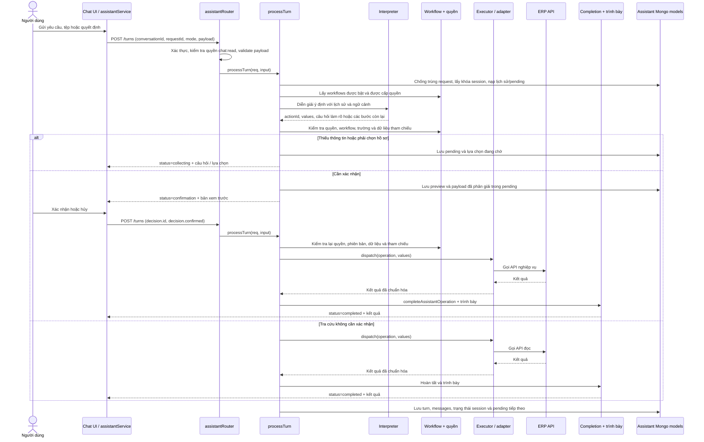

# Luồng hoạt động của Trợ lý ERP

Tài liệu này mô tả luồng xử lý của trợ lý hội thoại ERP ở backend, các trạng thái trao đổi với frontend và những hợp đồng cần giữ khi bổ sung nghiệp vụ mới. Đây là tài liệu định hướng theo mã nguồn hiện tại; `service.ts`, catalog, executor và các shared type vẫn là nguồn hành vi chuẩn.

## 1. Phạm vi và kiến trúc

Trợ lý hội thoại nằm dưới router chatbot và có hai chế độ:

- `work`: hiểu yêu cầu nghiệp vụ, tra cứu hoặc thao tác dữ liệu ERP.
- `qa`: trả lời câu hỏi dựa trên cuộc trò chuyện, tài liệu, dự án và các nguồn ngữ cảnh được phép.

Luồng chính của một lượt thao tác:



## 2. Các thành phần và trách nhiệm

| Thành phần | Trách nhiệm |
|---|---|
| `server/router/chatbot.router.ts` | Gắn assistant router vào namespace chatbot. |
| `server/assistant/router.ts` | Xác thực `chat:read`, kiểm tra schema request, xử lý `/turns`, jobs và các API cài đặt/hội thoại. |
| `server/assistant/service.ts` | Điều phối toàn bộ lượt chat: nạp session, chọn nhánh, thu thập dữ liệu, preview, xác nhận, gọi dispatch, xử lý lỗi và lưu trạng thái. |
| `server/assistant/semantic-interpreter.ts` | Diễn giải yêu cầu thành cấu trúc ý định, hành động và giá trị; xử lý danh mục lớn và ngữ cảnh nhiều bước. |
| `server/assistant/interpreter.ts` | Các luật nghiệp vụ và diễn giải chuyên biệt, gồm chuẩn hóa ý định và xử lý một số miền nghiệp vụ. |
| `server/assistant/catalog.ts` cùng catalog module | Khai báo operation: `actionId`, module, method/path, permission, fields, result allowlist, confirmation và adapter. |
| `server/assistant/workflows.ts` | Tính danh sách operation người dùng được phép dùng; nạp workflow theo người dùng/công ty; kiểm tra phiên bản và cấu hình. |
| `server/assistant/policy.ts` | Kiểm tra trường bắt buộc, kiểu dữ liệu, điều kiện và tính hợp lệ của cấu hình workflow. |
| `server/assistant/executor.ts` | Phân giải tham chiếu và thực thi operation; gọi API hiện có hoặc chuyển sang adapter chuyên biệt. |
| `server/assistant/completion.ts` | Hook hoàn tất dùng chung; sau khi tạo thành công có thể hỏi về trường tùy chọn còn thiếu. |
| `server/assistant/reply-presentation.ts` và `reply-rules.ts` | Chuẩn hóa câu trả lời người dùng nhìn thấy, áp dụng quy tắc giọng điệu, loại bỏ lời dẫn nội bộ và giá trị mặc định không cần hiển thị. |
| `src/shared/assistant-result-table.ts` | Hợp đồng tạo/nhận diện bảng kết quả dùng chung giữa module, backend và frontend. |
| `src/shared/assistant-date.ts` | Định dạng ngày giờ trợ lý theo lịch Việt Nam và múi giờ `Asia/Ho_Chi_Minh`. |
| `server/assistant/models.ts` | Lưu session, turn, workflow, memory, job và tài liệu trợ lý; tạo unique indexes cho idempotency và scope. |
| `server/assistant/jobs.ts`, `server/workers/assistant.worker.ts` | Hàng đợi xử lý nền khi `ASSISTANT_BACKGROUND_ENABLED=true`. |

## 3. API và payload

Các endpoint của assistant được mount dưới `/api/v1/chatbot/assistant`. Toàn router yêu cầu đăng nhập và quyền `chat:read`; operation nghiệp vụ còn phải qua kiểm tra quyền/module riêng.

### Gửi một lượt hội thoại

`POST /turns` nhận một `AssistantTurnInput`. Trường cốt lõi:

```ts
{
  conversationId: string;
  requestId: string;
  mode?: "work" | "qa";
  text?: string;
  projectId?: string;
  attachment?: AssistantTableAttachment;
  conversationUpload?: FilePayload; // được middleware parse
  referenceSelections?: Record<string, string[]>;
  skipReferenceKeys?: string[];
  decision?: { id: string; confirmed: boolean; password?: string };
  trainingContent?: AssistantTrainingContentForm;
  acceptanceLines?: AssistantQuotationAcceptanceLinesInput;
}
```

Schema ở router buộc request chứa đúng một dạng đầu vào chính: text, decision, selections, training content hoặc acceptance lines. Tệp bảng và tệp hội thoại phải đi cùng text. Frontend tạo request qua `src/services/assistantService.ts`; file được gửi dạng multipart, request thường gửi JSON.

Reply theo `AssistantReply` trong `src/shared/assistant-workflow.ts`. Các status chính:

| Status | Ý nghĩa |
|---|---|
| `collecting` | Đang cần trường bắt buộc, câu trả lời làm rõ hoặc lựa chọn tham chiếu. |
| `confirmation` | Đã có preview; cần người dùng quyết định trước khi thực hiện. |
| `completed` | Lượt xử lý hoàn tất theo kết quả trả về. |
| `cancelled` | Yêu cầu đang chờ bị hủy. Các bước đã hoàn tất trước đó không tự rollback. |
| `unsupported` | Không có operation phù hợp hoặc thao tác không khả dụng; không ghi dữ liệu. |
| `failed` | Lỗi đã xác định trong xử lý/API. |
| `processing` | Turn/job đang được xử lý. |
| `uncertain` | Không xác minh được kết quả gọi API; không tự gửi lại để tránh tác động trùng. |

## 4. Khởi tạo turn, idempotency và session lock

Điểm vào trung tâm là `processTurn()` trong `server/assistant/service.ts`.

1. Xác định scope từ tài khoản, công ty và chi nhánh. `actorScope()` yêu cầu người dùng thuộc doanh nghiệp hợp lệ.
2. Đảm bảo indexes của assistant đã sẵn sàng.
3. Tạo digest của nội dung request, gồm conversation, mode, text, attachment, quyết định và lựa chọn tham chiếu.
4. Tạo `AssistantTurn` với unique key theo scope và `requestId`.
   - Cùng `requestId` và cùng digest: trả kết quả đã lưu nếu turn hoàn tất.
   - Cùng `requestId` nhưng digest khác: trả lỗi xung đột `409`.
   - Turn đang chạy: trả `processing`; turn quá hạn cửa sổ phục hồi có thể trở thành `uncertain`.
5. Khóa session bằng cập nhật có điều kiện `busy: false`. Nếu hội thoại đã bận, từ chối turn mới thay vì chạy hai turn đồng thời trên cùng pending state.
6. Nạp pending action, danh sách yêu cầu nhiều bước còn lại, memory hội thoại và lịch sử. Session lưu tối đa 40 message gần nhất; tóm tắt session được cập nhật riêng khi đủ số message.

Unique indexes và turn journal là một phần của an toàn thực thi. Không bỏ `requestId`, digest, trạng thái `executing` hoặc step journal khi thay đổi luồng gọi API.

## 5. Nhánh Hỏi đáp (`mode: "qa"`)

Nhánh Hỏi đáp được xử lý riêng với thao tác ERP thông thường:

1. Nạp cài đặt cá nhân, hướng dẫn dự án, memory được bật và lịch sử session.
2. Đọc tệp hội thoại nếu được đính kèm; bảng tải lên có thể được đưa vào làm document context.
3. Gọi `answerAssistantConversation()` trong `server/assistant/documents.ts` với câu hỏi, ngữ cảnh, lịch sử và response rules.
4. Trả lời có thể chứa nguồn, file hoặc minh họa theo hợp đồng `AssistantReply`.
5. Nếu `autoMemoryEnabled` được bật, có thể lưu memory tự động sau câu trả lời hợp lệ. Lệnh ghi/xóa memory rõ ràng được xử lý riêng.

Trong `work`, câu hỏi tổng quát có thể được hướng dẫn sang tab Hỏi đáp. Một số intent có xử lý chuyên biệt (ví dụ tra cứu tài liệu pháp lý) có thể đi vào operation nghiệp vụ trước nhánh tổng quát; không nên suy luận rằng mọi `mode=qa` đều đồng nghĩa “không có API read”.

## 6. Nhánh Thao tác (`mode: "work"`)

### 6.1. Tạo danh mục operation được phép

`listWorkflows(req)` chỉ trả về operation thỏa các điều kiện:

- Role của người dùng hợp lệ với operation.
- Có permission phù hợp; operation có thể khai báo nhiều nhóm permission.
- Module nghiệp vụ được bật cho công ty và loại hình doanh nghiệp.
- Workflow cá nhân đang enabled và operation không có `unavailableReason`.

Workflow được lưu theo `userId + companyCode + actionId`. Metadata kỹ thuật, method/path, permissions và hard constraints lấy từ code/catalog, không lấy từ cấu hình cá nhân. Cấu hình workflow có thể điều chỉnh hướng dẫn, trường required/default và yêu cầu xác nhận trong giới hạn policy.

### 6.2. Diễn giải intent

`interpretRequest()` nhận text hiệu lực, danh sách workflow đã lọc, pending action, lịch sử, project instructions, memory và session summary. Kết quả diễn giải có thể gồm:

- `actionId`: operation được chọn.
- `values`: giá trị trích xuất theo field key.
- `intentType`, `clarification` hoặc thông tin unsupported/ambiguous.
- `newRequest`, `cancel`.
- `remainingRequests`: các bước còn lại trong một mục tiêu nhiều bước.
- Đề xuất memory, nếu có.

Interpreter không được coi lịch sử, project instruction hay kết quả do mô hình tạo là quyền truy cập. Sau diễn giải, hệ thống chỉ chấp nhận `actionId` trong workflow hiện hành, alias field không mơ hồ và giá trị nằm trong schema của workflow. Giá trị không khớp operation được hỏi làm rõ thay vì bị âm thầm bỏ qua.

Khi có hơn 120 workflow, semantic interpreter có thể chạy bước khám phá module để thu hẹp danh mục, nhưng kết quả cuối vẫn được kiểm tra với danh mục operation đã cấp quyền. Nếu chọn module không hợp lệ hoặc bước rút gọn thất bại, interpreter có thể thử lại trên toàn danh mục.

### 6.3. Tiếp tục hoặc thay thế pending

- Nếu `actionId` mới trùng pending và không phải mục tiêu mới, merge thông tin mới với `pending.provided`.
- Nếu người dùng chuyển sang yêu cầu độc lập, hủy pending cũ trước khi chuẩn bị yêu cầu mới. Preview cũ không được phép xác nhận lại.
- Câu trả lời cho câu hỏi đang thu thập phải được diễn giải trong context pending, không coi là intent mới chỉ vì chứa từ khóa giống một nghiệp vụ khác.
- Nếu đang chờ lựa chọn tham chiếu, nhận `referenceSelections` hoặc `skipReferenceKeys`, kiểm tra chúng thuộc pending hiện tại rồi chuẩn bị lại operation.

### 6.4. Chuẩn hóa, map tệp và phân giải tham chiếu

`prepare()` chịu trách nhiệm dựng payload đủ an toàn trước khi trả collecting hoặc confirmation:

1. Kiểm tra operation bằng `assertOperation()` trước khi dùng.
2. Lấy workflow hiện tại và ghi nhận version.
3. Chuẩn hóa các giá trị có cấu trúc và merge phần cập nhật nếu là partial update.
4. Map attachment dạng bảng vào field được operation hỗ trợ. Tên file đơn lẻ không đủ để suy ra thao tác ghi; nếu yêu cầu không rõ, trợ lý hỏi người dùng muốn làm gì.
5. Xử lý tham chiếu (nhân sự, chi nhánh, khách hàng, sản phẩm...) qua `lookupRecords()` và `resolveReferences()`.
   - Cho người dùng chọn nếu có nhiều kết quả phù hợp.
   - ID nội bộ chỉ dùng trong payload sau khi đã phân giải, không dùng làm giá trị hiển thị.
   - Với field tham chiếu yêu cầu lựa chọn tường minh, không tự chấp nhận một ID do mô hình suy ra.
6. Áp dụng default cho thực thi theo workflow và quy tắc operation. Không xem default như dữ liệu do người dùng nhập và không đưa mặc định vào lời trả lời/bản xem trước.
7. Chạy `collectValues()` và policy kiểm tra required, kiểu, pattern, options, điều kiện `requiredWhen`, giới hạn và lỗi JSON.
8. Nếu còn thiếu thông tin hoặc lỗi, trả `collecting` và lưu `PendingAction` để lượt sau tiếp tục.

`PendingAction` là trạng thái riêng trên server, bao gồm `actionId`, giá trị người dùng cung cấp, intent gốc, version workflow, preview, giá trị đã phân giải, các selection đang chờ, trạng thái bỏ qua và thông tin hiển thị xác nhận. Không đưa metadata nội bộ này thành nội dung chat.

### 6.5. Preview và xác nhận

Nếu thao tác/cấu hình yêu cầu xác nhận, hệ thống trả `status: "confirmation"`, gồm action title và values cho frontend hiển thị. Quyết định xác nhận được gắn với `pending.id`.

Yêu cầu xác nhận được quyết định từ metadata operation, `workflow.requireConfirmation`, `settings.alwaysConfirm`, các điều kiện ép xác nhận theo thao tác (như ghi dữ liệu từ tệp) và các trường hợp chuyên biệt. Không giả định rằng mọi GET cần xác nhận hoặc tự đổi chính sách xác nhận khi thêm operation.

Trước khi tạo preview:

- Lọc field theo workflow và payload được phép.
- Ẩn field default khỏi preview.
- Ánh xạ tham chiếu thành tên/mã hiển thị an toàn.
- Ẩn UUID/object ID/revision nội bộ.
- Định dạng trường ngày theo quy tắc trợ lý.
- Với thao tác nhạy cảm, có thể bổ sung chi tiết tác động hoặc yêu cầu password trong vùng bảo mật của UI.

Khi nhận `decision`:

1. Tìm pending và so sánh `decision.id`; nếu preview hết hiệu lực, trả lỗi và yêu cầu gửi lại để tạo preview mới.
2. Nếu `confirmed=false`, xóa pending và trả `cancelled`; không gọi API ghi.
3. Nếu xác nhận, lấy operation/workflow hiện tại, kiểm tra permission lần nữa và so sánh workflow version.
4. Kiểm tra lại payload required/error và phân giải tham chiếu gần thời điểm ghi.
5. Các operation có snapshot/version/confirmation details phải so sánh lại với preview; nếu dữ liệu đã thay đổi, dừng và yêu cầu xem preview mới.
6. Yêu cầu password nếu action yêu cầu, ví dụ tạo tài khoản nhân sự.

### 6.6. Dispatch và gọi API

Execution được gom trong callback `dispatch()` trong `service.ts`. Đường này:

- kiểm tra cancellation và execution budget;
- kiểm tra ràng buộc báo cáo;
- ghi step `executing` vào turn journal;
- gọi `callOperation()` hoặc callback lookup được inject;
- cập nhật step `completed` khi API trả thành công;
- tạo `AssistantCompletion` dùng chung gồm operation, workflow, values, result và defaulted keys.

`callOperation()` trong `executor.ts` xác thực operation và chuyển operation tới API ERP hoặc adapter theo module. Catalog khai báo adapter như `contract`, `healthcare`, `quotation`; adapter vẫn phải giữ scope/quyền và dùng kết quả được allowlist. Không gọi API nghiệp vụ trực tiếp từ nhánh hội thoại/adapters để né dispatcher.

GET/read-only có thể trả kết quả sau khi đủ dữ liệu. Với write, chính sách confirmation nằm ở catalog/workflow/settings và kiểm tra bổ sung trong `prepare()`/`execute()`. Một số thao tác như phân tích danh sách có thể cần nhiều lần đọc; các call đó vẫn đi qua dispatcher để ghi journal và tính budget.

### 6.7. Hoàn tất nghiệp vụ và hỏi bổ sung

Sau khi trả lời `completed`, `completeAssistantOperation()` được gọi tại điểm chung ở service:

- Chỉ xét thao tác POST tạo mới, thành công và trả về record hợp lệ.
- Tìm operation PATCH/PUT ghép cặp, kiểm tra quyền cập nhật hiện tại.
- Tính các field tùy chọn còn thiếu, có thể sửa và chưa được người dùng cung cấp.
- Nếu có field phù hợp, thêm câu hỏi “Bạn có muốn bổ sung không?”; người dùng có thể gửi thông tin hoặc bỏ qua.
- Lưu context follow-up riêng gồm operation update và nhận diện record/branch để lần bổ sung tiếp tục trên cùng bản ghi.

Completion là hợp đồng dùng chung cho các module. Adapter không tự thêm câu hỏi bổ sung và không được kết thúc luồng trước completion. Không tạo record thứ hai khi người dùng trả lời câu hỏi bổ sung sau xác nhận.

### 6.8. Format kết quả và response rules

- Các formatter nghiệp vụ chỉ chọn field công khai phù hợp; không đưa credential, UUID, revision hoặc dữ liệu riêng tư không cần thiết ra chat.
- Kết quả create/update/lookup có cấu trúc sử dụng `formatAssistantResultTable()` từ `src/shared/assistant-result-table.ts`. UI và bước response rewrite nhận diện cùng cấu trúc bảng; câu hỏi follow-up phải được giữ lại.
- Ngày/giờ người dùng nhìn thấy qua `formatAssistantTemporalValue()` trong `src/shared/assistant-date.ts`, lịch Việt Nam và timezone `Asia/Ho_Chi_Minh`. Payload/API vẫn giữ giá trị ISO; không định dạng tên/mã chỉ vì chuỗi giống ngày.
- `presentAssistantReply()` loại bỏ lời kể implementation và field default. `applyAssistantResponseRules()` có thể viết lại câu trả lời; sau đó service chuẩn hóa và trình bày lại để giữ bảng/câu hỏi và ẩn ID.
- Field mặc định ở query không được dùng để ẩn giá trị bản ghi trả về. Chiếu kết quả theo đúng đường dẫn công khai đã yêu cầu, kể cả một member của `summary`, không mở lại các member cùng cấp.
- Báo cáo đọc nhiều nguồn dùng `queryPlan` và một lượt đối chiếu chung. `analysis` giữ AST nhất quán giữa lập kế hoạch và replay. `composite-report.ts` dựng bảng trực tiếp từ dữ liệu đã chiếu; không gọi thêm model để thay số liệu. Response rules chỉ sửa lời dẫn và giữ bảng nguyên vẹn.
- Nguồn có collection trong envelope cần khai báo `resultRowsField`; tổng/trang không được coi là dòng nghiệp vụ. Nếu API đọc thiếu ngữ cảnh bắt buộc, `AssistantReadInputRequired` đưa về form/option theo field đã khai báo, không trả kết quả rỗng thay thế.
- File có lifecycle lưu riêng trong `AssistantDocumentModel`; reply trả metadata file, frontend tải qua endpoint file đã xác thực.

## 7. Mục tiêu nhiều bước và xử lý nền

### Mục tiêu nhiều bước

Interpreter có thể trả `remainingRequests`. Service chạy từng bước tuần tự trong cùng session lock và execution budget. Mỗi bước có requestId con trong journal. Xác nhận thuộc đúng preview của bước hiện tại; không được tái sử dụng xác nhận của bước trước cho bước sau. Khi cần collecting/confirmation, dừng kế hoạch tại bước đó và lưu phần còn lại. Cancel hoặc uncertain xóa phần còn lại; không rollback các bước đã hoàn tất.

Nếu hết hạn diễn giải trước khi dispatch và chưa có bản soạn, service giữ nguyên yêu cầu để người dùng nói “tiếp tục”. Không tự chạy lại thao tác đã dispatch hoặc thao tác ghi chưa rõ kết quả. Phần việc hoãn phải gắn đúng evidence trong `remainingRequests`, không được xem như lời dẫn để bỏ qua.

### Xử lý nền

Khi `ASSISTANT_BACKGROUND_ENABLED=true`, `/turns` có thể chuyển yêu cầu văn bản trong tab Thao tác sang `submitAssistantJob()`. Q&A, attachment, confirmation, reference selections và một số payload biểu mẫu không thuộc loại job văn bản này. Worker:

1. Claim job queued bằng cập nhật atomic và lease.
2. Xác thực lại token/quyền khi chạy.
3. Gọi lại `processTurn()` với cancellation callback.
4. Cập nhật trạng thái và kết quả để frontend poll `/jobs/:requestId`.

Job hết lease sau khi đã bắt đầu không được chạy lại mù quáng. Nếu không có kết quả turn để xác minh, job kết thúc ở trạng thái uncertain. Trạng thái “đã nhận job” không đồng nghĩa nghiệp vụ đã ghi xong.

## 8. Xử lý lỗi và ý nghĩa trạng thái

- **Thiếu dữ liệu:** `collecting`; giữ pending và không dispatch.
- **Không phân biệt được intent:** hỏi làm rõ; không chọn gần đúng.
- **Không hỗ trợ/thiếu quyền:** `unsupported`; không thay đổi dữ liệu. Permission được kiểm tra ở cả danh sách workflow và lúc execution.
- **Validation/API rejection đã biết:** trả lỗi thân thiện; giữ draft nếu chưa dispatch để người dùng sửa.
- **Người dùng hủy:** `cancelled`; xóa pending hiện tại. Các bước trước đó đã hoàn thành không tự rollback.
- **Lỗi không xác định sau khi bắt đầu dispatch:** `uncertain`; không tự retry vì có thể API đã ghi. Cần tra trạng thái nghiệp vụ trước khi yêu cầu chạy lại.
- **Request lặp:** dựa vào requestId và digest; replay cùng nội dung trả kết quả đã lưu thay vì gọi lại operation.
- **Session đã bận:** trả lỗi chờ; không cho hai turn cùng sửa pending state của một conversation.

## 9. Bản đồ dữ liệu lưu

Các schema chính ở `server/assistant/models.ts`:

| Model | Mục đích |
|---|---|
| `AssistantSession` | Lịch sử, mode, branch scope, pending action, remaining requests, session memory, last reply và busy lock. |
| `AssistantTurn` | Idempotency key/digest, status, actionId, workflowVersion, payload, step journal và kết quả turn. |
| `AssistantWorkflow` | Cấu hình workflow theo user/company/actionId và version optimistic concurrency. |
| `AssistantSettings` | Hướng dẫn, response rules, confirmation preference, voice và memory flags. |
| `AssistantMemory` | Ghi nhớ theo tài khoản; nội dung và nguồn ghi nhớ. |
| `AssistantDocument` | File/tài liệu kết quả thuộc conversation và request. |
| `AssistantJob` | Envelope mã hóa, queue state, lease, cancellation và kết quả nền. |

Không đưa scope fields (`userId`, `companyCode`, `branchId`), pending payload hoặc kết quả API thô vào nội dung người dùng nhìn thấy.

## 10. Hướng dẫn thêm operation/module

Khi nối nghiệp vụ mới:

1. Thêm operation vào catalog phù hợp, khai báo method/path, module, permission, fields, required/default, tham chiếu, result allowlist, link và confirmation policy.
2. Nếu dùng adapter chuyên biệt, đăng ký adapter ở executor/dispatch nhưng vẫn để `service.ts` gọi qua dispatcher chung.
3. Khai báo result formatter chỉ với các field công khai; dùng `formatAssistantResultTable()` cho kết quả có cấu trúc.
4. Không hiển thị default tự điền hoặc internal IDs. Trường ngày/giờ đi qua shared formatter; giá trị API vẫn ISO.
5. Đảm bảo thao tác tạo đi qua `completeAssistantOperation()`. Không tự hỏi optional fields trong adapter.
6. Bổ sung test cấu trúc/completion và conversation test: tạo thiếu thông tin tùy chọn → đồng ý hoặc bỏ qua → bổ sung vào cùng record → kiểm tra bảng kết quả. Test chỉ gọi API, đăng ký catalog, hoặc test formatter không chứng minh được luồng hội thoại hoàn chỉnh.
7. Kiểm tra permission, branch/company scope, stale preview, duplicate request, cancel, API rejection và uncertain execution.

Yêu cầu kiến trúc chung được ghi thêm trong `AGENTS.md`; phần coverage và các route chưa hỗ trợ được thống kê trong `COVERAGE.md` và `UNSUPPORTED.md`.

## 11. File nên đọc khi sửa luồng

1. `server/assistant/router.ts` — endpoint, body schema, background routing.
2. `server/assistant/service.ts` — orchestration từ `processTurn()`, `prepare()`, execution và persistence.
3. `server/assistant/workflows.ts` — quyền, module access, config/version workflow.
4. `server/assistant/semantic-interpreter.ts` và `interpreter.ts` — intent selection và validation sau diễn giải.
5. `server/assistant/catalog.ts` cùng catalog theo module — operation contract.
6. `server/assistant/executor.ts` — API calls, lookup, reference resolution.
7. `server/assistant/completion.ts` — optional follow-up sau tạo.
8. `server/assistant/reply-presentation.ts`, `result-format.ts`, `src/shared/assistant-result-table.ts`, `src/shared/assistant-date.ts` — output người dùng nhìn thấy.
9. `server/assistant/models.ts`, `jobs.ts`, `server/workers/assistant.worker.ts` — persistence/idempotency/background.
10. `src/services/assistantService.ts` và component chat trong `src/components/common/` — client request, trạng thái và rendering.
