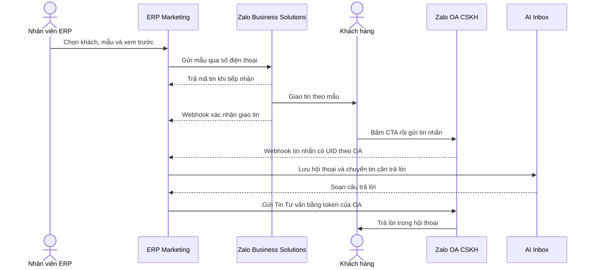

# Gửi mẫu tin ZBS qua số điện thoại và tư vấn AI trên Zalo OA

**Phạm vi** — Gửi thông báo từ ERP đến số Zalo của khách hàng theo mẫu đã duyệt. Khách bấm **Liên hệ CSKH**, mở trang Zalo Official Account (OA) của doanh nghiệp và gửi tin. Tin nhắn vào Inbox, nơi AI có thể trả lời bằng chính OA đó.

**Trạng thái trong ERP** — Mã nguồn đã có kết nối OA bằng OAuth, tiếp nhận tin nhắn vào Inbox và gọi AI trả lời tự động. Màn hình gửi mẫu ZBS, lịch sử gửi và xử lý xác nhận giao tin là phần thiết kế bên dưới. [Kết nối OA](shared/zalo-oauth.router.ts) · [Webhook hiện tại](message/controller/zalo-messenger.controller.ts) · [Xử lý tin nhắn và gọi AI](message/service/zalo-messenger.service.ts)

## Luồng từ lúc gửi đến khi AI trả lời



ZBS giao thông báo theo mẫu. Zalo OA tiếp nhận cuộc hội thoại. Trong luồng ERP hiện tại, việc khách gửi tin nhắn mới kích hoạt AI. [Luồng gửi ZBS](https://zalo.solutions/blog/gui-api/rrzepi6v8x0yrrlhnvlbogkh) · [Hướng dẫn chatbot OA](https://docs.zaloplatforms.com/docs/OA/phu-luc/lam-the-nao-de-tao-chatbot-tra-loi-tu-dong-voi-zalo-api)

## Điều kiện của Zalo

| Hạng mục | Quy tắc áp dụng |
| --- | --- |
| Người nhận | Số điện thoại phải gắn với tài khoản Zalo. Khách có thể chưa chat với OA, nhưng nội dung phải có bối cảnh giao dịch hoặc sử dụng dịch vụ phù hợp và đáp ứng điều kiện của loại tin. Lưu căn cứ gửi như yêu cầu của khách hoặc mã giao dịch. [Điều khoản ZBS](https://zalo.solutions/terms) · [Gửi qua SĐT và UID](https://zalo.solutions/blog/phan-biet-thong-bao-zns-va-tin-uid/qf0x9w218hgfpjhri4hjs24p) |
| Mẫu và mục đích | Dùng `template_id` đã duyệt cho OA và App có quyền. Mẫu có mục đích Giao dịch, Chăm sóc khách hàng hoặc Hậu mãi. Với mẫu Giao dịch và Chăm sóc khách hàng, thông thường cần trường cá nhân hóa và trường nhận diện giao dịch hoặc khách hàng. Zalo xét bối cảnh khi duyệt mẫu. [Quy định duyệt mẫu](https://zalo.solutions/news/quy-dinh-chung-khi-kiem-duyet-mau-zns/xdygqtrjjm97k28rsh07wr72) |
| Nút thao tác | Chọn loại **Đến trang thông tin OA** và đặt link OA trong nút CTA. Link và nội dung nút được duyệt cùng mẫu. Zalo loại link Zalo cá nhân, nhóm chat, link rút gọn và link mở thẳng kịch bản chatbot. Mẫu tùy chỉnh hỗ trợ tối đa hai nút. [Thiết lập CTA](https://zalo.solutions/business-message/guidelines/en/nut-thao-tac-cta) · [Quy định duyệt CTA](https://zalo.solutions/news/quy-dinh-chung-khi-kiem-duyet-mau-zns/xdygqtrjjm97k28rsh07wr72) |
| Hạn mức và chi phí | Hạn mức gửi theo OA có thể thay đổi theo chất lượng gửi. Tin Hậu mãi còn có giới hạn theo người nhận. Phí phụ thuộc mẫu và thành phần như CTA. Zalo tính phí tin gửi qua số điện thoại khi tin đến thiết bị trong thời gian quy định. [Hạn mức và chất lượng](https://zalo.solutions/blog/co-che-danh-gia-chat-luong-va-quyen-loi-gui-zns/qsuhj60o4oteiy7rnrf0ohpe) · [Cách tính phí khi gửi qua API](https://zalo.solutions/blog/gui-api/rrzepi6v8x0yrrlhnvlbogkh) |

## Thiết lập cho từng doanh nghiệp

1. **Chuẩn bị OA và tài khoản ZBS.** Xác thực OA doanh nghiệp, chọn gói có OpenAPI, liên kết OA và Zalo App với tài khoản ZBS, rồi chuẩn bị số dư để gửi. Zalo công bố hỗ trợ gửi qua OpenAPI cho OA doanh nghiệp xác thực dùng gói Tăng trưởng hoặc Toàn diện, cùng một số gói cũ đủ điều kiện. [Đăng ký dịch vụ ZBS](https://zalo.solutions/blog/huong-dan-dang-ky-su-dung-dich-vu-zns/jlm44tzzwffh0od10ix6rra7) · [Gói dịch vụ OA](https://zalo.solutions/oa/pricing)
2. **Cấp quyền cho App.** Bật quyền gửi tin qua số điện thoại và nhận sự kiện gửi qua số điện thoại. Cho phần chat, cấp quyền nhận tin nhắn đến OA và gửi Tin Tư vấn. Nếu OA đã kết nối ERP trước khi thêm quyền, cấp lại quyền OA cho App và kiểm tra bằng lần gửi thử. [Nhóm quyền ZBS](https://docs.zaloplatforms.com/docs/ZBS/bat-dau/gioi-thieu-ve-cac-nhom-quyen-thuoc-zbs-template-message) · [Thiết lập chatbot OA](https://docs.zaloplatforms.com/docs/OA/phu-luc/lam-the-nao-de-tao-chatbot-tra-loi-tu-dong-voi-zalo-api)
3. **Đăng ký hai URL trên Zalo for Developers.** Dùng domain HTTPS công khai của ERP ở đúng môi trường. Đăng ký callback OAuth để cấp quyền và URL webhook để nhận sự kiện. [Cấu hình mẫu của ERP](../../../.env.example) · [Route OAuth](shared/zalo-oauth.router.ts)
4. **Kết nối đúng OA trong ERP.** Vào **Tích hợp Marketing → MXH Doanh nghiệp → Zalo → Kết nối Zalo OA**. Chọn OA của doanh nghiệp rồi kiểm tra quyền quản lý tích hợp, module `omni-inbox` và cấu hình trả lời tự động cho OA. Gửi một tin từ tài khoản thử vào OA và xác nhận tin xuất hiện trong đúng Inbox. [Màn hình tích hợp](../../../src/modules/marketing-suite/shared/components/settings/CompanyIntegrationsTab.tsx) · [Kiểm tra quyền nhận webhook](message/webhook-access.ts)
5. **Tạo và duyệt mẫu.** Tại tài khoản ZBS, vào **Thiết kế nội dung → Quản lý Template → Tạo Template**. Chọn App và OA gửi, khai báo nội dung, trường dữ liệu, CTA và ghi chú về tình huống gửi. Gắn mẫu vào ERP sau khi Zalo duyệt. [Hướng dẫn tạo mẫu tùy chỉnh](https://zalo.solutions/blog/huong-dan-tao-mau-thong-bao-zns-/yy5nbqqn7hh520nitywomu67)

| Cấu hình ERP | Giá trị hoặc vai trò |
| --- | --- |
| `APP_URL` | Domain HTTPS công khai của môi trường đang chạy ERP |
| OAuth callback | `GET https://<domain-erp>/api/v1/zalo/oauth-callback` |
| Webhook | `POST https://<domain-erp>/api/v1/zalo/webhook` |
| `ZALO_APP_ID`, `ZALO_APP_SECRET` | Thông tin App dùng cho OAuth và gia hạn token OA |
| `ZALO_OA_SECRET_KEY` | Khóa xác minh chữ ký webhook, lấy từ cấu hình Zalo tương ứng |
| `ZALO_OA_ID` | Cấu hình hỗ trợ payload thử của Zalo. OA cho lần gửi thật lấy từ kết nối của doanh nghiệp |

Workflow đọc `ENV_FILE` khi triển khai staging và `ENV_FILE_PROD` khi triển khai production. Lưu secret ở đúng môi trường. Mã hiện tại dùng App ID và các khóa cấu hình trên server cho OAuth, gia hạn token và xác minh webhook. Nếu mỗi doanh nghiệp dùng một Zalo App riêng, phần mở rộng cần lưu quan hệ doanh nghiệp, App và OA để chọn đúng thông tin xác thực cho từng thao tác. [Workflow triển khai](../../../.github/workflows/cd.yml) · [Route OAuth](shared/zalo-oauth.router.ts) · [Xác minh webhook](message/webhook-signature.ts)

## Mẫu tin để gửi duyệt

Tình huống minh họa là khách đã yêu cầu báo giá và doanh nghiệp có mã yêu cầu trong ERP. Ghi rõ bối cảnh này trong phần ghi chú kiểm duyệt. Zalo quyết định mẫu và mục đích được chấp thuận.

```text
Tiêu đề mẫu
Báo giá theo yêu cầu đã sẵn sàng

Nội dung
Chào quý khách <ten_khach_hang>,
Báo giá cho yêu cầu <ma_yeu_cau> đã sẵn sàng.
Quý khách có thể nhắn mã yêu cầu cho bộ phận chăm sóc khách hàng để được hỗ trợ.

Nút thao tác
Liên hệ CSKH

Loại nút
Đến trang thông tin OA

Đường dẫn
https://zalo.me/<oa_id>
```

Ưu tiên URL chính thức của cùng OA gửi mẫu, đồng thời dùng OA đó để tiếp nhận chat trong ERP. Khi mỗi doanh nghiệp có OA riêng, đăng ký CTA cho OA của doanh nghiệp đó và kết nối đúng OA nhận chat. Mã yêu cầu hỗ trợ xác định ngữ cảnh khi khách nhắn. Nếu sau này cần nút **Xem báo giá**, có thể đăng ký CTA thứ hai cho trang xem của doanh nghiệp và gửi duyệt cùng mẫu. [Đường dẫn OA](https://oa.zalo.me/home/documents/guides/dang-ky-url-tuy-bien_1657351075835496432) · [Cấu hình CTA và tham số URL](https://zalo.solutions/business-message/guidelines/en/nut-thao-tac-cta)

## Thiết kế gửi tin trong ERP

### Màn hình gửi và dữ liệu

Đặt tính năng **Gửi mẫu Zalo** trong Marketing Message. Bản đầu gửi từng khách từ hồ sơ khách hàng hoặc bản ghi nghiệp vụ, như một yêu cầu báo giá. Người gửi chọn OA và mẫu đã duyệt, kiểm tra số nhận và nội dung sau khi điền biến, rồi xác nhận gửi. Hiển thị lịch sử trên bản ghi gốc để nhân viên biết tin đã tới đâu.

- Mỗi cấu hình mẫu lưu doanh nghiệp, App, OA, `template_id`, trạng thái duyệt và các trường bắt buộc. Dùng danh sách hoặc chi tiết mẫu từ Zalo nếu App có quyền quản lý mẫu.
- Backend kiểm tra quyền gửi, quyền truy cập khách hàng và bản ghi gốc, quyền sử dụng OA, trạng thái mẫu và kiểu dữ liệu các biến. Chuẩn hóa số Việt Nam thành dạng `84…` trước khi gửi.
- Tạo bản ghi gửi trước khi gọi Zalo. Bản ghi gồm doanh nghiệp, OA, mẫu, khách hàng hoặc giao dịch, người thao tác, `tracking_id`, mã tin Zalo, trạng thái và mốc thời gian. Dùng khóa duy nhất theo lần xác nhận để chặn bấm đúp hoặc worker xử lý trùng. Hạn chế hiển thị số điện thoại đầy đủ trong lịch sử và log.
- Dùng token của kết nối OA trên backend. ERP dùng cơ chế gia hạn token hiện có, với một lần gia hạn và thử lại có kiểm soát khi Zalo xác nhận request bị từ chối vì token hết hạn.

### Request gửi qua số điện thoại

```http
POST https://business.openapi.zalo.me/message/template
Content-Type: application/json
access_token: <oa_access_token>
```

```json
{
  "phone": "<so_dien_thoai_da_chuan_hoa>",
  "template_id": "<template_id_da_duyet>",
  "template_data": {
    "ten_khach_hang": "Nguyễn Văn An",
    "ma_yeu_cau": "BG20261107001"
  },
  "tracking_id": "ERPZBSBG20261107001A1"
}
```

`template_data` chỉ chứa trường có trong mẫu đã duyệt. `tracking_id` là mã đối soát do ERP sinh cho lần gửi, nên giới hạn 48 ký tự và dùng chữ hoặc số. Chống gửi trùng dựa trên bản ghi trong ERP. Khi timeout và chưa rõ Zalo đã nhận lệnh hay chưa, giữ trạng thái chờ đối soát, thay vì tự phát một lệnh gửi mới. [API gửi qua số điện thoại](https://docs.zaloplatforms.com/docs/ZBS/gui-tin-template-qua-sdt/api-gui-tin-qua-sdt/api-gui-tin)

### Trạng thái gửi và xác nhận giao

| Trạng thái ERP | Điều kiện cập nhật |
| --- | --- |
| Chờ gửi | Đã ghi nhận yêu cầu gửi hợp lệ trong ERP |
| Zalo đã tiếp nhận | Zalo trả `error: 0` và `data.msg_id`. Lưu `data.sent_time` nếu có |
| Đã giao | Nhận webhook giao tin hợp lệ hoặc API đối soát xác nhận giao. Lấy thời điểm giao từ `delivery_time` |
| Gửi thất bại | Zalo trả mã từ chối hoặc kết quả đối soát xác nhận không giao |
| Chờ đối soát | Mất phản hồi hoặc timeout nên chưa xác định kết quả. Tra API trạng thái khi đã có mã tin Zalo |

Với sự kiện `user_received_message` qua số điện thoại, Zalo gửi `X-ZEvent-Server: ZNS`. Xác minh `X-ZEvent-Signature` từ App ID, raw JSON, timestamp và khóa webhook. Lấy OA từ `sender.id`, người nhận từ `recipient.id` và đối chiếu `message.msg_id` hoặc `message.tracking_id` trong phạm vi App và OA. Ghi cập nhật có tính lặp an toàn và lưu xác nhận trước khi trả thành công. Route webhook hiện có cần phân luồng sự kiện này trước bộ xử lý Inbox, vì Inbox đọc `recipient.id` như OA của tin nhắn đến. [Webhook giao tin](https://docs.zaloplatforms.com/docs/ZBS/gui-tin-template-qua-sdt/webhook-gui-tin-qua-sdt/su-kien-nguoi-dung-nhan-tin-qua-sdt) · [API đối soát trạng thái](https://docs.zaloplatforms.com/docs/ZBS/gui-tin-template-qua-sdt/api-truy-xuat-thong-tin-gui-tin-qua-sdt/api-lay-thong-tin-trang-thai-gui-tin-qua-sdt)

| Lỗi Zalo | Xử lý trong ERP |
| --- | --- |
| `-108`, `-132` | Hiển thị trường cần kiểm tra, như số điện thoại hoặc giá trị biến của mẫu |
| `-117`, `-131` | Kiểm tra App, OA và quyền sử dụng mẫu. Chỉ bật gửi khi mẫu được duyệt |
| `-135`, `-136`, `-138` | Kiểm tra xác thực và gói OA, liên kết tài khoản ZBS hoặc quyền App |
| `-137` | Báo quản trị viên kiểm tra số dư và thanh toán ZBS |
| `-140`, `-141` | Ghi nhận người nhận không đủ điều kiện hoặc đã từ chối nhận. Dừng gửi lại tự động |
| `-144`, `-147`, `-1471` | Ghi nhận vượt hạn mức OA, mẫu hoặc người nhận. Dừng gửi lại tức thời |

Tra bảng mã chính thức khi cần phân loại lỗi ngoài danh sách này. [Mã lỗi ZBS](https://docs.zaloplatforms.com/docs/ZBS/bang-ma-loi)

## Cách AI nhận đúng hội thoại

1. Khách mở OA từ CTA và gửi tin, ví dụ **Tư vấn yêu cầu BG20261107001**. Sự kiện `user_send_text` có UID khách tại `sender.id` và OA tại `recipient.id`. ERP lưu tin, xác định đúng doanh nghiệp từ kết nối OA và kích hoạt AI theo cấu hình Inbox. [Sự kiện người dùng gửi tin](https://docs.zaloplatforms.com/docs/OA/webhook/tin-nhan/su-kien-nguoi-dung-gui-tin-nhan) · [Xử lý Inbox trong ERP](message/service/zalo-messenger.service.ts)
2. Mã yêu cầu khách nhập là dữ liệu tra cứu. ERP chỉ tra bản ghi trong doanh nghiệp sở hữu OA và chỉ cung cấp chi tiết khi đã xác minh hội thoại được phép truy cập bản ghi đó. Nếu chưa liên kết được khách, AI có thể hỏi thêm hoặc chuyển nhân viên xử lý. Sự kiện giao tin theo số điện thoại và sự kiện chat theo UID mang các định danh khác nhau, nên cần liên kết khách hàng đã xác minh để nối hai luồng. [Webhook giao tin qua SĐT](https://docs.zaloplatforms.com/docs/ZBS/gui-tin-template-qua-sdt/webhook-gui-tin-qua-sdt/su-kien-nguoi-dung-nhan-tin-qua-sdt) · [Webhook chat OA](https://docs.zaloplatforms.com/docs/OA/webhook/tin-nhan/su-kien-nguoi-dung-gui-tin-nhan)
3. ERP trả lời bằng API Tin Tư vấn `/v3.0/oa/message/cs` với token OA và UID trong hội thoại. Phần chat tuân theo chính sách Tin Tư vấn của OA. Theo dõi lỗi API và dùng quy trình Inbox khi nhân viên cần tiếp nhận. [Cơ chế chatbot OA](https://docs.zaloplatforms.com/docs/OA/phu-luc/lam-the-nao-de-tao-chatbot-tra-loi-tu-dong-voi-zalo-api) · [Chính sách và giá gói OA](https://zalo.solutions/oa/pricing)

## Kiểm thử trước khi bật gửi thật

| Tình huống | Kết quả cần thấy |
| --- | --- |
| Gửi thử bằng `mode: "development"` tới số quản trị viên OA hoặc App | API trả mã tin, nội dung hiển thị đúng biến và CTA mở đúng OA. [API gửi thử](https://docs.zaloplatforms.com/docs/ZBS/gui-tin-template-qua-sdt/api-gui-tin-qua-sdt/api-gui-tin-su-dung-development-mode) |
| Khách chỉ bấm CTA | Trang OA mở. Inbox chờ khách gửi tin để chuyển cho AI |
| Khách gửi tin vào OA | Hội thoại xuất hiện trong đúng doanh nghiệp và AI trả lời bằng OA nhận tin |
| Zalo trả mã tin rồi gửi webhook | Trạng thái chuyển từ **Zalo đã tiếp nhận** sang **Đã giao** theo `delivery_time` |
| Bấm gửi hai lần hoặc webhook phát lại | Một lần gửi cho cùng xác nhận, trạng thái giao cập nhật nhất quán |
| Timeout khi gửi | ERP giữ yêu cầu để đối soát, tránh phát thêm tin ngoài ý muốn |
| Sai mẫu, sai dữ liệu, OA hết hạn mức hoặc khách từ chối | ERP hiển thị lý do tương ứng để nhân viên hoặc quản trị viên xử lý |
| Chữ ký sai hoặc App, OA, doanh nghiệp khác phạm vi | Sự kiện bị từ chối hoặc bỏ qua theo quyền, lịch sử gửi và hội thoại của doanh nghiệp khác được bảo vệ |

Triển khai theo thứ tự **kết nối OA và thử Inbox → duyệt một mẫu có CTA về OA → gửi thử cho quản trị viên → kiểm tra giao tin và AI trả lời → bật gửi cho một nhóm nhỏ khách đủ điều kiện**.
